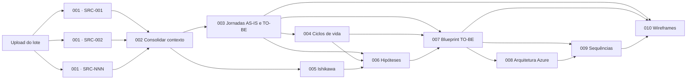

# Visão e contrato da fase Contexto

Este arquivo define o que a fase **Contexto** produz, em que ordem, com quais dependências e como suas saídas alimentam o [DarkLab](02-darklab-000-visao-e-contrato-da-fase.md) e o [Backlog do Futuro](03-backlog-do-futuro-000-visao-e-contrato-da-fase.md). Ele especializa, sem contradizer, o [contrato comum das capacidades](00-contrato-comum-das-capacidades.md) e o [repositório único de artefatos](00-repositorio-unico-de-artefatos.md). Requisitos de origem: requisitos funcionais 1 a 4 e §2.2, §3 e §3.1 da [especificação da plataforma](especificacao-plataforma-jornada-guiada.md).

## 1. Visão da fase

O Contexto transforma um **lote** de arquivos enviados em uma **base de conhecimento consolidada e rastreável** e, a partir dela, em nove artefatos analíticos e de desenho de solução. Cada afirmação aponta para um trecho localizado da fonte (`EVD-NNN`) ou está explicitamente marcada como `inferido`, `hipótese` ou `proposta`.

Fluxo em uma frase: cada arquivo é analisado isoladamente e em paralelo (001); quando todo o lote termina, as análises são consolidadas (002); a base consolidada libera os mapeamentos de jornada (003) e de causas (005); os demais artefatos se encadeiam até os wireframes (010). O Modo Turbo (011) executa o grafo inteiro a partir do upload.

### 1.1 Criação do projeto

A jornada **Contexto → DarkLab → Projeto → Backlog** começa aqui. O Contexto é onde o projeto é **criado**, antes do primeiro upload, e o projeto criado é o identificador principal de tudo o que vem depois: lotes, fontes, execuções, motores do DarkLab, ficha do projeto, Épicos, Features, Histórias e o que fazer.

| Passo | Quem | O que acontece |
|---|---|---|
| 1. Criar projeto | Usuário com permissão de criar projetos na organização (vira Administrador do projeto) | `POST /projects` com nome e descrição. A aplicação gera `projectId` (interno, imutável) e `code` `PRJ-NNN`, grava `projeto.json` ([repositório §8](00-repositorio-unico-de-artefatos.md#8-projeto-identidade-e-etapa)) e registra a etapa `contexto` ([contrato §5.3](00-contrato-comum-das-capacidades.md#53-etapa-do-projeto)). |
| 2. Convidar membros | Administrador do projeto | Papéis Leitor, Editor, Aprovador e Administrador valem só para este projeto. |
| 3. Enviar fontes | Editor | Upload do lote dentro do projeto; nenhuma fonte existe fora de um projeto. |
| 4. Analisar e consolidar | Plataforma (001, 002) ou Turbo (011) | Ao gravar a 002, o projeto passa à etapa `contexto_consolidado` e o DarkLab fica disponível. |

Nenhuma capacidade da fase cria, renomeia ou troca o projeto; todas recebem `projectId` e `projectCode` na entrada canônica e os ecoam no envelope.

## 2. Capacidades da fase

| Etapa | capabilityId | `kind` da saída | Dependências diretas | Saída no repositório |
|---|---|---|---|---|
| 001 | [01-contexto-001-analisar-e-enriquecer-artefato](01-contexto-001-analisar-e-enriquecer-artefato.md) | `sourceAnalysis` | — | `fontes/{SRC-NNN}/r{n}/analise.json` |
| 002 | [01-contexto-002-consolidar-contexto](01-contexto-002-consolidar-contexto.md) | `contextBase` | 001 (todas as fontes do lote) | `contexto/01-contexto-002-consolidar-contexto/{escopo}/r{n}/saida.json` |
| 003 | [01-contexto-003-mapear-jornadas-as-is-e-to-be](01-contexto-003-mapear-jornadas-as-is-e-to-be.md) | `journeyMaps` | 002 | `contexto/01-contexto-003-.../{escopo}/r{n}/saida.json` |
| 004 | [01-contexto-004-mapear-ciclo-de-vida-das-jornadas-e-assuntos](01-contexto-004-mapear-ciclo-de-vida-das-jornadas-e-assuntos.md) | `journeyLifecycles` | 003 | idem, pasta da 004 |
| 005 | [01-contexto-005-gerar-diagrama-de-ishikawa](01-contexto-005-gerar-diagrama-de-ishikawa.md) | `ishikawaAnalysis` | 002 | idem, pasta da 005 |
| 006 | [01-contexto-006-analisar-hipoteses](01-contexto-006-analisar-hipoteses.md) | `hypothesisAnalysis` | 003, 004, 005 | idem, pasta da 006 |
| 007 | [01-contexto-007-gerar-blueprint-da-solucao-to-be](01-contexto-007-gerar-blueprint-da-solucao-to-be.md) | `serviceBlueprint` | 003, 004, 006 | idem, pasta da 007 |
| 008 | [01-contexto-008-desenhar-arquitetura-de-solucao-azure](01-contexto-008-desenhar-arquitetura-de-solucao-azure.md) | `azureSolutionArchitecture` | 007 | idem, pasta da 008 |
| 009 | [01-contexto-009-gerar-diagramas-de-sequencia](01-contexto-009-gerar-diagramas-de-sequencia.md) | `functionalSequences` | 007, 008 | idem, pasta da 009 |
| 010 | [01-contexto-010-propor-wireframes](01-contexto-010-propor-wireframes.md) | `wireframeProposal` | 003, 007, 009 | idem, pasta da 010 |
| 011 | [01-contexto-011-modo-turbo](01-contexto-011-modo-turbo.md) | `turboRunManifest` | — (orquestra 001–010) | `execucoes/{runId}/manifesto-turbo.json` |

`{escopo}` é `projeto` quando o lote é o corpus corrente do projeto e `lote-{batchId}` quando o Editor executa um recorte explícito de outro lote. As capacidades 004, 007, 009 e 010 aceitam também `jornada-{JRN-NNN}` para regenerar uma única jornada. Toda capacidade consome as saídas **do mesmo escopo** da `contextBase` que a originou.

## 3. Grafo de dependências

Regras do grafo:

1. O campo `dependências` do frontmatter de cada capacidade lista **exatamente** as arestas diretas acima. O Modo Turbo usa as mesmas arestas.
2. Uma capacidade lê, do Contexto, apenas as saídas de suas dependências diretas e de seus **ancestrais transitivos** (ex.: 008 pode ler 003, 004, 005 e 006 porque são ancestrais de 007). **Nunca** lê saída de capacidade irmã paralela ou descendente, mesmo que exista revisão atual no repositório. Exemplos proibidos: 003 ler hipóteses (006); 005 ler jornadas (003); 008 ler sequências (009).
3. 002 é a única porta de entrada para 003–010: nenhuma capacidade posterior lê `analise.json` diretamente, exceto para recuperar trechos de evidência pelo `EVD-NNN` já catalogado na `contextBase`.

## 4. Execução individual × Modo Turbo

| Situação | Dependência obrigatória | Dependências declaradas restantes |
|---|---|---|
| Execução individual (botão **Gerar**/**Regenerar**) | `contextBase` atual do escopo (para 003–010) e as dependências **essenciais**: 003 para 004 e 003 para 007 (lida como ancestral) | Lidas se houver revisão atual no escopo. Se ausentes, a capacidade executa com a `contextBase`, registra `GAP-NNN` "insumo preferencial ausente" com `impact` e lista o insumo em `coverage.omittedInputs` |
| Modo Turbo | Todas as arestas declaradas | Se uma dependência falhar ou for cancelada, o nó vira `skipped`; ramos independentes continuam (ver [011](01-contexto-011-modo-turbo.md)) |

O estado de revisão humana (`não revisado`, `revisado`, `aceito`) nunca bloqueia nenhuma das duas formas (requisito funcional 10 da especificação da plataforma).

## 5. Elegibilidade do lote

O lote (`lotes/{batchId}.json`) fixa as versões `SRC-NNN@r{n}` que o compõem e é **imutável**.

| Situação da fonte | Conta como concluída? |
|---|---|
| Original seguro gravado, `extracao.json` navegável e `analise.json` gravado e recuperável (mesmo que só por leitura direta, com indexação pendente) | Sim |
| Fonte legível com páginas, abas ou trechos ilegíveis registrados em `unitCoverage` e `gaps[]` | Sim |
| Rejeitada (tipo real inválido, malware, limite de tamanho ou descompactação) | Não |
| Ilegível por completo (nenhuma unidade extraída) | Não |
| Falha operacional de 001 após as tentativas | Não |
| Em extração ou análise | Não (pendente) |

Regras:

1. O lote é **elegível** quando **todas** as fontes estão concluídas. Só então 002 pode executar (individualmente responde `422` com código `LOTE_INCOMPLETO`; no Turbo o nó 002 aguarda).
2. Correção: **nova tentativa** de 001 sobre a mesma versão mantém o lote; **substituição** do arquivo cria nova versão da fonte e, portanto, um **novo lote** derivado (`derivedFrom: {batchId}`), cuja elegibilidade é recalculada automaticamente reaproveitando as análises das fontes não alteradas.
3. O Editor pode criar um novo lote com recorte explícito que exclua a fonte problemática; a plataforma mostra a composição de cada lote.
4. Arquivos enviados depois do início de uma execução entram em nova seleção de lote; execuções iniciadas não mudam.
5. Bytes idênticos (mesmo hash) no projeto são deduplicados no armazenamento, mas cada envio mantém proveniência lógica própria.

## 6. Identificadores da fase

Todos seguem o [contrato comum](00-contrato-comum-das-capacidades.md) §2: 3 dígitos, nunca reaproveitados.

**Reserva de números (`scope.idBlocks`)**. Como várias análises 001 rodam em paralelo e os IDs são únicos no projeto, a aplicação reserva, antes de cada execução, um bloco de números por prefixo e o entrega em `scope.idBlocks` (ex.: `{"EVD": {"from": 200, "to": 399}}`). A IA usa números do bloco apenas para itens **novos**; itens correspondentes à revisão-base mantêm o ID. Números não usados são descartados.

**Consolidação**. Na 002, quando ocorrências de várias fontes representam o mesmo item, o item canônico mantém o ID da **primeira ocorrência** (menor `SRC-NNN`, depois menor número) e as demais recebem disposição `duplicado` apontando para ele.

**Prefixos usados na fase**:

| Uso | Formato |
|---|---|
| Fato, regra, dor, ator, sistema, termo | `FAT-NNN`, `RUL-NNN`, `PAIN-NNN`, `ACT-NNN`, `SYS-NNN`, `TRM-NNN` |
| Outras entidades de conhecimento | prefixos do contrato §2.1 (`OBJ`, `KPI`, `PRC`, `EVT`, `DEC`, `CON`, `RSK`, `STK`, `DEP`, `ASM`, `QST`, `REL`…) |
| Jornada e etapa | `JRN-NNN`, `JRN-NNN-STP-NNN`; delta `JRN-NNN-DLT-NNN` |
| Ciclo de vida, estado, transição | `LCY-NNN`, `LCY-NNN-STA-NNN`, `LCY-NNN-TRN-NNN` |
| Efeito (Ishikawa) e causa | `PRB-NNN`, `PRB-NNN-CAU-NNN` |
| Hipótese | `HIP-NNN` |
| Requisito da solução, componente, zona de confiança, fluxo | `RSN-NNN`, `CMP-NNN`, `ZON-NNN`, `FLX-NNN` |
| Sequência | `SEQ-NNN` |
| Portal e tela | `PRT-NNN`, `WFR-NNN` |

`FAT`, `RSN`, `ZON`, `FLX`, `PRT` e os sufixos hierárquicos `STP`, `DLT`, `STA`, `TRN` e `CAU` são complementares desta fase e estão registrados no [contrato comum §2.1](00-contrato-comum-das-capacidades.md#21-formato).

## 7. Saídas e consumidores

| `kind` | Consumo na própria fase | Alimenta o DarkLab | Alimenta o Backlog do Futuro |
|---|---|---|---|
| `sourceAnalysis` | 002 | Indiretamente, via `contextBase` e evidências | Indiretamente, via evidências |
| `contextBase` | 003–010 (todas) | Sim: insumo principal de todos os motores (fatos, regras, dores, atores, sistemas, glossário, conflitos) | Sim: insumo principal dos Épicos; `RUL`, `TRM` e `CON` sustentam critérios de aceite |
| `journeyMaps` | 004, 006, 007, 010 e ancestral de todos | Sim: enquadramento e compreensão do problema | Sim: deltas AS-IS→TO-BE orientam Épicos e Features |
| `journeyLifecycles` | 006, 007 | Sim | Sim: estados e transições viram regras de Histórias |
| `ishikawaAnalysis` | 006 | Sim: causas priorizadas orientam a estratégia | Contexto de justificativa (`mapeado_ao_contexto`) |
| `hypothesisAnalysis` | 007 | Sim: plano de aprendizado alimenta experimentação e comprovação | Hipóteses viram critérios de validação de Features |
| `serviceBlueprint` | 008, 009, 010 | Sim: desenho de serviço e ativos | Sim: raias front-stage/back-stage originam Features |
| `azureSolutionArchitecture` | 009 | Sim: arquitetura, dados e IA | Sim: componentes `CMP` orientam o "o que fazer" |
| `functionalSequences` | 010 | Sim | Sim: mensagens e alternativas viram cenários e critérios de aceite |
| `wireframeProposal` | — | Sim: materialização e prototipação | Sim: telas `WFR` vinculam Histórias de interface |

DarkLab e Backlog leem sempre a revisão atual (`isCurrent: true`) elegível no momento da execução, fixada no snapshot. Ausência de um artefato do Contexto vira lacuna na fase consumidora, nunca bloqueio.

## 8. Regeneração em cascata

- Regenerar um artefato cria nova revisão e **não** regenera automaticamente os descendentes.
- Cada saída registra em `inputsSnapshot` as revisões consumidas. Ao abrir um descendente cuja dependência tem revisão atual mais nova, a aplicação mostra "insumo desatualizado: 003 r2 → r3" e oferece **Regenerar** com `inputPolicy: current_inputs`.
- Regeneração com `same_snapshot` reutiliza exatamente as revisões da base.

## 9. Critérios de aceite da fase

0. Nenhuma fonte, lote ou execução existe sem projeto; o projeto é criado no Contexto e mantém o mesmo `projectId` em todas as saídas da jornada.

1. Os frontmatters de 001–010 declaram `dependências` idênticas às arestas do §3, e o nó correspondente do Turbo tem o mesmo `dependsOn`.
2. Nenhuma capacidade consome saída de irmã paralela ou descendente (verificável comparando `inputsSnapshot.inputs[].capabilityId` com o conjunto de ancestrais).
3. Um lote com qualquer fonte não concluída não produz `contextBase`.
4. Todas as saídas 002–010 são gravadas sob o mesmo `{escopo}` da `contextBase` consumida.
5. Todos os IDs têm 3 dígitos e nenhum número de `scope.idBlocks` é usado fora do bloco reservado.
6. Nenhum `data` contém o campo `coverage`.
