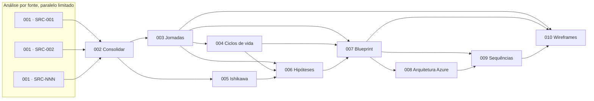

# 011 · Modo Turbo do Contexto

Segue o [contrato comum](00-contrato-comum-das-capacidades.md) (§5.1 estados e §11 manifesto) e a [visão da fase](01-contexto-000-visao-e-contrato-da-fase.md). O Turbo é executado pelo **orquestrador**, não pela IA: não há prompt. Ele não declara dependências próprias porque orquestra as capacidades 001–010; as arestas do grafo são exatamente as declaradas no frontmatter de cada uma delas.

## Objetivo

Executar a fase Contexto **ponta a ponta** sobre um lote: analisar todas as fontes em paralelo limitado, consolidar e gerar os nove artefatos derivados na ordem do grafo, persistindo cada resultado assim que produzido, isolando falhas por ramo e permitindo cancelar, reexecutar um nó e retomar sem refazer o que já foi gravado. O resultado técnico é o `turboRunManifest`.

## Pré-condições

0. Projeto criado no Contexto (`projeto.json`); o Turbo nunca cria projeto e todos os nós gravam sob o mesmo `projectId`.
1. Lote `{batchId}` registrado (pode conter fontes ainda em extração ou análise; o Turbo cuida desse pré-requisito).
2. Solicitante com papel Editor ou Administrador no projeto e acesso a todas as fontes do lote.
3. Versões publicadas de 001–010 carregadas no catálogo; a execução fixa as versões de capacidade em `execucao.json`.
4. Limites configurados: concorrência de 001 (`contexto.turbo.maxParallelSources`, proposta 4), concorrência global de nós por projeto (proposta 3), tentativas por nó (proposta 3, com espera progressiva) e orçamento de tokens por execução.

## Insumos

| Insumo | Caminho | Uso |
|---|---|---|
| Manifesto do lote | `repo://projetos/{projectId}/lotes/{batchId}.json` | Fontes e versões que geram os nós 001 |
| Estado das fontes | `repo://projetos/{projectId}/fontes/{SRC-NNN}/r{n}/metadados.json` e `extracao.json` | Saber se a extração terminou e se já há `analise.json` válido |
| Saídas dos nós da própria execução | `outputUri` de cada nó em `repo://projetos/{projectId}/execucoes/{runId}/manifesto-turbo.json` | Insumo dos nós dependentes |
| Manifesto anterior (retomada) | `repo://projetos/{projectId}/execucoes/{runId}/manifesto-turbo.json` | Nós já `succeeded` reaproveitados |

## Instruções para a IA

O Turbo é executado pelo **orquestrador**, não pela IA: não há prompt de sistema próprio. Cada nó envia à IA o prompt da sua capacidade, com a entrada canônica do [contrato §7](00-contrato-comum-das-capacidades.md#7-entrada-canônica) montada pelo orquestrador: `inputsSnapshot` com o lote congelado e as saídas já gravadas pelos predecessores deste run, `inputs[]` com essas saídas, `previousResult` e `feedback` nulos e `scope.idBlocks` reservado por nó. O grafo abaixo define a ordem.

### Grafo de execução



| Nó | capabilityId | nodeKey | dependsOn | Saída (`outputUri`) |
|---|---|---|---|---|
| 001 (um por fonte) | `01-contexto-001-analisar-e-enriquecer-artefato` | `01-contexto-001-analisar-e-enriquecer-artefato:SRC-NNN@r{n}` | — | `fontes/{SRC-NNN}/r{n}/analise.json` |
| 002 | `01-contexto-002-consolidar-contexto` | `01-contexto-002-consolidar-contexto:{escopo}` | todos os nós 001 do lote | `contexto/01-contexto-002-consolidar-contexto/{escopo}/r{n}/saida.json` |
| 003 | `01-contexto-003-mapear-jornadas-as-is-e-to-be` | `01-contexto-003-mapear-jornadas-as-is-e-to-be:{escopo}` | 002 | `contexto/01-contexto-003-.../{escopo}/r{n}/saida.json` |
| 004 | `01-contexto-004-mapear-ciclo-de-vida-das-jornadas-e-assuntos` | `01-contexto-004-mapear-ciclo-de-vida-das-jornadas-e-assuntos:{escopo}` | 003 | idem |
| 005 | `01-contexto-005-gerar-diagrama-de-ishikawa` | `01-contexto-005-gerar-diagrama-de-ishikawa:{escopo}` | 002 | idem |
| 006 | `01-contexto-006-analisar-hipoteses` | `01-contexto-006-analisar-hipoteses:{escopo}` | 003, 004, 005 | idem |
| 007 | `01-contexto-007-gerar-blueprint-da-solucao-to-be` | `01-contexto-007-gerar-blueprint-da-solucao-to-be:{escopo}` | 003, 004, 006 | idem |
| 008 | `01-contexto-008-desenhar-arquitetura-de-solucao-azure` | `01-contexto-008-desenhar-arquitetura-de-solucao-azure:{escopo}` | 007 | idem |
| 009 | `01-contexto-009-gerar-diagramas-de-sequencia` | `01-contexto-009-gerar-diagramas-de-sequencia:{escopo}` | 007, 008 | idem |
| 010 | `01-contexto-010-propor-wireframes` | `01-contexto-010-propor-wireframes:{escopo}` | 003, 007, 009 | idem |

`{escopo}` é `projeto` ou `lote-{batchId}` (visão da fase §2) e é o mesmo para todos os nós da execução. Os caminhos são relativos a `repo://projetos/{projectId}/`.

## Passo a passo

1. **Criar execução**. `POST /projects/{projectId}/runs` com `capabilityId: 01-contexto-011-modo-turbo` e `batchId`; resposta `202` com `runId`. O orquestrador grava `execucao.json` e o manifesto com todos os nós em `pending`, `snapshotId: null`.
2. **Nós 001**. Para cada fonte do lote:
   - se já existe `analise.json` válido para a mesma versão da fonte e a mesma versão de capacidade, o nó é registrado `succeeded` com `attempts: 0` e `outputUri` da análise existente (reuso, sem chamada à IA);
   - senão, aguarda o fim da extração e executa 001, respeitando `maxParallelSources`.
3. **Congelar snapshot**. Quando todos os nós 001 estão `succeeded`, o orquestrador cria o snapshot (lote + revisão de cada `analise.json`) e grava `snapshotId` no manifesto.
4. **Expandir o grafo**. Um nó passa a `running` quando todos os seus `dependsOn` estão `succeeded`. Ordem resultante: 002 → {003, 005 em paralelo} → 004 (após 003) → 006 (após 003, 004 e 005) → 007 (após 003, 004 e 006) → 008 → 009 (após 007 e 008) → 010 (após 003, 007 e 009).
5. **Insumos fixados**. Cada nó recebe como `inputs` as saídas **dos nós da própria execução** (`outputUri`/`outputRevision`) e seus ancestrais, nunca o ponteiro "atual" do catálogo. Uma revisão mais nova criada por outra execução durante o Turbo não é usada.
6. **Persistência por nó**. Cada nó grava blob e catálogo ao concluir e registra `outputUri` e `outputRevision`; a saída fica disponível na interface imediatamente (sem esperar o fim do Turbo).
7. **Encerramento**. Sem nós `pending`/`running`, o orquestrador calcula o agregado (§5.1 do contrato) e grava `finishedAt`.

## Saída

`repo://projetos/{projectId}/execucoes/{runId}/manifesto-turbo.json`, `kind: turboRunManifest`, válido contra `https://jornada-guiada/schemas/comum/1.0.0/turbo-run-manifest.json` (contrato §11). Campos específicos da fase:

| Campo | Valor no Contexto |
|---|---|
| `phase` | `contexto` |
| `phaseOptions.batchId` | lote executado (obrigatório) |
| `phaseOptions.levelCounts` | `null` (exclusivo do Backlog) |
| `nodes[].scope` | `{ "sourceId": "SRC-NNN", "sourceRevision": n }` nos nós 001; `{ "escopo": "projeto" }` nos demais |
| `nodes[].error.code` | `SAIDA_INVALIDA`, `MODELO_INDISPONIVEL`, `EXTRACAO_FALHOU`, `TEMPO_ESGOTADO`, `ORCAMENTO_EXCEDIDO`, `ACESSO_NEGADO` |

Tentativas individuais ficam em `execucoes/{runId}/nos/{nodeKey}/tentativa-{k}.json`.

## Regras de qualidade e guardrails

Regras de controle do orquestrador, além das do [contrato §11](00-contrato-comum-das-capacidades.md#11-manifesto-do-modo-turbo-turborunmanifest):


**Isolamento de falhas**
- Falha de um nó (após as tentativas) marca `skipped` **somente** os nós que dependem dele, direta ou transitivamente, com `skipReason` citando o nó de origem. Ramos independentes continuam. Exemplos: falha de 005 marca 006, 007, 008, 009 e 010 como `skipped`, mas 003 e 004 seguem; falha de 008 marca 009 e 010, e 003–007 permanecem válidos.
- **Falha de 001 em qualquer fonte bloqueia 002 do lote**: 002 e todos os demais nós ficam `skipped` com `skipReason: "lote bloqueado: SRC-NNN sem análise concluída"`. O bloqueio só termina com (a) reexecução bem-sucedida do nó 001 da fonte ou (b) novo lote (substituição da fonte ou recorte que a exclua), que gera nova execução Turbo reaproveitando as análises válidas.

**Cancelar** (Editor ou Administrador; cancelar execução de outra pessoa exige Administrador)
- Nós `pending` vão para `cancelled`.
- Nós `running` concluem a tentativa corrente; se o cancelamento chegar antes do commit no catálogo, a saída não é gravada e o nó fica `cancelled`; se o commit já ocorreu, o nó fica `succeeded`.
- Agregado `cancelled`. Revisões já gravadas permanecem disponíveis.

**Reexecutar nó**
- `POST /projects/{projectId}/runs/{runId}/nodes/{nodeKey}/retry` (proposta): cria nova tentativa só do nó (`failed` ou `cancelled`) e, em seguida, dos dependentes `skipped` por causa dele, no **mesmo snapshot**.
- Para um nó 001, a reexecução usa a mesma versão da fonte; se a extração precisar ser refeita, ela ocorre antes da tentativa.

**Retomar**
- `POST /projects/{projectId}/runs/{runId}/retry`: reaproveita todos os nós `succeeded` e o mesmo snapshot; executa `failed`, `skipped` e `cancelled` na ordem do grafo.
- Idempotência: a mesma `nodeKey` com os mesmos insumos não gera segunda revisão; o retry de fila é deduplicado pela chave do nó.

**Consistência**
- Os filhos ficam presos às revisões produzidas pelos nós da execução, mesmo que outra execução tenha criado revisões mais novas.
- O estado de revisão humana nunca bloqueia nenhum nó.

## Renderização na aplicação

- Grafo de progresso com os nós do Mermaid acima, coloridos por estado (`pending`, `running`, `succeeded`, `failed`, `cancelled`, `skipped`), contador de tentativas e duração.
- Lista de fontes com o estado do nó 001 de cada uma e a cobertura de leitura.
- Painel de falhas com `error.code`, mensagem acionável e botões **Reexecutar nó**, **Retomar** e **Cancelar** conforme o papel.
- Balanço final: artefatos gerados (links para cada revisão), nós ignorados e motivo, lacunas mais relevantes.

## Tratamento de falhas e lacunas

| Situação | Estado do nó | Efeito |
|---|---|---|
| Extração falhou ou fonte rejeitada | 001 `failed` (`EXTRACAO_FALHOU`) | Lote bloqueado; 002–010 `skipped` |
| JSON inválido após as tentativas | `failed` (`SAIDA_INVALIDA`) | Dependentes `skipped` |
| Modelo indisponível ou cota | `failed` (`MODELO_INDISPONIVEL`) após espera progressiva | Dependentes `skipped`; retomada recomendada |
| Orçamento da execução esgotado | nós restantes `failed` (`ORCAMENTO_EXCEDIDO`) | Agregado `partial` ou `failed` |
| Permissão revogada durante a execução | `failed` (`ACESSO_NEGADO`) | Reavaliada no worker antes de cada leitura |
| Lista vazia válida (ex.: nenhuma jornada) | `succeeded` | Dependentes executam e registram lacunas |

## Critérios de aceite da capacidade

1. O `dependsOn` de cada nó é idêntico às `dependências` do frontmatter da capacidade correspondente (001 → nenhuma; 002 → todos os 001; 006 → 003, 004 e 005; 010 → 003, 007 e 009).
2. Nenhum nó inicia antes de todos os seus `dependsOn` estarem `succeeded`; 003 e 005 podem rodar simultaneamente.
3. Falha de 005 não impede 003 e 004 de concluírem; falha de 001 em uma fonte impede 002.
4. Retomar não reexecuta nós `succeeded` e não cria revisões duplicadas.
5. Cancelar antes do commit não grava revisão do nó em andamento.
6. O manifesto valida contra o schema comum do contrato §11 e o agregado segue §5.1.

## Exemplo mínimo de saída

Execução em que 008 falhou por indisponibilidade do modelo: 009 e 010 ficaram `skipped`; os demais artefatos estão gravados.

```json
{
  "schemaVersion": "1.0.0",
  "capabilityId": "01-contexto-011-modo-turbo",
  "runId": "run_01JGD9T011",
  "projectId": "prj_01JGD7Q2XK",
  "phase": "contexto",
  "status": "partial",
  "snapshotId": "snp_01JGD9S002",
  "startedAt": "2026-11-18T14:00:00Z",
  "finishedAt": "2026-11-18T15:12:00Z",
  "nodes": [
    { "nodeKey": "01-contexto-001-analisar-e-enriquecer-artefato:SRC-001@r1", "capabilityId": "01-contexto-001-analisar-e-enriquecer-artefato", "scope": { "sourceId": "SRC-001", "sourceRevision": 1 }, "dependsOn": [], "status": "succeeded", "attempts": 1, "outputUri": "repo://projetos/prj_01JGD7Q2XK/fontes/SRC-001/r1/analise.json", "outputRevision": 1, "error": null, "skipReason": null },
    { "nodeKey": "01-contexto-001-analisar-e-enriquecer-artefato:SRC-002@r1", "capabilityId": "01-contexto-001-analisar-e-enriquecer-artefato", "scope": { "sourceId": "SRC-002", "sourceRevision": 1 }, "dependsOn": [], "status": "succeeded", "attempts": 0, "outputUri": "repo://projetos/prj_01JGD7Q2XK/fontes/SRC-002/r1/analise.json", "outputRevision": 1, "error": null, "skipReason": null },
    { "nodeKey": "01-contexto-002-consolidar-contexto:projeto", "capabilityId": "01-contexto-002-consolidar-contexto", "scope": { "escopo": "projeto" }, "dependsOn": ["01-contexto-001-analisar-e-enriquecer-artefato:SRC-001@r1", "01-contexto-001-analisar-e-enriquecer-artefato:SRC-002@r1"], "status": "succeeded", "attempts": 1, "outputUri": "repo://projetos/prj_01JGD7Q2XK/contexto/01-contexto-002-consolidar-contexto/projeto/r1/saida.json", "outputRevision": 1, "error": null, "skipReason": null },
    { "nodeKey": "01-contexto-003-mapear-jornadas-as-is-e-to-be:projeto", "capabilityId": "01-contexto-003-mapear-jornadas-as-is-e-to-be", "scope": { "escopo": "projeto" }, "dependsOn": ["01-contexto-002-consolidar-contexto:projeto"], "status": "succeeded", "attempts": 1, "outputUri": "repo://projetos/prj_01JGD7Q2XK/contexto/01-contexto-003-mapear-jornadas-as-is-e-to-be/projeto/r1/saida.json", "outputRevision": 1, "error": null, "skipReason": null },
    { "nodeKey": "01-contexto-005-gerar-diagrama-de-ishikawa:projeto", "capabilityId": "01-contexto-005-gerar-diagrama-de-ishikawa", "scope": { "escopo": "projeto" }, "dependsOn": ["01-contexto-002-consolidar-contexto:projeto"], "status": "succeeded", "attempts": 1, "outputUri": "repo://projetos/prj_01JGD7Q2XK/contexto/01-contexto-005-gerar-diagrama-de-ishikawa/projeto/r1/saida.json", "outputRevision": 1, "error": null, "skipReason": null },
    { "nodeKey": "01-contexto-004-mapear-ciclo-de-vida-das-jornadas-e-assuntos:projeto", "capabilityId": "01-contexto-004-mapear-ciclo-de-vida-das-jornadas-e-assuntos", "scope": { "escopo": "projeto" }, "dependsOn": ["01-contexto-003-mapear-jornadas-as-is-e-to-be:projeto"], "status": "succeeded", "attempts": 1, "outputUri": "repo://projetos/prj_01JGD7Q2XK/contexto/01-contexto-004-mapear-ciclo-de-vida-das-jornadas-e-assuntos/projeto/r1/saida.json", "outputRevision": 1, "error": null, "skipReason": null },
    { "nodeKey": "01-contexto-006-analisar-hipoteses:projeto", "capabilityId": "01-contexto-006-analisar-hipoteses", "scope": { "escopo": "projeto" }, "dependsOn": ["01-contexto-003-mapear-jornadas-as-is-e-to-be:projeto", "01-contexto-004-mapear-ciclo-de-vida-das-jornadas-e-assuntos:projeto", "01-contexto-005-gerar-diagrama-de-ishikawa:projeto"], "status": "succeeded", "attempts": 2, "outputUri": "repo://projetos/prj_01JGD7Q2XK/contexto/01-contexto-006-analisar-hipoteses/projeto/r1/saida.json", "outputRevision": 1, "error": null, "skipReason": null },
    { "nodeKey": "01-contexto-007-gerar-blueprint-da-solucao-to-be:projeto", "capabilityId": "01-contexto-007-gerar-blueprint-da-solucao-to-be", "scope": { "escopo": "projeto" }, "dependsOn": ["01-contexto-003-mapear-jornadas-as-is-e-to-be:projeto", "01-contexto-004-mapear-ciclo-de-vida-das-jornadas-e-assuntos:projeto", "01-contexto-006-analisar-hipoteses:projeto"], "status": "succeeded", "attempts": 1, "outputUri": "repo://projetos/prj_01JGD7Q2XK/contexto/01-contexto-007-gerar-blueprint-da-solucao-to-be/projeto/r1/saida.json", "outputRevision": 1, "error": null, "skipReason": null },
    { "nodeKey": "01-contexto-008-desenhar-arquitetura-de-solucao-azure:projeto", "capabilityId": "01-contexto-008-desenhar-arquitetura-de-solucao-azure", "scope": { "escopo": "projeto" }, "dependsOn": ["01-contexto-007-gerar-blueprint-da-solucao-to-be:projeto"], "status": "failed", "attempts": 3, "outputUri": null, "outputRevision": null, "error": { "code": "MODELO_INDISPONIVEL", "message": "Modelo sem capacidade após 3 tentativas; use Reexecutar nó ou Retomar." }, "skipReason": null },
    { "nodeKey": "01-contexto-009-gerar-diagramas-de-sequencia:projeto", "capabilityId": "01-contexto-009-gerar-diagramas-de-sequencia", "scope": { "escopo": "projeto" }, "dependsOn": ["01-contexto-007-gerar-blueprint-da-solucao-to-be:projeto", "01-contexto-008-desenhar-arquitetura-de-solucao-azure:projeto"], "status": "skipped", "attempts": 0, "outputUri": null, "outputRevision": null, "error": null, "skipReason": "dependência 01-contexto-008-desenhar-arquitetura-de-solucao-azure:projeto falhou" },
    { "nodeKey": "01-contexto-010-propor-wireframes:projeto", "capabilityId": "01-contexto-010-propor-wireframes", "scope": { "escopo": "projeto" }, "dependsOn": ["01-contexto-003-mapear-jornadas-as-is-e-to-be:projeto", "01-contexto-007-gerar-blueprint-da-solucao-to-be:projeto", "01-contexto-009-gerar-diagramas-de-sequencia:projeto"], "status": "skipped", "attempts": 0, "outputUri": null, "outputRevision": null, "error": null, "skipReason": "dependência 01-contexto-009-gerar-diagramas-de-sequencia:projeto ignorada (origem: 008)" }
  ],
  "phaseOptions": { "batchId": "bat_01JGD7R0AA", "levelCounts": null }
}
```

O nó de SRC-002 mostra reuso: `attempts: 0` com a análise já existente para a mesma versão. Ao **Reexecutar nó** 008 com sucesso, o orquestrador executa 009 e depois 010 no mesmo snapshot e o agregado passa a `succeeded`.
