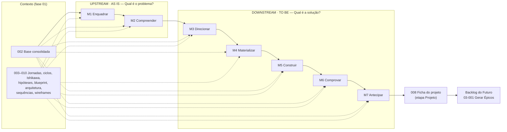

# DarkLab · Visão e contrato da fase

Este documento descreve a fase 02 (DarkLab) e as regras que valem para todas as capacidades `02-darklab-001` a `02-darklab-009`. Ele **complementa** o [contrato comum das capacidades](00-contrato-comum-das-capacidades.md) e o [repositório único de artefatos](00-repositorio-unico-de-artefatos.md); em caso de conflito, prevalece o contrato comum. A visão da plataforma está na [especificação da plataforma](especificacao-plataforma-jornada-guiada.md); a fase anterior está em [Contexto · visão e contrato](01-contexto-000-visao-e-contrato-da-fase.md).

## 1. Visão

O DarkLab aplica **sete motores** de inovação sobre o conhecimento consolidado na fase Contexto. Cada motor responde a uma pergunta, aplica um conjunto de métodos como **lentes analíticas sobre as evidências disponíveis** e devolve produtos estruturados, rastreáveis até a fonte original.

A plataforma **não conduz** entrevistas, workshops, testes, desenvolvimento nem experimentos reais. Quando um método exige trabalho de campo, o motor (a) extrai das fontes o que já foi feito e documentado, (b) aplica o raciocínio do método ao que existe e (c) propõe o trabalho de campo que falta, com natureza `proposta`. Resultados reais só aparecem como `documentado` quando há evidência nas fontes.

Na jornada **Contexto → DarkLab → Projeto → Backlog**, o DarkLab é a fase que **define o projeto**. O projeto já existe desde o Contexto, com o mesmo `projectId`; ao fim dos sete motores, a capacidade [008 · Consolidar a ficha do projeto](02-darklab-008-consolidar-ficha-do-projeto.md) reúne o que eles concluíram na ficha do projeto, que a página **Projetos** exibe e o Backlog do Futuro consome.

## 2. Upstream × Downstream

| Faixa | Motores | Pergunta | Natureza predominante | Papel |
|---|---|---|---|---|
| **UPSTREAM · AS IS** | M1 Enquadrar, M2 Compreender | **Qual é o problema?** | `documentado` e `inferido` | Delimitar o desafio e ler pessoas, dados, jornadas e sinais sobre a situação atual. |
| **DOWNSTREAM · TO BE** | M3 Direcionar, M4 Materializar, M5 Construir, M6 Comprovar, M7 Antecipar | **Qual é a solução?** | `proposta` e `hipótese` (com `documentado` quando houver evidência) | Transformar sinais em visão, desenho, plano de MVP, plano de prova de impacto e evolução futura. |

Regra de faixa: um motor Downstream nunca reclassifica um fato do Upstream; ele o referencia (`crossRef`) e constrói sobre ele. Uma afirmação Downstream derivada de item `hipótese` permanece `hipótese` ou `proposta` (herança de natureza, contrato §3).

## 3. Os sete motores

| Etapa | Motor | Faixa | Nome | Arquivo | Saídas principais (`data`) |
|---|---|---|---|---|---|
| 001 | M1 Enquadrar | Upstream | Descoberta estratégica | [Motor 1](02-darklab-001-motor-1-enquadrar-descoberta-estrategica.md) | `framedChallenge`, `opportunityMap`, `investigationHypotheses`, `stakeholders`, `constraints`, `expectedResults`, `successCriteria` |
| 002 | M2 Compreender | Upstream | Escuta e inteligência de sinais | [Motor 2](02-darklab-002-motor-2-compreender-escuta-e-sinais.md) | `pains`, `needs`, `signals`, `journeyPatterns`, `insights`, `solutionPills` |
| 003 | M3 Direcionar | Downstream | Estratégia e visão de produto | [Motor 3](02-darklab-003-motor-3-direcionar-estrategia-e-visao-de-produto.md) | `valuePropositions`, `businessModel`, `productStatementPack`, `productVision`, `metrics`, `priorities`, `initialRoadmap`, `capabilityMap`, `partners`, `dependencies` |
| 004 | M4 Materializar | Downstream | Design e ativos digitais | [Motor 4](02-darklab-004-motor-4-materializar-design-e-ativos-digitais.md) | `futureJourneys`, `flows`, `prototypes`, `serviceBlueprint`, `technicalView`, `assetLibrary`, `buildReadyBacklog` |
| 005 | M5 Construir | Downstream | MVP e validação | [Motor 5](02-darklab-005-motor-5-construir-mvp-e-validacao.md) | `pocPlan`, `mvpDefinition`, `increments`, `qualityPlan`, `instrumentationPlan`, `validationPlan` |
| 006 | M6 Comprovar | Downstream | Experimentação e impacto | [Motor 6](02-darklab-006-motor-6-comprovar-experimentacao-e-impacto.md) | `experiments`, `indicators`, `hypothesisResults`, `recommendation` |
| 007 | M7 Antecipar | Downstream | Foresight e evolução contínua | [Motor 7](02-darklab-007-motor-7-antecipar-foresight-e-evolucao.md) | `forces`, `scenarios`, `implications`, `futureOpportunities`, `futureExperiments`, `revisedRoadmap`, `futureBacklog`, `reviewTriggers` |
| 008 | — | Projeto | Ficha do projeto | [Ficha do projeto](02-darklab-008-consolidar-ficha-do-projeto.md) | `project`, `framing`, `objectives`, `scope`, `mvp`, `roadmapWaves`, `backlogSeeds`, `readiness` |
| 009 | — | — | Modo Turbo | [Modo Turbo](02-darklab-009-modo-turbo.md) | `turboRunManifest` |

### 3.1 Sequência



## 4. O que todos os motores consomem do Contexto

Todos os motores leem **o contexto inteiro** da fase 01 disponível no snapshot, com prioridade para a base consolidada. Cada motor indica quais insumos são mais relevantes, mas nenhum é proibido.

| Capacidade do Contexto | Kind no manifesto | Uso principal no DarkLab |
|---|---|---|
| [01-contexto-002-consolidar-contexto](01-contexto-002-consolidar-contexto.md) | `contextBase` | **Obrigatório para todos.** Objetivos (`OBJ`), problemas (`PRB`), stakeholders (`STK`), atores (`ACT`), sistemas (`SYS`), regras (`RUL`), restrições (`CON`), glossário (`TRM`), evidências (`EVD`). |
| [01-contexto-003-mapear-jornadas-as-is-e-to-be](01-contexto-003-mapear-jornadas-as-is-e-to-be.md) | `journeys` | M2 (padrões AS IS), M4 (jornadas futuras), M5/M6 (pontos de medição). |
| [01-contexto-004-mapear-ciclo-de-vida-das-jornadas-e-assuntos](01-contexto-004-mapear-ciclo-de-vida-das-jornadas-e-assuntos.md) | `lifecycles` | M2 (estados problemáticos), M4 (fluxos), M6 (eventos de funil). |
| [01-contexto-005-gerar-diagrama-de-ishikawa](01-contexto-005-gerar-diagrama-de-ishikawa.md) | `ishikawa` | M1 (enquadramento do problema), M2 (causas de dores). |
| [01-contexto-006-analisar-hipoteses](01-contexto-006-analisar-hipoteses.md) | `hypotheses` | M1 (hipóteses de investigação), M5 (hipóteses críticas), M6 (hipóteses a comprovar). |
| [01-contexto-007-gerar-blueprint-da-solucao-to-be](01-contexto-007-gerar-blueprint-da-solucao-to-be.md) | `blueprint` | M3 (capacidades), M4 (service blueprint). |
| [01-contexto-008-desenhar-arquitetura-de-solucao-azure](01-contexto-008-desenhar-arquitetura-de-solucao-azure.md) | `architecture` | M3 (dependências), M4 (visão técnica), M5 (arquitetura do MVP e instrumentação). |
| [01-contexto-009-gerar-diagramas-de-sequencia](01-contexto-009-gerar-diagramas-de-sequencia.md) | `sequences` | M4 (integrações), M5 (testes de integração). |
| [01-contexto-010-propor-wireframes](01-contexto-010-propor-wireframes.md) | `wireframes` | M4 (protótipos), M5 (testes de usabilidade). |

Ausência de uma saída 003–010 no snapshot **não** impede o motor: vira `gaps[]` com `impact` proporcional e o motor trabalha com a base consolidada.

## 5. Regras da fase

### 5.1 Dependências

- **Obrigatória** (frontmatter `dependências`) em todos os motores: revisão atual de `01-contexto-002-consolidar-contexto`. Sem ela, a API responde `422` com código `contexto_nao_consolidado`.
- **Preferenciais** (seção Insumos de cada motor): motores anteriores. Em execução individual, o motor usa a revisão atual de cada motor anterior disponível; se faltar, registra `gaps[]` (`impact: médio`, `suggestedSource: "executar o Motor N"`) e segue com o Contexto.
- No [Modo Turbo](02-darklab-009-modo-turbo.md), a sequência M1→M7 é estrita: cada motor recebe as saídas **da mesma execução** dos motores anteriores.

### 5.2 Identificadores no DarkLab

- Entidades já existentes no Contexto são **referenciadas pelo mesmo ID** (ex.: `STK-004`, `HIP-010`, `JRN-002`), nunca recriadas. A referência usa `crossRef` (seção 6).
- Entidades novas usam os prefixos do contrato §2.1 e, quando não houver prefixo, os complementares do DarkLab abaixo. A numeração de uma entidade nova usa apenas números do bloco reservado pela aplicação em `scope.idBlocks` ([contrato comum §7.1](00-contrato-comum-das-capacidades.md#71-reserva-de-números-scopeidblocks)); a aplicação ainda confere a unicidade no projeto antes do commit.

| Prefixo | Entidade | Motor de origem |
|---|---|---|
| `NEC` | Necessidade | M2 |
| `SEG` | Segmento | M2 |
| `PAT` | Padrão de jornada | M2 |
| `PIL` | Pílula de solução | M2 |
| `VPR` | Proposta de valor | M3 |
| `PTN` | Parceiro | M3 |
| `PRI` | Item de priorização | M3 |
| `BMD` | Modelo de negócio | M3 |
| `PSP` | Product Statement Pack | M3 |
| `PVS` | Visão de produto | M3 |
| `FLW` | Fluxo | M4 |
| `PTP` | Protótipo | M4 |
| `BPR` | Etapa de service blueprint | M4 |
| `INT` | Integração | M4 |
| `AST` | Ativo digital reutilizável | M4 |
| `BKL` | Tema de backlog preparado | M4 |
| `TVW` | Visão técnica | M4 |
| `POC` | Prova de conceito | M5 |
| `MVP` | Definição de MVP | M5 |
| `INC` | Incremento de MVP | M5 |
| `TST` | Teste de qualidade | M5 |
| `TEL` | Ponto de instrumentação | M5 |
| `VAL` | Plano de validação | M5 |
| `HRS` | Resultado de hipótese | M6 |
| `REC` | Recomendação | M6 |
| `FRC` | Força de transformação (STEEP) | M7 |
| `IMP` | Implicação | M7 |
| `FBK` | Item do backlog do futuro | M7 |
| `TRG` | Gatilho de revisão | M7 |
| `ATV` | Atividade do projeto registrada nas fontes | todos |

### 5.3 Evidências

- Um motor reaproveita `EVD-NNN` dos insumos: copia para o próprio `evidenceRefs` a evidência que cita, com o mesmo `id`, `sourceId`, `sourceRevision` e `locator`. Nunca cria evidência a partir de saída de outro motor (saída de motor é derivado, não fonte).
- Item construído sobre item de outro motor cita o item (`crossRefs`) **e** herda as `evidenceIds` que sustentam a afirmação.

### 5.4 Métodos como lentes

Cada motor devolve `data.methodLenses[]`, uma linha por método listado na sua tabela, dizendo se o método pôde ser aplicado sobre as evidências (`aplicado_sobre_evidencias`), aplicado parcialmente (`parcial`) ou não (`sem_evidencia_suficiente`), quais itens resultaram dele e qual trabalho de campo é proposto.

### 5.5 Estrutura comum da saída dos motores

Além dos produtos próprios, todo motor devolve em `data` os mesmos cinco blocos. Eles mostram, para cada motor, o que o projeto já fez, o que falta e o que o resultado comprova, separando o trabalho registrado nas fontes do que a plataforma propõe.

| Bloco | Conteúdo | Definição |
|---|---|---|
| `inputsUsed[]` | Insumos efetivamente lidos (capacidade e revisão do snapshot) e para que foram usados | `inputUse` |
| `methodLenses[]` | Métodos do motor aplicados como lentes (§5.4) | `methodLens` |
| `activities[]` | Trabalho do projeto ligado ao motor que as fontes registram: período, título, descrição, status e evidências (`ATV-NNN`) | `activity` |
| `deliverables[]` | Um item por entregável esperado do motor, com status, nota, campos de `data` que o tratam e evidências | `deliverable` |
| `ecosystem` | Pessoas (papéis), dados, usos de IA e parcerias envolvidos | `ecosystem` |
| `readingNote` | O que o resultado comprova (`proves`) e o que não comprova (`doesNotProve`) | `readingNote` |

Status de atividades e entregáveis (`workStatus`):

| Status | Quando usar | Evidência |
|---|---|---|
| `concluído` | Há evidência de aceite do entregável ou de conclusão da atividade | obrigatória |
| `em aceite` | Material produzido; aceite não comprovado | obrigatória |
| `em andamento` | Trabalho registrado em curso | obrigatória |
| `impedido` | Bloqueio registrado (dado, decisão, dependência) | obrigatória |
| `pendente` | Sem evidência de início | dispensada |

Regras:

1. O status descreve o entregável **no projeto**, segundo as fontes. O conteúdo que o motor gera é proposta da plataforma e não muda esse status.
2. Produzido não é aceito: material elaborado sem evidência de aceite fica `em aceite`, nunca `concluído`. A IA nunca marca entregável como aprovado.
3. Sem evidência operacional, é plano: sem MVP em operação ou telemetria, M5–M7 entregam planos e propostas com natureza `hipótese`; entrevistas e workshops do discovery não contam como resultado de experimento.
4. Os entregáveis esperados de cada motor são fixos e listados no prompt do motor; o schema do motor restringe `deliverables[].name` a essa lista.
5. `workStatus` não se confunde com os estados de execução e de revisão humana da plataforma (contrato §5).

### 5.6 Estados

Os motores seguem os estados de execução e de revisão humana do contrato §5. Nenhum motor ou entregável usa estados de aprovação. O `workStatus` (§5.5) descreve o trabalho do projeto registrado nas fontes e nunca bloqueia execução ou consumo.

## 6. Schema comum da fase

Os schemas de `data` dos motores referenciam estas definições por `https://jornada-guiada/schemas/02-darklab-000-visao-e-contrato-da-fase/1.0.0/darklab-comum.json#/$defs/<nome>`.

Convenção de schema: o objeto `data` usa `additionalProperties: false`; itens que são afirmações usam `allOf` com `$ref` a `afirmacao` do envelope e `unevaluatedProperties: false` (equivalente a `additionalProperties: false` quando há composição em draft 2020-12).

```json
{
  "$schema": "https://json-schema.org/draft/2020-12/schema",
  "$id": "https://jornada-guiada/schemas/02-darklab-000-visao-e-contrato-da-fase/1.0.0/darklab-comum.json",
  "$defs": {
    "crossRef": {
      "type": "object",
      "required": [
        "capabilityId",
        "itemId"
      ],
      "additionalProperties": false,
      "properties": {
        "capabilityId": {
          "type": "string",
          "pattern": "^0[1-3]-(contexto|darklab|backlog-do-futuro)-\\d{3}-[a-z0-9-]+$"
        },
        "revision": {
          "type": [
            "integer",
            "null"
          ],
          "minimum": 1
        },
        "itemId": {
          "type": "string"
        }
      }
    },
    "methodLens": {
      "type": "object",
      "required": [
        "method",
        "status",
        "resultIds",
        "fieldWorkProposal"
      ],
      "additionalProperties": false,
      "properties": {
        "method": {
          "type": "string"
        },
        "status": {
          "enum": [
            "aplicado_sobre_evidencias",
            "parcial",
            "sem_evidencia_suficiente"
          ]
        },
        "resultIds": {
          "type": "array",
          "items": {
            "type": "string"
          }
        },
        "fieldWorkProposal": {
          "type": [
            "string",
            "null"
          ],
          "description": "trabalho de campo proposto (natureza proposta) para completar o método"
        }
      }
    },
    "nivel": {
      "enum": [
        "alto",
        "médio",
        "baixo",
        null
      ]
    },
    "priorityScore": {
      "type": "object",
      "required": [
        "valor",
        "esforco",
        "risco",
        "rationale"
      ],
      "additionalProperties": false,
      "properties": {
        "valor": {
          "$ref": "#/$defs/nivel"
        },
        "esforco": {
          "$ref": "#/$defs/nivel"
        },
        "risco": {
          "$ref": "#/$defs/nivel"
        },
        "urgencia": {
          "$ref": "#/$defs/nivel"
        },
        "rationale": {
          "type": "string"
        }
      }
    },
    "horizonte": {
      "enum": [
        "agora",
        "próximo",
        "futuro"
      ]
    },
    "workStatus": {
      "enum": [
        "pendente",
        "em andamento",
        "em aceite",
        "concluído",
        "impedido"
      ]
    },
    "inputUse": {
      "type": "object",
      "required": [
        "capabilityId",
        "revision",
        "usage"
      ],
      "additionalProperties": false,
      "properties": {
        "capabilityId": {
          "type": [
            "string",
            "null"
          ],
          "pattern": "^0[1-3]-(contexto|darklab|backlog-do-futuro)-\\d{3}-[a-z0-9-]+$"
        },
        "revision": {
          "type": [
            "integer",
            "null"
          ],
          "minimum": 1
        },
        "usage": {
          "type": "string"
        }
      }
    },
    "activity": {
      "allOf": [
        {
          "$ref": "https://jornada-guiada/schemas/comum/1.0.0/envelope.json#/$defs/afirmacao"
        }
      ],
      "required": [
        "id",
        "period",
        "title",
        "description",
        "status"
      ],
      "properties": {
        "id": {
          "type": "string",
          "pattern": "^ATV-\\d{3,}$"
        },
        "natureza": {
          "enum": [
            "documentado",
            "inferido"
          ]
        },
        "period": {
          "type": [
            "string",
            "null"
          ],
          "description": "data ou período como aparece nas fontes"
        },
        "title": {
          "type": "string"
        },
        "description": {
          "type": "string"
        },
        "status": {
          "$ref": "#/$defs/workStatus"
        }
      },
      "unevaluatedProperties": false
    },
    "deliverable": {
      "type": "object",
      "required": [
        "name",
        "status",
        "note",
        "dataFields",
        "evidenceIds",
        "gapIds"
      ],
      "additionalProperties": false,
      "properties": {
        "name": {
          "type": "string"
        },
        "status": {
          "$ref": "#/$defs/workStatus"
        },
        "note": {
          "type": "string"
        },
        "dataFields": {
          "type": "array",
          "minItems": 1,
          "items": {
            "type": "string"
          }
        },
        "evidenceIds": {
          "type": "array",
          "items": {
            "type": "string",
            "pattern": "^EVD-\\d{3,}$"
          }
        },
        "gapIds": {
          "type": "array",
          "items": {
            "type": "string",
            "pattern": "^GAP-\\d{3,}$"
          }
        }
      },
      "if": {
        "properties": {
          "status": {
            "not": {
              "const": "pendente"
            }
          }
        }
      },
      "then": {
        "properties": {
          "evidenceIds": {
            "minItems": 1
          }
        }
      }
    },
    "ecosystemEntry": {
      "type": "object",
      "required": [
        "text",
        "refIds",
        "natureza",
        "evidenceIds"
      ],
      "additionalProperties": false,
      "properties": {
        "text": {
          "type": "string"
        },
        "refIds": {
          "type": "array",
          "items": {
            "type": "string"
          }
        },
        "natureza": {
          "$ref": "https://jornada-guiada/schemas/comum/1.0.0/envelope.json#/$defs/natureza"
        },
        "evidenceIds": {
          "type": "array",
          "items": {
            "type": "string",
            "pattern": "^EVD-\\d{3,}$"
          }
        },
        "rationale": {
          "type": [
            "string",
            "null"
          ]
        }
      },
      "allOf": [
        {
          "if": {
            "properties": {
              "natureza": {
                "enum": [
                  "documentado",
                  "inferido"
                ]
              }
            }
          },
          "then": {
            "properties": {
              "evidenceIds": {
                "minItems": 1
              }
            }
          }
        },
        {
          "if": {
            "properties": {
              "natureza": {
                "enum": [
                  "inferido",
                  "hipótese",
                  "proposta"
                ]
              }
            }
          },
          "then": {
            "required": [
              "rationale"
            ]
          }
        }
      ]
    },
    "ecosystem": {
      "type": "object",
      "required": [
        "people",
        "data",
        "ai",
        "partners"
      ],
      "additionalProperties": false,
      "properties": {
        "people": {
          "type": "array",
          "items": {
            "$ref": "#/$defs/ecosystemEntry"
          }
        },
        "data": {
          "type": "array",
          "items": {
            "$ref": "#/$defs/ecosystemEntry"
          }
        },
        "ai": {
          "type": "array",
          "items": {
            "$ref": "#/$defs/ecosystemEntry"
          }
        },
        "partners": {
          "type": "array",
          "items": {
            "$ref": "#/$defs/ecosystemEntry"
          }
        }
      }
    },
    "readingNote": {
      "type": "object",
      "required": [
        "proves",
        "doesNotProve"
      ],
      "additionalProperties": false,
      "properties": {
        "proves": {
          "type": "array",
          "items": {
            "type": "string"
          }
        },
        "doesNotProve": {
          "type": "array",
          "minItems": 1,
          "items": {
            "type": "string"
          }
        }
      }
    }
  }
}
```

## 7. O que alimenta o Backlog do Futuro

[03-backlog-do-futuro-001-gerar-epicos](03-backlog-do-futuro-001-gerar-epicos.md) exige a **ficha do projeto** e consome também as revisões atuais dos motores no snapshot, com esta precedência:

| Origem | Campo | Uso no Backlog |
|---|---|---|
| 008 | ficha do projeto: `backlogSeeds[]`, `scope`, `objectives`, `roadmapWaves`, `readiness` | **Porta de entrada obrigatória**: define o escopo do projeto, quais `FBK` entram (`inScope`) e em que onda. Sem ficha com prontidão diferente de `insuficiente`, o Backlog não começa. |
| M7 | `futureBacklog[]` (`FBK-NNN`) | **Conteúdo principal**: cada item é candidato a Épico (resultado, hipótese de valor, fronteira, prioridade, horizonte, gatilhos). Disposição obrigatória em 03-001. |
| M7 | `revisedRoadmap[]`, `reviewTriggers[]` | Ondas e condições de revisão do roadmap de Épicos. |
| M3 | `productStatementPack`, `metrics[]`, `capabilityMap[]` | Objetivos, KPIs e capacidades para fronteiras de Épico. |
| M4 | `buildReadyBacklog[]`, `futureJourneys[]` | Temas e jornadas TO BE para Features. |
| M5 | `mvpDefinition`, `increments[]` | Recorte de MVP e sequência de entrega. |
| M6 | `hypothesisResults[]`, `recommendation` | Ajuste de prioridade (ampliar, ajustar, interromper). |
| M1–M7 | `deliverables[]`, `readingNote` | Situação de cada entregável no projeto e ressalvas: o que ainda é plano não vira escopo confirmado. |

Sem M7, a ficha sai `insuficiente` (não há sementes do backlog) e o Backlog do Futuro não começa; o caminho é executar o M7 e regenerar a ficha.

## 8. Renderização comum

- Ao fim da página do DarkLab, o cartão **Ficha do projeto** (prontidão, lacunas bloqueantes e link para a página Projetos).
- Página do DarkLab em duas faixas (Upstream AS IS, Downstream TO BE), um cartão por motor com **Gerar**/**Regenerar**, data da revisão atual, `natureSummary` e estado de revisão humana.
- Página do motor: tabela Insumos/Métodos/Saídas, abas por saída, painel de `methodLenses`, lacunas e conflitos destacados, selo de natureza em cada item e link para a evidência.
- Painel **Andamento no projeto** em cada motor: linha do tempo de `activities`, entregáveis com status por cor, ecossistema e ressalva de leitura. O cartão do motor na página da fase mostra a contagem de entregáveis por status.

## 9. Critérios de aceite da fase

1. Os sete motores executam individualmente com apenas `01-contexto-002` disponível, registrando lacunas para o que faltar.
2. Nenhum `data` contém `coverage`; todos os IDs têm 3 dígitos; nenhum estado de aprovação aparece.
3. Itens que repetem entidades do Contexto usam o mesmo ID.
4. M5 e M6 sem dados de operação entregam planos com natureza `proposta`/`hipótese` e nenhum resultado atribuído a teste sem evidência.
5. M7 entrega `futureBacklog[]` e a ficha do projeto (008) o seleciona em `backlogSeeds[]`, consumível por 03-001 sem transformação.
7. Todas as saídas da fase carregam o mesmo `projectId` do projeto criado no Contexto; a ficha do projeto reproduz `projectId` e `code` de `projeto.json`.
6. Todo motor entrega os blocos comuns da §5.5; cada `deliverables[]` lista exatamente os entregáveis esperados do motor, e todo status diferente de `pendente` cita evidência.
