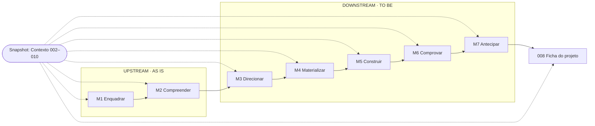

# Modo Turbo do DarkLab

Orquestração (sem prompt próprio) que executa os sete motores em sequência — **M1 → M2 → M3 → M4 → M5 → M6 → M7** — e, ao final, a [ficha do projeto](02-darklab-008-consolidar-ficha-do-projeto.md), de ponta a ponta sobre o mesmo Contexto. É o trecho DarkLab → Projeto da jornada Contexto → DarkLab → Projeto → Backlog. Segue integralmente o manifesto e as regras de controle do [contrato comum §11](00-contrato-comum-das-capacidades.md#11-manifesto-do-modo-turbo-turborunmanifest). Regras da fase em [DarkLab · visão e contrato](02-darklab-000-visao-e-contrato-da-fase.md).

## Objetivo

Gerar, em uma única execução idempotente e retomável, uma revisão de cada motor sobre o **mesmo snapshot** do Contexto, encadeando as saídas de cada motor para os seguintes, e terminar com a ficha do projeto consolidada, de modo que o Backlog do Futuro encontre o projeto definido, com prontidão calculada e sementes do backlog.

## Pré-condições

- Revisão atual de `01-contexto-002-consolidar-contexto` (senão `422 contexto_nao_consolidado`). O Turbo do DarkLab **não** executa o Contexto; para isso existe o [Turbo do Contexto](01-contexto-011-modo-turbo.md).
- Papel Editor ou Administrador.
- Não há outro Turbo do DarkLab `running` com a mesma `idempotencyKey` (mesma chave + payload diferente → `409`).

## Insumos

| Insumo | Caminho | Uso |
|---|---|---|
| Identidade do projeto | `repo://projetos/{projectId}/projeto.json` | Congelada no início; entregue à ficha. |
| Snapshot do Contexto (002 obrigatório; 003–010 quando houver) | `repo://projetos/{projectId}/contexto/{capabilityId}/{escopo}/r{n}/saida.json` | Congelado no início; entregue a **todos** os nós (M1–M7 e ficha). |
| Saídas dos nós anteriores **da mesma execução** | `repo://projetos/{projectId}/darklab/{capabilityId}/{escopo}/r{n}/saida.json` (`outputUri`/`outputRevision` do manifesto) | Cada motor recebe as saídas de todos os motores anteriores do run, nunca revisões de outras execuções. |
| Manifesto | `repo://projetos/{projectId}/execucoes/{runId}/manifesto-turbo.json` | Estado do grafo. |

Parâmetros de `POST /turbo-runs`: `{ phase: "darklab", scope?, idempotencyKey }`.
- `scope` padrão `projeto`; pode ser `lote-{batchId}` quando o Contexto foi gerado por lote.

## Instruções para a IA

O Turbo não tem prompt próprio: cada nó usa o prompt da sua capacidade. O orquestrador monta, para cada nó, a entrada canônica do [contrato §7](00-contrato-comum-das-capacidades.md#7-entrada-canônica):

- `inputsSnapshot`: o snapshot do Contexto **mais** as revisões gravadas pelos nós predecessores neste run;
- `inputs[]`: Contexto inteiro + saídas de M1…M(k−1) do run;
- `previousResult` e `feedback`: `null` (o Turbo não regenera; regeneração é por artefato);
- `scope.idBlocks`: bloco de números reservado para o nó (contrato §7.1), sem sobreposição entre nós do mesmo run.

## Passo a passo

1. A API valida papel, pré-condições e idempotência; congela o snapshot (`snapshotId`); cria o manifesto com os oito nós `pending`; responde `202 {runId}`.
2. O orquestrador executa M1. Ao `succeeded`, grava a revisão (blob antes do commit) e registra `outputUri`/`outputRevision` no nó.
3. Executa M2 com o Contexto + M1; depois M3 com Contexto + M1–M2; e assim até M7 (Contexto + M1–M6).
4. Executa a ficha do projeto (008) com `projeto.json`, o Contexto e M1–M7 do run. Ao gravá-la, a etapa do projeto é atualizada ([contrato §5.3](00-contrato-comum-das-capacidades.md#53-etapa-do-projeto)).
5. Cada nó: até 2 novas tentativas para erro estrutural (JSON inválido, schema, referência inexistente) ou erro transitório; persistindo, `failed` com `error.code` acionável.
6. Ao fim, o agregado é derivado dos nós (contrato §5.1) e a página mostra o balanço: revisões geradas, lacunas por motor, entregáveis por status nós `failed`/`skipped` com motivo e a prontidão da ficha do projeto.

### Grafo



### Tabela de nós

| nodeKey | capabilityId | dependsOn | Lê além do snapshot |
|---|---|---|---|
| `m1:{escopo}` | `02-darklab-001-motor-1-enquadrar-descoberta-estrategica` | — | — |
| `m2:{escopo}` | `02-darklab-002-motor-2-compreender-escuta-e-sinais` | `m1` | M1 |
| `m3:{escopo}` | `02-darklab-003-motor-3-direcionar-estrategia-e-visao-de-produto` | `m2` | M1–M2 |
| `m4:{escopo}` | `02-darklab-004-motor-4-materializar-design-e-ativos-digitais` | `m3` | M1–M3 |
| `m5:{escopo}` | `02-darklab-005-motor-5-construir-mvp-e-validacao` | `m4` | M1–M4 |
| `m6:{escopo}` | `02-darklab-006-motor-6-comprovar-experimentacao-e-impacto` | `m5` | M1–M5 |
| `m7:{escopo}` | `02-darklab-007-motor-7-antecipar-foresight-e-evolucao` | `m6` | M1–M6 |
| `ficha:{escopo}` | `02-darklab-008-consolidar-ficha-do-projeto` | `m7` | `projeto.json`, M1–M7 |

Todos os nós leem o Contexto do snapshot. A ficha depende do M7 no Turbo para consolidar o DarkLab completo; fora do Turbo ela roda com o M1 e registra lacunas. `nodeKey` completo = `{runId}/{chave}`; é a chave de idempotência do nó.

Decisão de desenho: a sequência é **estrita** (cada motor depende do anterior), porque cada motor responde à pergunta do anterior e a comparação entre motores só é válida sobre o mesmo encadeamento. Para obter motores posteriores apesar de uma falha, o usuário pode reexecutar o nó (ver abaixo) ou executar o motor individualmente fora do Turbo, quando ele usará as revisões atuais disponíveis e registrará lacunas.

## Saída

`turboRunManifest` conforme o schema `https://jornada-guiada/schemas/comum/1.0.0/turbo-run-manifest.json` ([contrato §11](00-contrato-comum-das-capacidades.md#11-manifesto-do-modo-turbo-turborunmanifest)), com `phase: "darklab"` e:

| Campo de `phaseOptions` | Valor no DarkLab |
|---|---|
| `batchId` | `batchId` do escopo quando `scope = lote-{batchId}`; senão `null` |
| `levelCounts` | `null` (exclusivo do Backlog do Futuro) |

Cada nó `succeeded` aponta `outputUri` e `outputRevision` da revisão gravada; essas revisões entram imediatamente no catálogo como `isCurrent` da sua série ([repositório §5](00-repositorio-unico-de-artefatos.md#5-versionamento)) e com `reviewState: "não revisado"`, sem nenhum bloqueio de consumo.

## Regras de qualidade e guardrails

- **Mesmo snapshot** para todos os nós; nós nunca leem revisões de outras execuções.
- **Falha**: um nó `failed` marca como `skipped` (`skipReason: "dependência m{k} failed"`) apenas os nós que dependem dele, direta ou transitivamente; com a cadeia estrita, são os motores seguintes e a ficha.
- **Cancelar** (Editor dono ou Administrador): nós `running` terminam a tentativa corrente e não gravam se o cancelamento chegar antes do commit; nós `pending` vão para `cancelled`; agregado `cancelled`.
- **Reexecutar nó**: cria nova tentativa só daquele nó e dos dependentes `skipped`, com o mesmo snapshot e as saídas já gravadas dos predecessores.
- **Retomar**: reaproveita nós `succeeded` (não reexecuta, marca `skipped` com `skipReason: "saída válida reutilizada"` na nova tentativa do run) e executa `failed`, `skipped` e `cancelled` com o mesmo snapshot.
- Lacunas e baixa confiança em um motor geram `gaps[]`, **não** falha; M5 e M6 sem dados de operação terminam `succeeded` com planos e resultados `hipótese`.
- Entregáveis `pendente` ou `em aceite` nos blocos comuns não são falha: descrevem o projeto, não a execução.
- Estado de revisão humana nunca participa do grafo.

## Renderização na aplicação

- Página Execuções: grafo da tabela de nós em duas faixas (Upstream/Downstream), cor por estado, tentativas, duração, `error.code`/`message` e `skipReason`.
- Ações: **Cancelar**, **Reexecutar nó**, **Retomar**.
- Balanço final: prontidão da ficha do projeto e link para a página Projetos, revisões geradas (links), contagem de lacunas por motor, entregáveis por status (`workStatus`) em cada motor, `natureSummary` por motor e status agregado (`succeeded`, `partial`, `failed`, `cancelled`).

## Tratamento de falhas e lacunas

| Situação | Tratamento |
|---|---|
| Contexto não consolidado | `422 contexto_nao_consolidado`; nada é criado. |
| M3 `failed` após tentativas | M4–M7 e a ficha `skipped`; M1–M2 permanecem gravados; agregado `partial`. |
| M7 `failed` | M1–M6 permanecem gravados; a ficha fica `skipped`. A ficha pode ser gerada fora do Turbo com o M1, mas sai `insuficiente` sem as sementes do M7, e o Backlog não começa ([02-darklab-000 §7](02-darklab-000-visao-e-contrato-da-fase.md#7-o-que-alimenta-o-backlog-do-futuro)). |
| Ficha `failed` | Motores permanecem `succeeded`; agregado `partial`; reexecutar o nó `ficha`. |
| Worker interrompido | Nó volta a `pending` na retomada; idempotência por `nodeKey` evita revisão duplicada. |
| Revisão de Contexto mais nova surge durante o run | Ignorada; o run usa o snapshot. A interface sinaliza que há Contexto mais recente. |

## Critérios de aceite da capacidade

1. O manifesto tem exatamente 8 nós: M1 a M7, cada um dependendo do anterior, e a ficha do projeto dependendo do M7.
2. Cada motor recebe o Contexto do snapshot e as saídas dos motores anteriores do mesmo run.
3. Falha de um nó só torna `skipped` os dependentes; agregado `partial` quando há mistura.
4. Cancelar, reexecutar nó e retomar se comportam como no contrato §11, preservando revisões já gravadas.
5. Manifesto válido contra o schema comum.
6. Nenhuma aprovação humana é exigida entre nós.

## Exemplo mínimo de saída

Execução em que o M5 falhou após as tentativas; M6, M7 e a ficha ficaram `skipped` aguardando reexecução:

```json
{
  "schemaVersion": "1.0.0",
  "capabilityId": "02-darklab-009-modo-turbo",
  "runId": "run_01JDL001",
  "projectId": "prj_01JX",
  "phase": "darklab",
  "status": "partial",
  "snapshotId": "snp_01JDL",
  "startedAt": "2026-11-18T15:00:00Z",
  "finishedAt": "2026-11-18T15:31:00Z",
  "nodes": [
    {
      "nodeKey": "run_01JDL001/m1:projeto",
      "capabilityId": "02-darklab-001-motor-1-enquadrar-descoberta-estrategica",
      "scope": {
        "escopo": "projeto"
      },
      "dependsOn": [],
      "status": "succeeded",
      "attempts": 1,
      "outputUri": "repo://projetos/prj_01JX/darklab/02-darklab-001-motor-1-enquadrar-descoberta-estrategica/projeto/r1/saida.json",
      "outputRevision": 1,
      "error": null,
      "skipReason": null
    },
    {
      "nodeKey": "run_01JDL001/m2:projeto",
      "capabilityId": "02-darklab-002-motor-2-compreender-escuta-e-sinais",
      "scope": {
        "escopo": "projeto"
      },
      "dependsOn": [
        "run_01JDL001/m1:projeto"
      ],
      "status": "succeeded",
      "attempts": 1,
      "outputUri": "repo://projetos/prj_01JX/darklab/02-darklab-002-motor-2-compreender-escuta-e-sinais/projeto/r1/saida.json",
      "outputRevision": 1,
      "error": null,
      "skipReason": null
    },
    {
      "nodeKey": "run_01JDL001/m3:projeto",
      "capabilityId": "02-darklab-003-motor-3-direcionar-estrategia-e-visao-de-produto",
      "scope": {
        "escopo": "projeto"
      },
      "dependsOn": [
        "run_01JDL001/m2:projeto"
      ],
      "status": "succeeded",
      "attempts": 2,
      "outputUri": "repo://projetos/prj_01JX/darklab/02-darklab-003-motor-3-direcionar-estrategia-e-visao-de-produto/projeto/r1/saida.json",
      "outputRevision": 1,
      "error": null,
      "skipReason": null
    },
    {
      "nodeKey": "run_01JDL001/m4:projeto",
      "capabilityId": "02-darklab-004-motor-4-materializar-design-e-ativos-digitais",
      "scope": {
        "escopo": "projeto"
      },
      "dependsOn": [
        "run_01JDL001/m3:projeto"
      ],
      "status": "succeeded",
      "attempts": 1,
      "outputUri": "repo://projetos/prj_01JX/darklab/02-darklab-004-motor-4-materializar-design-e-ativos-digitais/projeto/r1/saida.json",
      "outputRevision": 1,
      "error": null,
      "skipReason": null
    },
    {
      "nodeKey": "run_01JDL001/m5:projeto",
      "capabilityId": "02-darklab-005-motor-5-construir-mvp-e-validacao",
      "scope": {
        "escopo": "projeto"
      },
      "dependsOn": [
        "run_01JDL001/m4:projeto"
      ],
      "status": "failed",
      "attempts": 3,
      "outputUri": null,
      "outputRevision": null,
      "error": {
        "code": "saida_invalida",
        "message": "deliverables[] sem o entregável 'MVP com escopo delimitado' após 3 tentativas. Reexecute o nó."
      },
      "skipReason": null
    },
    {
      "nodeKey": "run_01JDL001/m6:projeto",
      "capabilityId": "02-darklab-006-motor-6-comprovar-experimentacao-e-impacto",
      "scope": {
        "escopo": "projeto"
      },
      "dependsOn": [
        "run_01JDL001/m5:projeto"
      ],
      "status": "skipped",
      "attempts": 0,
      "outputUri": null,
      "outputRevision": null,
      "error": null,
      "skipReason": "dependência m5 failed"
    },
    {
      "nodeKey": "run_01JDL001/m7:projeto",
      "capabilityId": "02-darklab-007-motor-7-antecipar-foresight-e-evolucao",
      "scope": {
        "escopo": "projeto"
      },
      "dependsOn": [
        "run_01JDL001/m6:projeto"
      ],
      "status": "skipped",
      "attempts": 0,
      "outputUri": null,
      "outputRevision": null,
      "error": null,
      "skipReason": "dependência m5 failed"
    },
    {
      "nodeKey": "run_01JDL001/ficha:projeto",
      "capabilityId": "02-darklab-008-consolidar-ficha-do-projeto",
      "scope": {
        "escopo": "projeto"
      },
      "dependsOn": [
        "run_01JDL001/m7:projeto"
      ],
      "status": "skipped",
      "attempts": 0,
      "outputUri": null,
      "outputRevision": null,
      "error": null,
      "skipReason": "dependência m5 failed"
    }
  ],
  "phaseOptions": {
    "batchId": null,
    "levelCounts": null
  }
}
```
