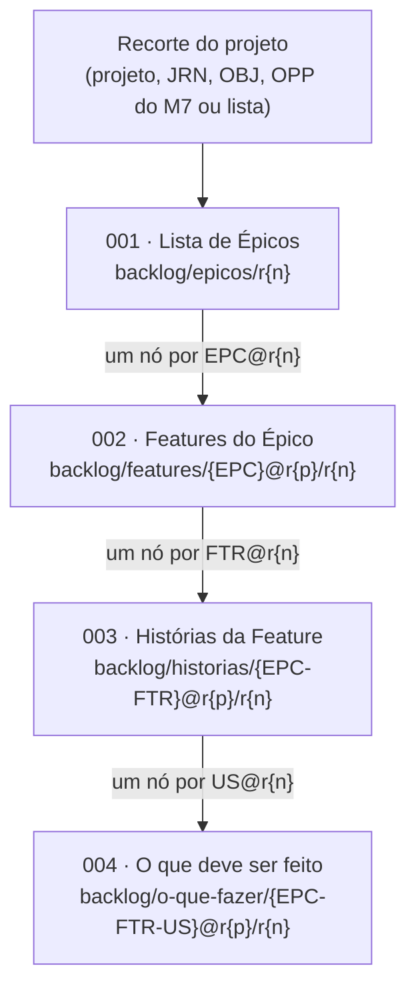

# Backlog do Futuro: visão e contrato da fase

Este documento define o que vale para todas as capacidades da fase **Backlog do Futuro**. Ele complementa o [contrato comum das capacidades](00-contrato-comum-das-capacidades.md), que prevalece em caso de divergência, e o [repositório único de artefatos](00-repositorio-unico-de-artefatos.md). A visão geral da plataforma está na [especificação da plataforma](especificacao-plataforma-jornada-guiada.md) (seções 3 e 3.1).

## 1. Objetivo da fase

Transformar o **projeto definido** — criado no Contexto e definido pelo DarkLab na [ficha do projeto](02-darklab-008-consolidar-ficha-do-projeto.md) — em um backlog refinado e rastreável, em quatro níveis. É a última etapa da jornada **Contexto → DarkLab → Projeto → Backlog**: o Backlog só começa quando o projeto está na etapa `projeto_definido` ([contrato §5.3](00-contrato-comum-das-capacidades.md#53-etapa-do-projeto)).

| Nível | Capacidade | Raiz (pai obrigatório) | Item gerado | Formato do ID |
|---|---|---|---|---|
| 1 | [03-backlog-do-futuro-001-gerar-epicos](03-backlog-do-futuro-001-gerar-epicos.md) | um **recorte** do projeto (seção 4) | Épico | `EPC-NNN` |
| 2 | [03-backlog-do-futuro-002-gerar-features-do-epico](03-backlog-do-futuro-002-gerar-features-do-epico.md) | um Épico em uma revisão (`EPC-NNN@r{p}`) | Feature | `EPC-NNN-FTR-NNN` |
| 3 | [03-backlog-do-futuro-003-gerar-historias-da-feature](03-backlog-do-futuro-003-gerar-historias-da-feature.md) | uma Feature em uma revisão (`EPC-NNN-FTR-NNN@r{p}`) | História | `EPC-NNN-FTR-NNN-US-NNN` |
| 4 | [03-backlog-do-futuro-004-detalhar-o-que-deve-ser-feito](03-backlog-do-futuro-004-detalhar-o-que-deve-ser-feito.md) | uma História em uma revisão (`EPC-NNN-FTR-NNN-US-NNN@r{p}`) | Requisito técnico e task | `REQ-NNN` (local) e `{storyId}-TSK-NNN` |
| — | [03-backlog-do-futuro-005-modo-turbo](03-backlog-do-futuro-005-modo-turbo.md) | o mesmo recorte do nível 1 | árvore completa | manifesto `turboRunManifest` |

Cada execução gera e **refina na mesma execução** todos os itens do seu nível para a raiz recebida, e para no seu nível: Épicos não trazem Features, Features não trazem Histórias, Histórias não trazem tasks e o "o que fazer" não traz código.

## 2. Árvore do backlog

- A árvore é guardada no catálogo como **tabela de adjacência com pai@revisão** (repositório único, seção 3).
- O filho fica **preso à revisão do pai que consumiu** (`{pai}@r{p}`). `p` é o número da revisão da série em que o item pai foi gravado: para um Épico, a revisão da lista de Épicos; para uma Feature, a revisão da série de Features do seu Épico; para uma História, a revisão da série de Histórias da sua Feature. A URI completa do artefato pai acompanha sempre a raiz (`scope.root.artifactUri`), o que elimina ambiguidade entre séries.
- Ao navegar a revisão atual do pai, a aplicação mostra **divergência** quando o filho foi gerado a partir de uma revisão anterior e oferece **Regenerar** o filho.
- Itens removidos em uma revisão nova não aparecem na lista atual; eles e seus descendentes continuam acessíveis pela **árvore histórica**.

## 3. Regras de pai obrigatório

1. Toda geração dos níveis 2, 3 e 4 exige `scope.root = { itemId, artifactUri, revision }`. Sem raiz, a API responde `422` com código `raiz_ausente`.
2. O `itemId` precisa existir na revisão indicada do artefato pai. Caso contrário, `422` com código `raiz_invalida`. A aplicação valida isso **antes** de chamar a IA.
3. O formato do ID do filho deriva do pai: toda Feature gerada para `EPC-003` começa com `EPC-003-FTR-`; toda História para `EPC-003-FTR-001` começa com `EPC-003-FTR-001-US-`; toda task para `EPC-003-FTR-001-US-002` começa com `EPC-003-FTR-001-US-002-TSK-`. A aplicação rejeita a saída que violar essa regra (erro estrutural, com nova tentativa).
4. O botão **Gerar Features**, **Gerar Histórias** ou **Gerar o que fazer** aparece no item da revisão atual quando o usuário tem papel Editor ou Administrador (RF-006). A API também aceita uma revisão histórica explícita do pai, usada em reprodução, retomada do Turbo e regeneração com a mesma revisão de pai.
5. O estado de revisão humana do pai (`não revisado`, `revisado`, `aceito`) **não** condiciona a geração do filho (contrato comum, seção 5.2; RF-010).
6. Uma lista vazia é um resultado válido: grava revisão `succeeded`, com justificativa em `summary` e lacunas em `gaps[]`, e não oferece filhos.

## 4. Recorte da geração de Épicos

O **recorte** define o escopo de negócio examinado pela capacidade 001 e pelo Turbo. Ele é parâmetro da execução (`scope.recorte`), fica registrado em `execucoes/{runId}/execucao.json` e é ecoado em `data.recorte` da saída.

| `tipo` | `ids` | O que entra na análise |
|---|---|---|
| `projeto` | `[]` | O escopo da ficha do projeto (padrão): os `backlogSeeds` com `inScope = true`, os objetivos e o escopo dentro da ficha, e o Upstream ligado a eles. |
| `onda` | um ou mais números de `roadmapWaves[].wave` da ficha | Os `FBK` da onda indicada e o Upstream ligado a eles. |
| `jornada` | um ou mais `JRN-NNN` | As jornadas indicadas, suas etapas, dores, capacidades, processos, políticas e objetivos ligados a elas na base consolidada, mais os itens do DarkLab vinculados a essas jornadas. |
| `objetivo` | um ou mais `OBJ-NNN` | Os objetivos indicados, seus KPIs, problemas, oportunidades, capacidades e jornadas relacionados. |
| `oportunidade` | um ou mais `OPP-NNN` (`futureOpportunities[]`) ou `FBK-NNN` (`futureBacklog[]`) da saída do motor 7 do DarkLab | As oportunidades e os itens do backlog do futuro do [motor 7 · Antecipar](02-darklab-007-motor-7-antecipar-foresight-e-evolucao.md), com as evidências, prioridades, ondas (`RDM`) e gatilhos de revisão (`TRG`) que o motor associou a eles, e os itens de Contexto a que remetem (`linkedIds`). |
| `lista` | IDs explícitos de qualquer entidade de conhecimento (`OBJ`, `PRB`, `OPP`, `CAP`, `JRN`, `POL`, `VST`, `PRC`, `PAIN`, `INS`...) | Exatamente os itens listados e as relações diretas de cada um. |

Regras do recorte:

- A aplicação resolve o recorte **antes** da chamada: valida que os IDs existem nas revisões atuais do snapshot e monta `inputs[]` apenas com o conteúdo pertinente. ID inexistente gera `422` com código `recorte_invalido`.
- Itens do Upstream fora do recorte que a IA precisar mencionar recebem disposição `fora_do_escopo` e entram em `coverage.omittedInputs` com o motivo "fora do recorte".
- **A lista de Épicos é uma série única por projeto** (`backlog/epicos/r{n}`), porque `EPC` é único no projeto. Em uma execução com recorte diferente de `projeto`, a IA devolve somente os Épicos do recorte. Antes de gravar, a aplicação acrescenta à nova revisão os Épicos da revisão-base que estão inteiramente fora do recorte, sem alterar o conteúdo, com `changeType: "mantido"` e `origemNaRevisao: "herdado_fora_do_recorte"`. Assim a revisão atual sempre representa o portfólio inteiro e a numeração nunca colide.
- Para não criar duplicatas, a IA recebe em `previousResult` a lista completa da revisão-base (inclusive o que está fora do recorte), apenas para comparação de duplicidade, sobreposição e numeração.

## 5. Identificadores da fase

Seguem o contrato comum, seção 2. Resumo do que é específico desta fase:

| Item | Formato | Escopo de unicidade | Observação |
|---|---|---|---|
| Épico | `EPC-NNN` | projeto | série única da lista de Épicos |
| Feature | `EPC-NNN-FTR-NNN` | dentro do Épico | o formato legado `FTR-EPC-003-001` é aceito **somente na leitura** e convertido para `EPC-003-FTR-001`; o ID lido fica em `sourceFeatureId` |
| História | `EPC-NNN-FTR-NNN-US-NNN` | dentro da Feature | IDs legados já emitidos (por exemplo `HST-A-003`) são preservados em `legacyIds[]`, nunca como ID canônico |
| Task | `EPC-NNN-FTR-NNN-US-NNN-TSK-NNN` | dentro da História | — |
| Critério de aceite | `AC-NNN` | dentro da História | referência externa `{storyId}#AC-NNN` |
| Requisito da História | `REF-NNN` | dentro da História | referência externa `{storyId}#REF-NNN` |
| Trecho original preservado | `ORIG-NNN` | dentro da História | herdado do legado-03; aponta para `EVD-NNN` do envelope |
| Requisito técnico | `REQ-NNN` | dentro da História (série do "o que fazer") | referência externa `{storyId}#REQ-NNN` |
| Entidades de apoio | `DEP`, `RSK`, `ASM`, `QST`, `RDM`, `REL`, `CHG` e demais prefixos do contrato | projeto | reutilizar o ID quando a entidade já existir no Upstream |

Alocação de números novos: a aplicação reserva em `scope.idBlocks` um bloco de números livres por prefixo de projeto (por exemplo `{ "EPC": { "from": 7, "to": 106 } }`), conforme o [contrato comum §7.1](00-contrato-comum-das-capacidades.md#71-reserva-de-números-scopeidblocks). A IA usa apenas números do bloco e nunca reaproveita um ID retirado. Para `FTR`, `US`, `TSK`, `AC`, `REF`, `REQ` e `ORIG`, o próximo número é calculado a partir da revisão-base do mesmo pai (enviada em `previousResult`).

Identidade entre revisões (contrato comum, seção 2.3): todo item de lista tem `changeType` (`mantido`, `alterado`, `novo`, `dividido`, `fundido`), `relatedIds[]` e `matchReason`. Itens retirados não aparecem na lista atual; eles constam em `data.mudancas[]` com `changeType: "removido"`.

## 6. Natureza, disposições e estados

- **Natureza**: cada afirmação material recebe `documentado`, `inferido`, `hipótese` ou `proposta`. Um item criado pela IA (Épico, Feature, História ou task desenhada a partir das fontes) é `proposta`; ele só é `documentado` quando já existe nas fontes (por exemplo, um portfólio ou backlog enviado). Campos de conteúdo que afirmam fatos (situação atual, resultado esperado, regras, requisitos) carregam natureza própria.
- **Correspondência legada** (contrato comum, seção 3.1): `EXPLICIT`/Explícito → `documentado`; `DERIVED_DIRECTLY`/Derivado tecnicamente → `inferido` com `rationale`; `INFERRED`/Inferido → `inferido`; `HYPOTHESIS` → `hipótese`; Ambíguo → `inferido` com lacuna registrada em `gaps[]` descrevendo as interpretações; `GAP`/Lacuna → `gaps[]`, e o item afetado cita `gapIds[]` (se o item precisar existir, recebe `hipótese`); `FORMAL_DECISION` e `APPROVED_BASELINE` → `documentado`.
- **Disposições** (contrato comum, seção 4): todo item relevante do insumo recebe uma das dez disposições em `data.dispositions[]`. Os códigos legados `MAPPED_TO_EPIC`, `MAPPED_TO_CONTEXT`, `CONTEXT_ONLY`, `DUPLICATE`, `OVERLAP`, `CONFLICT`, `OUT_OF_SCOPE`, `OPEN_QUESTION`, `DEFERRED` e `UNRESOLVED` correspondem, na ordem, a `mapeado_ao_item`, `mapeado_ao_contexto`, `somente_contexto`, `duplicado`, `sobreposto`, `conflitante`, `fora_do_escopo`, `questao_aberta`, `adiado` e `nao_resolvido`.
- **Estados**: execução usa os estados técnicos do contrato (`pending`, `running`, `succeeded`, `failed`, `cancelled`, `skipped`; `partial` só no agregado do Turbo). A leitura editorial usa o estado de revisão humana (`não revisado`, `revisado`, `aceito`), que é metadado do catálogo e não faz parte do envelope. Os estados legados `PROPOSTO` e `APROVADO` foram substituídos por esse estado de revisão humana e não aparecem em nenhum schema desta fase.

## 7. Insumos comuns da fase

Toda capacidade da fase recebe no `inputsSnapshot` as entradas atuais e elegíveis do `indice/manifesto.json`, filtradas pelo recorte ou pela raiz:

| Origem | URI | Uso principal |
|---|---|---|
| Ficha do projeto | `repo://projetos/{projectId}/darklab/02-darklab-008-consolidar-ficha-do-projeto/{escopo}/r{n}/saida.json` (ver [02-darklab-008-consolidar-ficha-do-projeto](02-darklab-008-consolidar-ficha-do-projeto.md)) | **obrigatória**: escopo, objetivos, ondas e sementes do backlog; a revisão consumida fica registrada em cada Épico |
| Base consolidada do Contexto | `repo://projetos/{projectId}/contexto/01-contexto-002-consolidar-contexto/{escopo}/r{n}/saida.json` (ver [01-contexto-002](01-contexto-002-consolidar-contexto.md)) | entidades com ID (`OBJ`, `KPI`, `PRB`, `OPP`, `STK`, `DOM`, `CAP`, `JRN`, `PRC`, `POL`, `CON`, `RSK`, `RUL`, `PAIN`...), evidências `EVD` e lacunas |
| Demais saídas do Contexto | `repo://projetos/{projectId}/contexto/{capabilityId}/{escopo}/r{n}/saida.json` das capacidades 01-contexto-003 a 01-contexto-010 (jornadas AS IS/TO BE, ciclos de vida, Ishikawa, hipóteses, blueprint TO BE, arquitetura, sequências funcionais e wireframes), localizadas pelo manifesto | etapas e momentos críticos de jornada, estados, causas, hipóteses `HIP`, componentes `CMP`, sequências `SEQ`, telas `WFR` |
| DarkLab | `repo://projetos/{projectId}/darklab/{capabilityId}/{escopo}/r{n}/saida.json` (ver [visão do DarkLab](02-darklab-000-visao-e-contrato-da-fase.md)) | M3 [visão e roadmap](02-darklab-003-motor-3-direcionar-estrategia-e-visao-de-produto.md), M4 [design e backlog preparado](02-darklab-004-motor-4-materializar-design-e-ativos-digitais.md), M5 [MVP](02-darklab-005-motor-5-construir-mvp-e-validacao.md) e principalmente M7 [backlog do futuro com evidências, prioridades e gatilhos de revisão](02-darklab-007-motor-7-antecipar-foresight-e-evolucao.md) |
| Backlog | `repo://projetos/{projectId}/backlog/...` (seção 2) | o pai na revisão fixada e a revisão-base do próprio resultado |

Ausência de uma saída opcional do Contexto ou do DarkLab não impede a execução: vira lacuna em `gaps[]` e limite em `coverage.limits`. A ficha do projeto e a base consolidada do Contexto são obrigatórias para a capacidade 001 e para o Turbo da fase.

## 8. Regeneração

- Entrada: alvo (série e revisão-base), `feedback` opcional, `inputPolicy` (`same_snapshot`, padrão, ou `current_inputs`) e, nos níveis 2 a 4, a política de pai: **manter** a revisão do pai já consumida ou **atualizar** para a revisão atual do pai, quando o item ainda existir nela.
- Ao atualizar o pai, a nova revisão nasce em outra série (`{pai}@r{novo}`), mas recebe em `previousResult` a revisão-base da série antiga para preservar IDs.
- A regeneração entrega sempre a lista **completa** do nível para a raiz, com `changeType` em cada item e o histórico em `data.mudancas[]`. Um pedido genérico ("gere de novo") revisa a lista inteira pelos critérios de fronteira, cobertura e refinamento; se não houver mudança material sustentada, os itens saem como `mantido`, `data.mudancas` fica `[]` e `data.revisionSummary` explica o que foi verificado.
- Nenhuma revisão é sobrescrita. Filhos anteriores permanecem ligados à revisão do pai que consumiram.

## 9. Saída e schemas

- Toda capacidade devolve o envelope único do contrato comum (seção 6). O conteúdo específico fica em `data`, validado por um JSON Schema draft 2020-12 publicado em `https://jornada-guiada/schemas/<capabilityId>/1.0.0/data.json`.
- `coverage` existe só no envelope. A cobertura específica de cada nível fica em `data.coverageMatrix` (linhas `{ itemId, coveredBy[], status, ... }`).
- Os schemas de `data` referenciam `natureza`, `disposicao`, `changeType`, `afirmacao` e `itemVersionado` em `https://jornada-guiada/schemas/comum/1.0.0/envelope.json#/$defs/...`. Nos objetos principais, todos os campos (inclusive `natureza`, `evidenceIds`, `rationale`, `gapIds`, `changeType`, `relatedIds` e `matchReason`) são declarados localmente em `properties`, e as regras condicionais vêm por `allOf` com os `$ref` comuns. Isso permite `additionalProperties: false` sem rejeitar campos definidos no contrato.
- Validações que o JSON Schema não expressa são feitas pela aplicação: prefixo do ID do filho igual ao ID do pai, resolução de toda referência (`evidenceIds` em `evidenceRefs`, `gapIds` em `gaps`, `REF`/`AC`/`REQ` dentro da História), inversão `REQ.taskIds` ↔ `TSK.requirementIds`, unicidade de IDs e preservação dos IDs da revisão-base.

## 10. Renderização feita pela aplicação

A IA devolve **somente JSON**. Os documentos legados descreviam visões em Markdown que agora a aplicação gera a partir de `data` e do catálogo:

| Visão | Origem legada | Capacidade | Mapeamento |
|---|---|---|---|
| Lista de Épicos refinados, **21 seções** | legado-01, seção 41 | 001 | seção "Renderização na aplicação" de [001](03-backlog-do-futuro-001-gerar-epicos.md) |
| Features do Épico, **7 blocos** e ficha de Feature com **9 elementos** | legado-02, seções 6 e 9 | 002 | seção "Renderização na aplicação" de [002](03-backlog-do-futuro-002-gerar-features-do-epico.md) |
| História refinada, **27 seções** | legado-03, seção 9 | 003 | seção "Renderização na aplicação" de [003](03-backlog-do-futuro-003-gerar-historias-da-feature.md) |
| Matriz de requisitos, tasks e conferência, **5 blocos** e ficha de task com **11 elementos** | legado-04, seções 7 e 10 | 004 | seção "Renderização na aplicação" de [004](03-backlog-do-futuro-004-detalhar-o-que-deve-ser-feito.md) |

Regras comuns da renderização:

- O campo legado **Estado do resultado** passa a mostrar o **estado de revisão humana** lido do catálogo.
- Contagens, percentuais e totais exibidos são recalculados pela aplicação a partir de `data`; se divergirem do valor enviado pela IA, vale o recalculado e a aplicação registra aviso.
- Seções e subseções sem conteúdo são omitidas, sem marcadores como "N/A" ou "Nenhum".
- Natureza aparece como selo ao lado de cada afirmação; `hipótese` e `proposta` têm destaque visual distinto de `documentado` e `inferido`.
- Toda referência (`EVD`, `GAP`, `QST`, IDs de entidades e de itens do backlog) vira link interno navegável; nenhum HTML ativo é renderizado.

## 11. Mapeamento dos documentos legados para esta fase

| Legado | Conceito legado | Nesta fase |
|---|---|---|
| [legado-01](referencias/legado-01-criar-epicos.md) | `epicDiscoveryPackage` (schema 3.0.0) | envelope único + `data` da capacidade 001 (schema 1.0.0) |
| legado-01 | `artifact.status` `PROPOSTO`/`APROVADO`, Caso 19 (aprovação) | removidos; substituídos pelo estado de revisão humana do catálogo |
| legado-01 | `artifact.packageId`, `correlationId`, `revision`, `previousRevision`, `generation.*` | campos de runtime do envelope (`runId`, `revision`, `inputsSnapshot`) e metadados do catálogo |
| legado-01 | `sources[]` com autoridade e confiabilidade (seção 16) | `evidenceRefs` do envelope + `data.sourceAssessments[]` |
| legado-01 | coleções de conhecimento (`objectives`, `problems`, `capabilities`...) | reutilização das entidades da base consolidada do Contexto; entidades novas em `data.complementaryEntities[]` |
| legado-01 | `coverage` dentro do pacote | `data.coverageMatrix` |
| legado-01 | `changes[]` com `ADDED`, `UPDATED`, `SPLIT`, `MERGED`, `REMOVED` | `changeType` de cada item (`novo`, `alterado`, `dividido`, `fundido`, `mantido`) e `data.mudancas[]` (incluindo `removido`) |
| legado-01 | confiança `HIGH`/`MEDIUM`/`LOW`/`UNDETERMINED` | `alta`/`média`/`baixa`/`indeterminada` |
| legado-01 | avaliação de fronteira `APPROPRIATE`, `SPLIT_RECOMMENDED`, `MERGE_RECOMMENDED`, `BOUNDARY_UNCLEAR`, `INSUFFICIENT_EVIDENCE` | `adequado`, `divisao_recomendada`, `fusao_recomendada`, `fronteira_incerta`, `evidencia_insuficiente` |
| legado-01 | modos de operação (seção 15) | `data.mode` com códigos em português |
| legado-01 | 19 tipos de relação (seção 13) | mantidos como códigos em `data.relations[]` (por exemplo `SUPERSEDES`, que o contrato usa em divisão e fusão) |
| [legado-02](referencias/legado-02-criar-features.md) | `featureDiscoveryPackage` (2.0.0), ID `FTR-EPC-003-001` | `data` da capacidade 002, ID `EPC-003-FTR-001` |
| legado-02 | tipo `FUNCIONAL`/`HABILITADORA`/`CONTROLE` | `funcional`/`habilitadora`/`controle` |
| [legado-03](referencias/legado-03-criar-historias.md) | `storyDiscoveryPackage` (3.0.0), `AC-01`, natureza Explícito/Derivado/Inferido/Lacuna | `data` da capacidade 003, `AC-001`, natureza do contrato |
| legado-03 | categoria de cenário Principal/Alternativo/Exceção | `principal`/`alternativo`/`excecao` |
| [legado-04](referencias/legado-04-criar-o-que-fazer.md) | `taskDefinitionPackage` (1.0.0), natureza Ambíguo | `data` da capacidade 004; Ambíguo → `inferido` + `gaps[]` com interpretações |
| legado-04 | `coverage` (totais de requisitos) | `data.coverageMatrix` (linhas por `REQ`) e `data.requirementCoverage` (totais) |
| legado-04 | operação `Criar`/`Alterar`/`Validar` | `criar`/`alterar`/`validar` |
| todos | visão humana em Markdown | renderização pela aplicação a partir do JSON (seção 10) |
| todos | "gere de novo" na conversa | ação **Regenerar** com feedback opcional (seção 8) |
| todos | pedir ao usuário qual Épico/Feature/História usar quando ambíguo | a raiz chega sempre resolvida pela UI/API; raiz ausente ou inválida é rejeitada antes da IA (seção 3) |

## 12. Critérios de aceite da fase

1. Nenhuma geração filha é executada sem raiz válida (`itemId` presente na revisão indicada do pai).
2. Todo ID gerado segue o formato hierárquico de 3 dígitos e começa com o ID do pai.
3. Nenhum schema, saída ou renderização contém estado ou campo de aprovação; a leitura editorial usa apenas o estado de revisão humana do catálogo.
4. `coverage` só aparece no envelope; nenhum `data` tem campo `coverage`.
5. Regenerar mantém os IDs dos itens correspondentes e registra `changeType` em todos os itens.
6. Toda revisão gravada fica disponível imediatamente para consumo pelo nível seguinte e pelo Turbo, sem aceite humano.
7. Nenhum Épico é gerado sem ficha do projeto com prontidão diferente de `insuficiente`; todo Épico registra a revisão da ficha que consumiu e carrega o `projectId` do projeto criado no Contexto.
