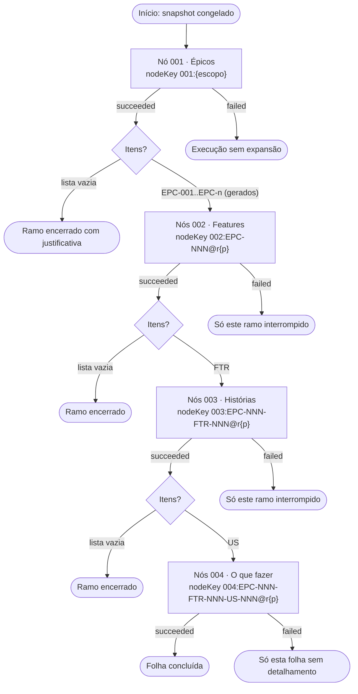
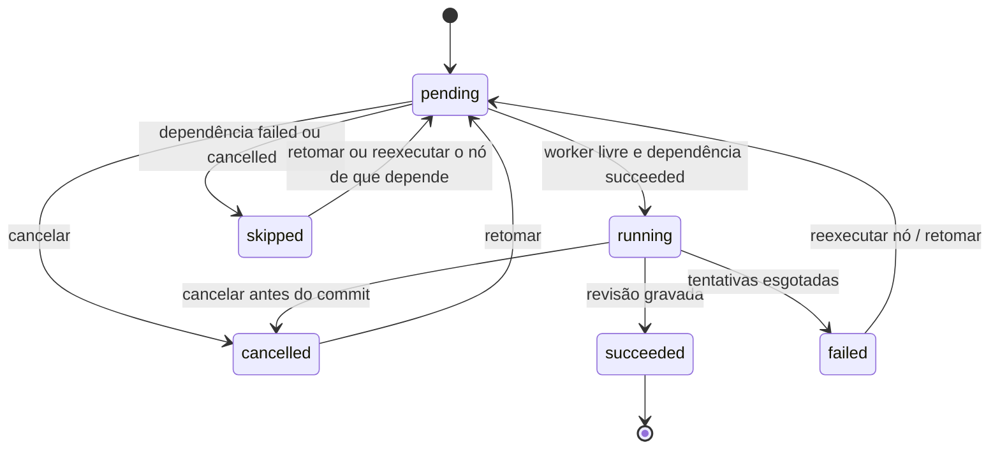

# Modo Turbo do Backlog do Futuro

## Objetivo

Gerar a árvore completa do backlog em uma única execução orquestrada: **Épicos → Features de cada Épico → Histórias de cada Feature → "o que fazer" de cada História**. O Turbo não tem prompt próprio: cada nó executa a capacidade do seu nível ([001](03-backlog-do-futuro-001-gerar-epicos.md), [002](03-backlog-do-futuro-002-gerar-features-do-epico.md), [003](03-backlog-do-futuro-003-gerar-historias-da-feature.md), [004](03-backlog-do-futuro-004-detalhar-o-que-deve-ser-feito.md)) com o mesmo contrato da geração sob demanda. O que muda é a orquestração: expansão dinâmica pela saída de cada pai, concorrência limitada, isolamento de falhas por ramo, controle de cancelamento, reexecução e retomada, e o manifesto `turboRunManifest` ([contrato comum](00-contrato-comum-das-capacidades.md), seção 11).

Fora do Turbo, a mesma árvore é construída **sob demanda por item**: **Gerar Épicos** no recorte, **Gerar Features** em cada Épico, **Gerar Histórias** em cada Feature e **Gerar o que fazer** em cada História (RF-006). Nos dois modos, cada nível exige o pai (visão da fase, seção 3).

## Pré-condições

0. Projeto na etapa `projeto_definido` (ficha do projeto com prontidão diferente de `insuficiente`); sem ela, `422 projeto_nao_definido`.
1. Existe revisão atual de `01-contexto-002-consolidar-contexto` (pré-condição do nó raiz); sem ela, `422 contexto_ausente`.
2. Recorte válido (visão da fase, seção 4). Se `raiz` for informada, o item existe na revisão indicada.
3. Papel Editor ou Administrador.
4. Não há outro Turbo do Backlog `running` para o mesmo projeto e o mesmo recorte (proposta: `409 turbo_em_andamento`, para evitar duas árvores concorrentes sobre a mesma série de Épicos).

## Insumos

| Insumo | Origem | Uso |
|---|---|---|
| Parâmetros | `POST /projects/{projectId}/runs` com `capabilityId: "03-backlog-do-futuro-005-modo-turbo"` | `recorte`, `raiz` (opcional), `profundidade` (padrão `o-que-fazer`), `pesosPrioridade` (repassado ao nó 001) |
| Snapshot | congelado no início, a partir de `repo://projetos/{projectId}/indice/manifesto.json` | todas as revisões de Contexto e DarkLab elegíveis; os nós do Backlog acrescentam ao snapshot apenas as revisões que a própria execução produziu |
| Saídas dos nós | `repo://projetos/{projectId}/backlog/epicos/r{n}/saida.json`, `backlog/features/{EPC}@r{p}/r{n}/saida.json`, `backlog/historias/{EPC-FTR}@r{p}/r{n}/saida.json`, `backlog/o-que-fazer/{EPC-FTR-US}@r{p}/r{n}/saida.json` | fonte da expansão do nível seguinte |
| Limites da plataforma (proposta) | configuração por projeto | concorrência (8 nós simultâneos), tentativas por nó (3, com recuo exponencial), teto de nós por execução (2.000), teto de custo por execução |
| Manifesto | `repo://projetos/{projectId}/execucoes/{runId}/manifesto-turbo.json` e `execucoes/{runId}/nos/{nodeKey}/tentativa-{k}.json` | estado da execução, persistido a cada transição |

## Instruções para a IA

O Turbo é executado pelo **orquestrador**, não pela IA. Não há prompt de sistema próprio: cada nó envia à IA o prompt da capacidade correspondente, com a entrada canônica montada pelo orquestrador. As regras do orquestrador, em formato de referência:

```text
ORQUESTRADOR DO MODO TURBO · BACKLOG DO FUTURO

1. Congele o snapshot. Crie o nó raiz N0 = 03-backlog-do-futuro-001-gerar-epicos com nodeKey "03-backlog-do-futuro-001-gerar-epicos:{escopo}" (escopo = "projeto" ou "{tipo}-{ids unidos por '+'}", por exemplo "jornada-JRN-001"). Se "raiz" foi informada, comece no nível da raiz (seção "Passo a passo", item 2).
2. Ao concluir um nó com succeeded, leia a saída gravada (outputUri, outputRevision) e crie um nó filho por item do nível:
   - 001 → um nó 002 por Épico com origemNaRevisao "gerado";
   - 002 → um nó 003 por Feature;
   - 003 → um nó 004 por História;
   - 004 → nenhum filho (folha).
   Cada filho recebe scope.root = { itemId, artifactUri: outputUri do pai, revision: outputRevision do pai }, dependsOn = [nodeKey do pai] e nodeKey = "{capabilityId}:{itemId}@r{outputRevision do pai}".
3. Lista vazia válida (succeeded com zero itens) encerra o ramo: nenhum filho é criado; a justificativa fica no summary e nos gaps da saída do nó.
4. Respeite a profundidade: não crie filhos de nível além de "profundidade".
5. Execute no máximo C nós ao mesmo tempo (C configurável). Entre os nós pending prontos, priorize o nível mais profundo e, no mesmo nível, a ordem de criação (fecha ramos completos mais cedo e limita a fila).
6. Falha técnica de um nó após as tentativas: status failed com error { code, message }. Nenhum filho é criado para ele. Nós já materializados que dependem dele vão para skipped com skipReason. Todos os demais ramos continuam.
7. Cancelamento: nós pending → cancelled; nós running terminam a tentativa corrente e não gravam se o cancelamento chegar antes do commit; nenhuma expansão nova.
8. O filho fica preso à revisão produzida pelo nó pai desta execução, mesmo que outra execução crie revisão mais recente do pai.
9. Idempotência: a chave de idempotência do nó é (projectId, nodeKey, snapshotId). Repetir a mesma chave reutiliza a revisão já gravada; mesma chave com payload diferente é conflito.
10. Persista o manifesto a cada transição de estado e recalcule status agregado e phaseOptions.levelCounts.
```

## Passo a passo

1. **Criação da execução.** A API valida acesso, recorte, raiz e limites; congela o snapshot; grava `execucao.json` e o manifesto com `status: pending`; responde `202` com `runId`.
2. **Ponto de partida.**
   - Sem `raiz`: nó 001 no recorte.
   - `raiz` = um Épico `EPC-NNN@r{p}` existente: o Turbo começa em um nó 002 para esse Épico (subárvore).
   - `raiz` = uma Feature `EPC-NNN-FTR-NNN@r{p}`: começa em um nó 003.
   - `raiz` = uma História: começa em um nó 004.
3. **Expansão dinâmica.** A cada nó `succeeded`, o orquestrador cria os filhos conforme as regras 2 a 4 do orquestrador. No recorte parcial, os Épicos `herdado_fora_do_recorte` acrescentados pela aplicação **não** são expandidos.
4. **Execução dos nós.** Cada nó monta a entrada canônica da sua capacidade (com `scope.root` e as revisões do snapshot), chama a IA, valida, grava a revisão e registra `outputUri`/`outputRevision` no manifesto. Cada revisão gravada fica disponível imediatamente no catálogo e na árvore (RF-010), antes do fim do Turbo.
5. **Isolamento de falhas.** A falha de um nó interrompe somente o seu ramo; irmãos e primos seguem.
6. **Encerramento.** Quando não restam nós `pending` ou `running`, o agregado é calculado (contrato comum, seção 5.1): `succeeded` se todos os nós `succeeded`; `partial` se há ao menos um `succeeded` e ao menos um `failed`/`skipped`/`cancelled`; `failed` se nenhum `succeeded`; `cancelled` se cancelado pelo usuário. O usuário vê o balanço por nível, os artefatos concluídos, as falhas acionáveis e pode regenerar qualquer resultado.



Estados de um nó:



## Saída

O Turbo produz o `turboRunManifest` do contrato comum (seção 11), com `phase: "backlog-do-futuro"`. Específico desta fase:

- `nodes[].nodeKey` = `capabilityId` + `:` + `itemId@r{revisão do pai}` (no nó 001, `capabilityId:{escopo}`). Dentro de uma execução cada pai está preso a uma única revisão, o que torna o `nodeKey` único; entre execuções, a idempotência usa também o `snapshotId`.
- `nodes[].scope` = `{ "root": { "itemId", "artifactUri", "revision" } }` (nos nós 002 a 004) ou `{ "recorte": {...} }` (no nó 001).
- `phaseOptions.levelCounts` conta os **itens produzidos** pelos nós `succeeded` desta execução: `epicos` (Épicos `gerado` da revisão produzida pelo nó 001), `features`, `historias` e `tasks` (tasks `TSK` de todos os nós 004).
- O manifesto não recebe campos fora do schema comum; os parâmetros específicos ficam em `phaseOptions`, que o schema comum deixa aberto. Schema dos campos adicionais de `phaseOptions` nesta fase:

```json
{
  "$schema": "https://json-schema.org/draft/2020-12/schema",
  "$id": "https://jornada-guiada/schemas/03-backlog-do-futuro-005-modo-turbo/1.0.0/phase-options.json",
  "type": "object",
  "required": ["batchId", "levelCounts", "recorte", "raiz", "profundidade", "limites", "nodeCountsPorNivel", "expansaoInterrompida"],
  "properties": {
    "batchId": { "type": ["string", "null"] },
    "levelCounts": {
      "type": "object",
      "additionalProperties": false,
      "required": ["epicos", "features", "historias", "tasks"],
      "properties": {
        "epicos": { "type": "integer", "minimum": 0 },
        "features": { "type": "integer", "minimum": 0 },
        "historias": { "type": "integer", "minimum": 0 },
        "tasks": { "type": "integer", "minimum": 0 }
      }
    },
    "recorte": {
      "type": "object",
      "additionalProperties": false,
      "required": ["tipo", "ids"],
      "properties": {
        "tipo": { "enum": ["projeto", "jornada", "objetivo", "oportunidade", "lista"] },
        "ids": { "type": "array", "items": { "type": "string", "pattern": "^[A-Z]{2,4}-\\d{3,}$" } }
      }
    },
    "raiz": {
      "type": ["object", "null"],
      "additionalProperties": false,
      "required": ["itemId", "artifactUri", "revision"],
      "properties": {
        "itemId": { "type": "string", "pattern": "^EPC-\\d{3,}(-FTR-\\d{3,}(-US-\\d{3,})?)?$" },
        "artifactUri": { "type": "string", "pattern": "^repo://projetos/" },
        "revision": { "type": "integer", "minimum": 1 }
      }
    },
    "profundidade": { "enum": ["epicos", "features", "historias", "o-que-fazer"] },
    "limites": {
      "type": "object",
      "additionalProperties": false,
      "required": ["concorrencia", "tentativasPorNo", "maxNos"],
      "properties": {
        "concorrencia": { "type": "integer", "minimum": 1 },
        "tentativasPorNo": { "type": "integer", "minimum": 1 },
        "maxNos": { "type": "integer", "minimum": 1 }
      }
    },
    "nodeCountsPorNivel": {
      "type": "object",
      "additionalProperties": false,
      "required": ["epicos", "features", "historias", "oQueFazer"],
      "properties": {
        "epicos": { "$ref": "#/$defs/contagem" },
        "features": { "$ref": "#/$defs/contagem" },
        "historias": { "$ref": "#/$defs/contagem" },
        "oQueFazer": { "$ref": "#/$defs/contagem" }
      }
    },
    "expansaoInterrompida": {
      "type": ["object", "null"],
      "additionalProperties": false,
      "required": ["motivo", "em"],
      "properties": { "motivo": { "enum": ["max_nos", "limite_de_custo", "cancelamento"] }, "em": { "type": "string", "format": "date-time" } }
    }
  },
  "$defs": {
    "contagem": {
      "type": "object",
      "additionalProperties": false,
      "required": ["pending", "running", "succeeded", "failed", "cancelled", "skipped"],
      "properties": {
        "pending": { "type": "integer", "minimum": 0 }, "running": { "type": "integer", "minimum": 0 }, "succeeded": { "type": "integer", "minimum": 0 },
        "failed": { "type": "integer", "minimum": 0 }, "cancelled": { "type": "integer", "minimum": 0 }, "skipped": { "type": "integer", "minimum": 0 }
      }
    }
  }
}
```

## Regras de qualidade e guardrails

1. **Pai obrigatório em cada nível.** Nenhum nó 002, 003 ou 004 é criado sem `scope.root` apontando para a revisão produzida pelo pai.
2. **Mesmo contrato da geração sob demanda.** Cada nó usa o prompt, o schema, as validações e a gravação da sua capacidade; o Turbo não altera conteúdo.
3. **Snapshot fixo.** Todos os nós usam o snapshot congelado no início; revisões de Contexto e DarkLab criadas durante a execução não entram.
4. **Concorrência limitada** e prioridade por profundidade (proposta), sem dois nós com o mesmo `nodeKey` simultâneos.
5. **Isolamento por ramo.** A falha de um nó afeta somente seus descendentes.
6. **Teto de expansão.** Ao atingir `maxNos` ou o teto de custo, nenhum nó novo é criado; os nós já criados terminam; `expansaoInterrompida` registra o motivo e o agregado fica `partial`. O usuário pode continuar a partir de qualquer item com a geração sob demanda ou com um novo Turbo com `raiz`.
7. **Sem aceite humano.** O estado de revisão humana não interfere na expansão; toda revisão gravada é consumida imediatamente pelo nível seguinte.
8. **Guardrails da IA** (contrato comum, seção 10) valem em cada nó, pelo prompt da capacidade.

## Renderização na aplicação

- **Painel da execução**: barra por nível com `nodeCountsPorNivel` (pendentes, em execução, concluídos, falhos, cancelados, pulados) e `levelCounts` (itens produzidos: Épicos, Features, Histórias, tasks), duração e custo agregados.
- **Árvore ao vivo**: cada nó aparece sob o pai, com estado, tentativas e link para a revisão gravada; ramos encerrados por lista vazia mostram a justificativa (`summary` e `gaps` da saída do nó); ramos com falha mostram `error.code` e `error.message` acionáveis, distinguindo erro operacional de lacuna de evidência.
- **Ações**: **Cancelar** (Editor ou Administrador; outra pessoa só o Administrador), **Reexecutar nó** em nós `failed`, **Retomar** a execução, e **Regenerar** em qualquer artefato concluído (fora do Turbo).
- **Diagrama**: a aplicação gera o `flowchart` Mermaid da árvore efetiva a partir de `nodes[]` (`dependsOn`), sanitizado antes de renderizar.

## Tratamento de falhas e lacunas

| Situação | Tratamento |
|---|---|
| Nó 001 falha | nenhuma expansão; agregado `failed`; **Reexecutar nó** ou **Retomar**. |
| Nó 002, 003 ou 004 falha | só aquele ramo para; demais seguem; agregado `partial` ao final. Como a expansão é dinâmica, os descendentes de um nó falho ainda não existem e não são criados; os que já estavam materializados e dependem dele vão para `skipped` com `skipReason: "dependência falhou: {nodeKey}"`. |
| Lista vazia válida | nó `succeeded`, ramo encerrado com justificativa; não conta como falha. |
| Erro estrutural persistente da IA | nó `failed` com `saida_invalida` e a mensagem de validação. |
| Timeout ou indisponibilidade do provedor | tentativas com recuo; esgotadas, `failed` com `provedor_indisponivel`. |
| Cancelamento | pendentes `cancelled`; em execução terminam a tentativa e não gravam se o cancelamento chegar antes do commit; revisões já gravadas permanecem válidas e visíveis. |
| **Reexecutar nó** | nova tentativa só do nó `failed` e dos seus dependentes `skipped`; ao concluir com sucesso, a expansão continua a partir dele normalmente. |
| **Retomar** | reaproveita os nós `succeeded` e o mesmo snapshot; executa `failed`, `skipped` e `cancelled`; nós `succeeded` cujos filhos não chegaram a ser criados (cancelamento entre o commit e a expansão) são expandidos a partir da revisão registrada no manifesto. |
| Pai regenerado por outra execução durante o Turbo | não afeta o Turbo: os filhos ficam presos à revisão produzida pelo nó pai desta execução; a árvore mostra a divergência depois. |
| Teto de nós ou de custo atingido | `expansaoInterrompida`, agregado `partial`. |

## Critérios de aceite da capacidade

1. Um Turbo sem falhas produz exatamente um nó 002 por Épico gerado, um nó 003 por Feature e um nó 004 por História, cada um com `scope.root` na revisão produzida pelo pai.
2. `nodeKey` segue `capabilityId:itemId@r{p}` (e `capabilityId:{escopo}` no nó 001) e é único na execução.
3. A falha de um nó 002 não impede a conclusão dos ramos dos outros Épicos; o agregado termina `partial`.
4. Uma lista vazia encerra o ramo com o nó em `succeeded` e justificativa visível.
5. Cancelar, reexecutar nó e retomar obedecem ao contrato comum (seção 11); retomar não regrava nós `succeeded`.
6. `levelCounts` confere com a soma de itens das revisões gravadas pela execução.
7. Toda revisão gravada aparece no catálogo e na árvore antes do fim do Turbo, com `reviewState: "não revisado"`.

## Exemplo mínimo de saída

Recorte `projeto`, dois Épicos. O ramo de `EPC-001` vai até a folha; a Feature `EPC-001-FTR-002` não sustentou Histórias (lista vazia válida); o nó de Features de `EPC-002` falhou. Agregado `partial`.

```json
{
  "schemaVersion": "1.0.0",
  "capabilityId": "03-backlog-do-futuro-005-modo-turbo",
  "runId": "run_01JBT005",
  "projectId": "prj_01JDEMO",
  "phase": "backlog-do-futuro",
  "status": "partial",
  "snapshotId": "snp_01JBT005",
  "startedAt": "2026-11-18T16:00:00Z",
  "finishedAt": "2026-11-18T16:21:40Z",
  "nodes": [
    {
      "nodeKey": "03-backlog-do-futuro-001-gerar-epicos:projeto",
      "capabilityId": "03-backlog-do-futuro-001-gerar-epicos",
      "scope": { "recorte": { "tipo": "projeto", "ids": [] } },
      "dependsOn": [],
      "status": "succeeded",
      "attempts": 1,
      "outputUri": "repo://projetos/prj_01JDEMO/backlog/epicos/r1/saida.json",
      "outputRevision": 1,
      "error": null,
      "skipReason": null
    },
    {
      "nodeKey": "03-backlog-do-futuro-002-gerar-features-do-epico:EPC-001@r1",
      "capabilityId": "03-backlog-do-futuro-002-gerar-features-do-epico",
      "scope": { "root": { "itemId": "EPC-001", "artifactUri": "repo://projetos/prj_01JDEMO/backlog/epicos/r1/saida.json", "revision": 1 } },
      "dependsOn": ["03-backlog-do-futuro-001-gerar-epicos:projeto"],
      "status": "succeeded",
      "attempts": 1,
      "outputUri": "repo://projetos/prj_01JDEMO/backlog/features/EPC-001@r1/r1/saida.json",
      "outputRevision": 1,
      "error": null,
      "skipReason": null
    },
    {
      "nodeKey": "03-backlog-do-futuro-002-gerar-features-do-epico:EPC-002@r1",
      "capabilityId": "03-backlog-do-futuro-002-gerar-features-do-epico",
      "scope": { "root": { "itemId": "EPC-002", "artifactUri": "repo://projetos/prj_01JDEMO/backlog/epicos/r1/saida.json", "revision": 1 } },
      "dependsOn": ["03-backlog-do-futuro-001-gerar-epicos:projeto"],
      "status": "failed",
      "attempts": 3,
      "outputUri": null,
      "outputRevision": null,
      "error": { "code": "saida_invalida", "message": "features[0].id 'EPC-001-FTR-001' não começa com o ID do pai EPC-002 após 3 tentativas. Use Reexecutar nó." },
      "skipReason": null
    },
    {
      "nodeKey": "03-backlog-do-futuro-003-gerar-historias-da-feature:EPC-001-FTR-001@r1",
      "capabilityId": "03-backlog-do-futuro-003-gerar-historias-da-feature",
      "scope": { "root": { "itemId": "EPC-001-FTR-001", "artifactUri": "repo://projetos/prj_01JDEMO/backlog/features/EPC-001@r1/r1/saida.json", "revision": 1 } },
      "dependsOn": ["03-backlog-do-futuro-002-gerar-features-do-epico:EPC-001@r1"],
      "status": "succeeded",
      "attempts": 1,
      "outputUri": "repo://projetos/prj_01JDEMO/backlog/historias/EPC-001-FTR-001@r1/r1/saida.json",
      "outputRevision": 1,
      "error": null,
      "skipReason": null
    },
    {
      "nodeKey": "03-backlog-do-futuro-003-gerar-historias-da-feature:EPC-001-FTR-002@r1",
      "capabilityId": "03-backlog-do-futuro-003-gerar-historias-da-feature",
      "scope": { "root": { "itemId": "EPC-001-FTR-002", "artifactUri": "repo://projetos/prj_01JDEMO/backlog/features/EPC-001@r1/r1/saida.json", "revision": 1 } },
      "dependsOn": ["03-backlog-do-futuro-002-gerar-features-do-epico:EPC-001@r1"],
      "status": "succeeded",
      "attempts": 1,
      "outputUri": "repo://projetos/prj_01JDEMO/backlog/historias/EPC-001-FTR-002@r1/r1/saida.json",
      "outputRevision": 1,
      "error": null,
      "skipReason": null
    },
    {
      "nodeKey": "03-backlog-do-futuro-004-detalhar-o-que-deve-ser-feito:EPC-001-FTR-001-US-001@r1",
      "capabilityId": "03-backlog-do-futuro-004-detalhar-o-que-deve-ser-feito",
      "scope": { "root": { "itemId": "EPC-001-FTR-001-US-001", "artifactUri": "repo://projetos/prj_01JDEMO/backlog/historias/EPC-001-FTR-001@r1/r1/saida.json", "revision": 1 } },
      "dependsOn": ["03-backlog-do-futuro-003-gerar-historias-da-feature:EPC-001-FTR-001@r1"],
      "status": "succeeded",
      "attempts": 2,
      "outputUri": "repo://projetos/prj_01JDEMO/backlog/o-que-fazer/EPC-001-FTR-001-US-001@r1/r1/saida.json",
      "outputRevision": 1,
      "error": null,
      "skipReason": null
    }
  ],
  "phaseOptions": {
    "batchId": null,
    "levelCounts": { "epicos": 2, "features": 2, "historias": 1, "tasks": 2 },
    "recorte": { "tipo": "projeto", "ids": [] },
    "raiz": null,
    "profundidade": "o-que-fazer",
    "limites": { "concorrencia": 8, "tentativasPorNo": 3, "maxNos": 2000 },
    "nodeCountsPorNivel": {
      "epicos": { "pending": 0, "running": 0, "succeeded": 1, "failed": 0, "cancelled": 0, "skipped": 0 },
      "features": { "pending": 0, "running": 0, "succeeded": 1, "failed": 1, "cancelled": 0, "skipped": 0 },
      "historias": { "pending": 0, "running": 0, "succeeded": 2, "failed": 0, "cancelled": 0, "skipped": 0 },
      "oQueFazer": { "pending": 0, "running": 0, "succeeded": 1, "failed": 0, "cancelled": 0, "skipped": 0 }
    },
    "expansaoInterrompida": null
  }
}
```

Leitura do exemplo: o nó `EPC-001-FTR-002@r1` terminou `succeeded` com `stories: []` e encerrou o ramo; o nó `EPC-002@r1` falhou e só o ramo de `EPC-002` ficou sem Features; **Reexecutar nó** sobre ele cria a tentativa 4 e, se concluir, expande normalmente as Features de `EPC-002`.
