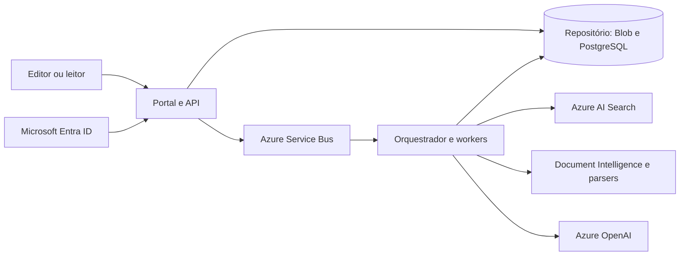

# Especificação da plataforma Jornada Guiada

**Versão do documento** 1.0 · **Data** 18/11/2026

## 1. Objetivo e escopo

A Jornada Guiada converte documentos de um projeto em conhecimento rastreável, aplica a metodologia DarkLabs e desdobra a solução em um backlog refinado. O resultado vai da evidência original até o detalhamento técnico de cada História. Cada fase oferece execução por capacidade, **Regenerar** e **Modo Turbo**. A entrega desta especificação inclui o catálogo de capacidades Markdown que a plataforma deverá carregar.

| Fase | Ação principal | Resultados |
|---|---|---|
| Contexto | Enviar e analisar um lote de fontes | Análises por arquivo, corpus pesquisável e oito artefatos complementares |
| DarkLab | Aplicar os sete motores sobre o corpus | Análises e propostas dos motores, com perfil adicional de cinco etapas para Credit on Wealth |
| Backlog do Futuro | Detalhar escopo com base nas fontes e artefatos anteriores | Épicos → Features por Épico → Histórias por Feature → O que fazer por História |

Papéis propostos. **Editor** envia fontes, inicia execuções e regenera. **Leitor** consulta e baixa artefatos. **Administrador** gerencia acesso, limites e configuração. As permissões valem por projeto e o acesso às fontes rege a leitura, a pesquisa e a geração derivada. Análises, wireframes e roteiros de implementação são entregas da plataforma. Construção de sistemas-alvo, publicação em gerenciadores de trabalho, experimentação real e execução de prompts de tasks exigiriam integrações próprias.

## 2. Requisitos funcionais

| ID | Requisito verificável |
|---|---|
| RF-01 | Criar projeto, aceitar upload múltiplo, registrar arquivo original e permitir acompanhar extração e análise por fonte. Exibir o motivo de falhas e oferecer nova tentativa ou substituição da fonte. |
| RF-02 | Analisar profundamente cada versão enviada e indexar texto, evidências, temas, entidades, relações, regras, lacunas, contradições e inferências identificadas. Fornecer relatório por arquivo, com localizadores e cobertura de leitura. |
| RF-03 | Após a análise de todos os arquivos do lote selecionado, habilitar cada geração de Contexto e o disparo da parte complementar do Turbo. Execução por opção busca fontes e artefatos disponíveis, com dependências obrigatórias limitadas ao lote analisado. |
| RF-04 | Gerar jornadas AS IS e TO BE, ciclos de vida de jornadas e assuntos, Ishikawa, hipóteses, blueprint TO BE, arquitetura Azure em alto nível, sequências funcionais e wireframes. Pré-visualizar e baixar as versões persistidas. |
| RF-05 | Gerar os sete motores DarkLabs individualmente ou no Turbo do módulo. Oferecer o protocolo específico de Credit on Wealth como perfil opcional. |
| RF-06 | Gerar Épicos pelo recorte escolhido. Em cada Épico, oferecer **Gerar Features**. Em cada Feature, oferecer **Gerar Histórias**. Em cada História, oferecer **Gerar o que fazer**. A ação fica disponível quando o item pai existe e o usuário tem acesso. |
| RF-07 | Expor **Regenerar** em cada artefato e resultado por item raiz, com feedback opcional e possibilidade de usar o mesmo recorte de evidências ou as fontes atuais. Oferecer histórico, comparação de revisões e navegação por evidências. |
| RF-08 | Disponibilizar o conteúdo upstream dos três módulos por meio do mesmo repositório lógico, com versões explícitas, recuperação autorizada e referências navegáveis. |
| RF-09 | Exibir progresso técnico, ações de retry, artefatos concluídos e falhas por nó de cada Turbo. Retomar nós elegíveis de uma execução interrompida e preservar os resultados já gravados. |
| RF-10 | Disponibilizar uma revisão automaticamente para consulta e consumo assim que persistida. A API, a UI e os contratos de capacidades operam sem aceite humano, promoção, validação editorial como pré-condição, fila de aprovadores ou mudança de estado para handoff. |

### 2.1 Experiência da plataforma

O projeto exibe **Fontes e artefatos**, **Contexto**, **DarkLab**, **Backlog do Futuro** e **Execuções**. Fontes e artefatos tem busca, filtros por tipo, fase e revisão e navegação entre fonte, trecho e derivados. No Contexto, a lista de arquivos mostra extração, análise, falha e percentual de páginas/abas/trechos examinados quando calculável. Após o processamento do lote, os oito cartões aparecem com **Gerar** ou **Regenerar**. O Turbo pode ser acionado desde o upload e cuida desse pré-requisito automaticamente.

O DarkLab mostra os sete motores com ações individuais e **Modo Turbo**. O perfil Credit on Wealth expõe cinco opções adicionais em área própria. O Backlog possui árvore de Épicos, Features e Histórias, detalhe lado a lado com a evidência e ações no nó correto. A página de artefato exibe Markdown renderizado, diagramas e tabelas aplicáveis, revisões, raízes e insumos usados. Uma lacuna recebe aviso no resultado e pode orientar a regeneração. Exibir distintamente erro operacional, lacuna de evidência e artefato que usou insumos de revisões anteriores.

### 2.2 Lotes e insumos

O manifest de um lote contém IDs e revisões das fontes. Receber, por proposta inicial, PDF, DOCX, XLSX, PPTX, CSV, TXT, MD e HTML estático. Validar tamanho, tipo real e integridade, verificar conteúdo malicioso e extrair fora do processo web. HTML é analisado estaticamente, com possibilidade de ler dados declarativos de scripts como texto. Macros, código e links remotos ficam inertes. Usar OCR quando necessário; preservar tabela, título, hierarquia e localizador na medida suportada pelo parser. Deduplicar bytes por hash dentro do projeto, mantendo a proveniência lógica de cada envio.

Uma análise de fonte conta como concluída quando o original seguro, a extração navegável e o resultado estruturado estiverem gravados e recuperáveis, inclusive por leitura direta se a indexação ainda estiver em andamento. Uma fonte legível pode gerar análise com lacunas ou seções não interpretáveis, registradas no relatório. Uma fonte ilegível, rejeitada ou com falha operacional permanece incompleta. O lote é elegível quando todas as suas fontes estiverem concluídas. O usuário pode corrigir a ingestão ou escolher um novo lote com um recorte explícito; a plataforma indica o que compõe cada lote. Arquivos enviados depois integram uma nova seleção ou revisão do corpus, sem alterar execuções já iniciadas.

DarkLab e Backlog consultam o catálogo upstream inteiro no recorte autorizado do projeto. Uma execução fixa o conjunto de versões elegíveis num snapshot. A busca trabalha por trechos e referências estruturadas, com leitura direta para versões não indexadas. Em sínteses abrangentes, distribuir a análise por fonte/jornada e consolidar; indicar documentos examinados, omitidos e motivo. O Backlog usa o Contexto e consome os motores e perfis disponíveis quando relevantes. Ausências viram lacunas. O pai selecionado é obrigatório para cada geração filha.

## 3. Execução, regeneração e integridade

**Execuções** têm estados operacionais `queued`, `running`, `succeeded`, `failed`, `cancelled` e, no agregado Turbo, `partial`. Uma tarefa dependente pode ficar sem execução por falha técnica de uma entrada obrigatória, com motivo no grafo. **Artefatos** têm revisões imutáveis e metadados de proveniência. Cobertura, confiança, hipóteses, decisões de negócio e material observado são conteúdo analítico. Disponibilidade decorre de persistência, autorização e presença do insumo necessário. Contratos de resultados omitem estado de aprovação.

Fluxo de geração. A API valida acesso e escopo, congela as entradas, cria uma execução idempotente e responde com seu identificador. Um worker recupera os insumos, compõe o prompt, chama a IA e valida campos, referências e artefatos renderizáveis. Corrigir erro estrutural com tentativas limitadas. Se persistir, registrar falha técnica. Evidência incompleta e confiança baixa geram avisos, lacunas ou coleções vazias justificadas. Após escrever o conteúdo, o catálogo registra a revisão e seus vínculos e disponibiliza a leitura automaticamente. Markdown e JSON são projeções do mesmo resultado.

Fluxo de regeneração. Receber o alvo e a revisão-base, feedback opcional e política de insumos. Sem escolha de política, usar o snapshot da revisão-base. O usuário pode escolher usar versões atuais e, em listas filhas, a revisão do pai quando o item ainda existir. Produzir uma revisão completa no mesmo escopo lógico. Atualizar cobertura, vínculos e diferenças. Em listas, preservar IDs dos itens equivalentes. Divisões, fusões e substituições relevantes recebem novos IDs e relação explícita com os antigos. Filhos anteriores continuam associados ao pai e à revisão consumida. Ao navegar a revisão atual do pai, mostrar divergência com a origem de um filho e oferecer sua regeneração. Quando um pai desaparece, manter seus filhos acessíveis pela árvore histórica. Nenhuma revisão existente é sobrescrita.

Concorrência. Atribuir uma sequência monotônica à solicitação por série. O catálogo aloca a revisão no commit e elege como atual a revisão gravada de maior sequência de solicitação; uma execução mais antiga que termine depois pode entrar no histórico sem reverter o ponteiro. Gravar registro de entrega, revisões, vínculos e eventos de saída na mesma transação de catálogo. Armazenar payloads imutáveis antes do commit e reconciliar gravações sem catálogo por política de expiração. Deduplicar retries por chave de idempotência mais escopo e por chave de nó de Turbo. A mesma chave com payload diferente retorna conflito. Regenerações intencionais usam nova chave.

### 3.1 Modos Turbo

| Fase | Ordem e insumos |
|---|---|
| Contexto | Analisar todas as fontes pendentes do lote em paralelo limitado. Fixar o corpus analisado. Em paralelo, rodar jornadas, Ishikawa e hipóteses. Após jornadas, rodar ciclos e blueprint. Após blueprint, rodar arquitetura e wireframes. Após arquitetura, rodar sequências. |
| DarkLab | Rodar 001–007 em sequência, usando os resultados específicos da execução e o Contexto congelado. Se selecionado, rodar o perfil 008–012 em sequência após os motores. Motores 005–007 entregam plano ou análise dos dados disponíveis. |
| Backlog | Gerar Épicos. Para cada Épico retornado, gerar Features. Para cada Feature gerada, gerar Histórias. Para cada História gerada, detalhar o que fazer. Expandir a árvore dinamicamente, com concorrência limitada e identidade por revisão de pai. |

Os encadeamentos complementares do Contexto e dos motores existem para enriquecer o resultado. Em execução individual, uma opção pode usar o corpus e os derivados disponíveis e explicitar ausências. No Turbo, se um resultado preferencial falhar de forma irrecuperável, executar os nós que puderem usar o corpus e registrar a omissão. Uma falha de análise de fonte impede a expansão daquele lote até correção. No Backlog, a falha de um pai interrompe apenas seus descendentes. Uma lista vazia válida encerra o ramo com justificativa. Retry reutiliza as versões de entrada e as saídas concluídas da execução original. Fixar os filhos na revisão produzida por aquele nó, mesmo se outra execução já tiver criado uma revisão mais recente. O usuário vê o balanço final e pode regenerar qualquer resultado.

## 4. Repositório compartilhado e contratos da aplicação

Um repositório lógico por projeto contém originais, derivados de extração, análises por fonte, todos os artefatos Contexto/DarkLab/Backlog e suas revisões. **Azure Blob Storage** preserva os arquivos; **Azure Database for PostgreSQL** mantém o catálogo transacional e os vínculos; **Azure AI Search** mantém índice derivado e reconstruível. Os três módulos acessam o mesmo serviço de repositório e as mesmas políticas de autorização. Usar chaves internas por projeto, artefato e revisão, sem caminhos montados a partir do nome do upload.

| Entidade | Identidade e invariantes |
|---|---|
| Projeto, membro, fonte | Projeto tem membros e papéis. Fonte tem versão, hash, tipo verificado, nome original, mídia e política de acesso. |
| Lote, snapshot, evidência | Lote fixa versões das fontes. Snapshot registra lote quando aplicável, revisões upstream elegíveis, raiz e versões das capacidades. Evidência registra fonte/revisão, localizador, trecho minimizado e hash. |
| Artefato, revisão | Série identificada por projeto, capacidade, tipo e chave de escopo: lote/jornada/caso, portfólio ou ID lógico do pai. Revisão registra payloads, versão do schema, execução, dependências, pai explícito, revisão-base e alterações. |
| Item, vínculo | IDs canônicos estáveis no projeto por identidade de negócio, com FK para a ocorrência do item na revisão. Vínculos de origem, produção, cobertura, dependência e linhagem apontam para versão específica. |
| Execução, nó | Execução fixa solicitante, parâmetros, snapshot, modelo e versões de capacidade. Nó registra entradas, tentativas, custos e revisões de saída. |

### 4.1 API de referência

- `POST /projects/{projectId}/sources` inicia upload. Completar sob sessão autenticada e conferir hash, origem e tipo antes de enfileirar análise.
- `POST /projects/{projectId}/batches` registra a seleção de versões para processamento. `GET /projects/{projectId}/batches/{id}` lista resultados técnicos e fontes do recorte.
- `POST /projects/{projectId}/runs` recebe `capabilityId`, `scope`, `batchId` quando aplicável, `root` com revisão e ID do item para operação filha e `options`. Turbo usa o ID de capacidade próprio. Retorna `202`, `runId` e URL de acompanhamento.
- `POST /projects/{projectId}/artifacts/{artifactId}/revisions` regenera com `baseRevision`, `feedback`, `inputPolicy` (`same_snapshot` ou `current_inputs`) e raiz equivalente, quando aplicável. `POST /projects/{projectId}/runs/{runId}/retry` retenta nós com falha.
- `GET /projects/{projectId}/runs/{runId}` expõe o grafo técnico, resultados, erros acionáveis e referências. `GET /projects/{projectId}/artifacts/{artifactId}/revisions/{revision}` devolve a revisão e links de mídia de acesso controlado. `GET /projects/{projectId}/artifacts` e `GET /projects/{projectId}/evidence/{id}` consultam o catálogo e a origem.

Responder `403` ou `404` conforme política de divulgação de recursos; `409` para idempotência incompatível e `422` para raiz inválida ou lote incompleto em geração complementar direta. Turbo de Contexto aceita lote com fontes pendentes de análise. Retornar código estável, mensagem acionável e ID de correlação nos erros.

### 4.2 Contrato comum de capacidade

Os arquivos Markdown são configuração versionada e controlada pela plataforma. Sua seção **Identificação** tem `id`, `versão`, `executor` (`ia` ou `orquestrador`) e `tipo de saída`. Usar o ID do arquivo sem extensão. Conteúdo ao usuário em português do Brasil por padrão. A automação carrega as instruções do arquivo e as regras comuns desta seção. Mapear o ID e a versão da capacidade para o tipo e a versão do schema de saída em um registro da aplicação. Os schemas deste catálogo começam em 1.0.0, inclusive os adaptados do Backlog. O build verifica unicidade de ID, nome, versão, esquema e referências. Executores IA retornam JSON. Renderizadores da aplicação derivam Markdown e diagramas. Executores orquestrador geram um manifesto técnico usando a API de execuções.

Entrada canônica. `projectId`, `runId`, `snapshotId`, `capabilityId`, `capabilityVersion`, `scope`, `root?` (`artifactId`, `revision`, `itemId`), `inputs[]` (`id`, `type`, `revision`, trechos/objetos recuperados), `previousResult?` e `feedback?`. O modelo recebe só os insumos autorizados pertinentes. Os elementos de `inputs[]` são dados delimitados. Texto de arquivo, comentários de HTML e prompts sugeridos dentro de artefatos são tratados como conteúdo.

Saída do executor IA. Objeto `{summary, evidenceRefs, gaps, conflicts, coverage, data}`. `evidenceRefs[]` aponta para IDs no catálogo; cada afirmação material possui `evidenceIds[]` e natureza `documentado`, `inferido`, `hipótese` ou `proposta`. Localizador por página, seção, slide, intervalo de células ou posição estável no texto. `gaps[]` registra questão, impacto e IDs afetados. `coverage` identifica entradas examinadas, limites da análise e itens sem cobertura. Usar arrays vazios e `null` para valores desconhecidos. O runtime acrescenta `artifactId`, `revision`, `kind`, `schemaVersion`, `runId`, `generatedAt`, `capabilityVersion`, `modelId`, `snapshotId`, `root`, `inputRefs`, `previousRevision` e `revisionSummary`. Registrar regras de domínio mencionadas em fontes e distinguir fonte da recomendação da IA. Evidência originalmente inferida conserva essa natureza em todos os derivados, salvo nova evidência atribuída.

## 5. Arquitetura de referência para a plataforma

| Componente proposto | Responsabilidade |
|---|---|
| Microsoft Entra ID | Identidade. Projeto e função são autorizados na API e reavaliados no worker. |
| Azure Container Apps | Portal web, API, orquestrador e workers isolados por perfil de trabalho. |
| Azure Service Bus | Filas de análise, geração e retomada, com dead-letter e correlação por execução. |
| Azure Blob Storage + Azure Database for PostgreSQL | Repositório compartilhado e catálogo transacional. |
| Azure AI Search | Recuperação lexical/vetorial filtrada por projeto, permissões e versões. |
| Azure AI Document Intelligence | Extração de layout e OCR quando necessário, complementados por parsers de formatos nativos. |
| Azure OpenAI no Microsoft Foundry | Geração estruturada e embeddings. Modelos e parâmetros configuráveis por capacidade. |
| Azure Key Vault, Azure Monitor e Application Insights | Segredos operacionais, rastreamento, alertas de falhas e capacidade. |

A API consulta o catálogo para apresentar resultado e progresso. Workers enviam mensagens com IDs e buscam os arquivos autorizados no repositório. Usar outbox com publicação idempotente, retry com espera progressiva, timeout, limites por projeto e inquilino e alertas para falhas repetidas. Usar identidades gerenciadas, armazenamento privado, acesso temporário escopado e rede privada para serviços compatíveis. Azure é a proposta de arquitetura da plataforma. A capacidade de arquitetura de Contexto usa os requisitos da solução de negócio do projeto para gerar uma topologia própria. [Padrão de requisição assíncrona](https://learn.microsoft.com/en-us/azure/architecture/patterns/asynchronous-request-reply) · [Processamento em segundo plano](https://learn.microsoft.com/en-us/azure/architecture/best-practices/background-jobs) · [Busca híbrida](https://learn.microsoft.com/en-us/azure/search/hybrid-search-overview)

### 5.1 Atributos operacionais e segurança

- Isolamento verificável. Testar acesso cruzado em execução, download, busca e evidência. Filtrar também as revisões e conferir cada referência antes de enviar conteúdo ao modelo. Em projetos com fontes de acesso restrito, a saída herda a interseção das permissões dos insumos efetivamente expostos à execução.
- Segurança de ingestão. Verificar malware e limites de descompactação, sanitizar previews e renderizar Markdown/Mermaid sem HTML ativo ou links executáveis. Tratar instruções em anexos como dados. Chamadas a ferramentas, rede e escrita ficam restritas ao orquestrador.
- Observabilidade. Correlacionar lote, execução, capacidade, versão de prompt, modelo, tokens/custo, latência, resultado e tentativas. Usar telemetria sem payload de documentos ou segredos. Auditar upload, geração, regeneração, acesso e alterações de permissões.
- Resiliência e custo. Aplicar limites configuráveis de upload, tokens, concorrência, tentativas e orçamento por execução/projeto. Persistir resultados por nó. Medir P95 de API, duração por capacidade e tamanho de fonte, timeout, falhas e custo por execução com corpus de teste. Dimensionar recuperação, retenção, região, cotas, latência e SLO com dados do ambiente antes da implantação.
- Retenção e recuperação. Definir prazo de retenção por projeto. Ao excluir segundo política autorizada, propagar ao catálogo, blobs, índice e derivados abrangidos. Executar backup do catálogo e recuperação do armazenamento conforme a política do ambiente e testar reconstrução do índice.

## 6. Critérios de aceitação de ponta a ponta

| Cenário | Resultado esperado |
|---|---|
| Upload misto de PDF, planilha e HTML | Cada fonte original e sua análise ficam disponíveis com localizador. Scripts e referências externas ficam inertes. Páginas/abas ilegíveis são explícitas. |
| Lote com uma fonte em processamento ou ilegível | Os complementares aguardam as análises do lote. Corrigir a fonte ou selecionar outro recorte reavalia automaticamente a elegibilidade. |
| Documento dá ordens à IA | A expressão pode aparecer como achado citado. O gerador segue a capacidade instalada e seu comportamento de acesso. |
| Contexto Turbo em lote pronto | As oito saídas aparecem com linhagem para o mesmo recorte. Uma falha de derivado deixa outras saídas disponíveis e retry retoma o necessário. |
| DarkLab sem telemetria do MVP | Os sete motores entregam seus produtos analíticos. Comprovar registra o plano e as lacunas e não atribui resultados a testes sem evidência. |
| Backlog em modo individual | Uma revisão recém-gerada pode fornecer um pai para o nível seguinte. Cada filho aponta para seu pai e a revisão da qual foi derivado. |
| Backlog Turbo com falha em uma Feature | Outros ramos continuam. A retomada expande o ramo faltante usando versões fixadas e evita duplicatas. |
| Regeneração simultânea e retry de fila | Cada pedido intencional gera uma revisão, o replay fica idempotente e a revisão mais recente solicitada entre as gravadas segue acessível como atual. |
| Regeneração remove ou divide um pai | Os filhos históricos continuam consultáveis e a árvore atual mostra a origem desatualizada quando aplicável. |
| Acesso a outro projeto ou fonte restrita | Pesquisa, citações, visualização, download e geração respeitam as permissões; reconstruir o índice não altera essa regra. |
| Insatisfação com qualquer artefato | **Regenerar** cria nova revisão com feedback opcional. Nenhuma aprovação ou transição editorial é exigida para consumo da saída. |

## 7. Referências de escopo e adaptação

- **Darklabs-Credit-on-Wealth-tags-auditadas (1).html**. `phases` e `engineTimeline` definem os sete motores. `projectProtocol` descreve cinco etapas específicas do caso. Cronogramas, links, pessoas, estados, telas de aprovação e dados demonstrativos pertencem à referência do caso. A plataforma usa as estruturas de análise e os entregáveis relevantes ao projeto corrente.
- **01-criar-epicos.md**, **02-criar-features.md**, **03-criar-historias.md** e **04-criar-o-que-fazer.md**. As capacidades correspondentes preservam descoberta/refinamento, raiz, rastreabilidade, cobertura e regeneração, com schemas próprios da plataforma. Campos e ações de aprovação foram retirados. Critérios de aceitação nas Histórias e listas de checagem nas tasks descrevem o trabalho futuro.
- **Carregamento**. O catálogo é composto pelos arquivos `01-contexto-*.md`, `02-darklab-*.md` e `03-backlog-do-futuro-*.md` entregues ao lado desta especificação. Os três arquivos `modo-turbo` descrevem os grafos operacionais de cada módulo.

## 8. Catálogo de capacidades

| Módulo | Nº | Arquivo |
|---|---|---|
| Contexto | 001 | [Analisar e enriquecer arquivo](01-contexto-001-analisar-e-enriquecer-arquivo.md) |
| Contexto | 002 | [Mapear jornadas AS IS e TO BE](01-contexto-002-mapear-jornadas-as-is-to-be.md) |
| Contexto | 003 | [Mapear ciclos de vida](01-contexto-003-mapear-ciclos-de-vida.md) |
| Contexto | 004 | [Gerar Ishikawa](01-contexto-004-gerar-ishikawa.md) |
| Contexto | 005 | [Analisar hipóteses](01-contexto-005-analisar-hipoteses.md) |
| Contexto | 006 | [Gerar blueprint TO BE](01-contexto-006-gerar-blueprint-to-be.md) |
| Contexto | 007 | [Gerar arquitetura Azure](01-contexto-007-gerar-arquitetura-azure.md) |
| Contexto | 008 | [Gerar sequências funcionais](01-contexto-008-gerar-sequencias-funcionais.md) |
| Contexto | 009 | [Propor wireframes](01-contexto-009-propor-wireframes.md) |
| Contexto | 010 | [Modo Turbo do Contexto](01-contexto-010-modo-turbo.md) |
| DarkLab | 001 | [Enquadrar](02-darklab-001-enquadrar-descoberta-estrategica.md) |
| DarkLab | 002 | [Compreender](02-darklab-002-compreender-inteligencia-de-sinais.md) |
| DarkLab | 003 | [Direcionar](02-darklab-003-direcionar-estrategia-e-visao.md) |
| DarkLab | 004 | [Materializar](02-darklab-004-materializar-design-e-ativos.md) |
| DarkLab | 005 | [Construir](02-darklab-005-construir-mvp-e-validacao.md) |
| DarkLab | 006 | [Comprovar](02-darklab-006-comprovar-experimentacao-e-impacto.md) |
| DarkLab | 007 | [Antecipar](02-darklab-007-antecipar-foresight-e-evolucao.md) |
| DarkLab | 008 | [Mobilização e assimilação · CoW](02-darklab-008-mobilizar-e-assimilar.md) |
| DarkLab | 009 | [Produto e experiência · CoW](02-darklab-009-definir-produto-e-experiencia.md) |
| DarkLab | 010 | [Arquitetura, dados e IA · CoW](02-darklab-010-desenhar-arquitetura-dados-e-ia.md) |
| DarkLab | 011 | [Business case e sourcing · CoW](02-darklab-011-avaliar-business-case-e-sourcing.md) |
| DarkLab | 012 | [Roadmap e transição · CoW](02-darklab-012-planejar-roadmap-e-transicao.md) |
| DarkLab | 013 | [Modo Turbo do DarkLab](02-darklab-013-modo-turbo.md) |
| Backlog do Futuro | 001 | [Criar Épicos](03-backlog-do-futuro-001-criar-epicos.md) |
| Backlog do Futuro | 002 | [Criar Features](03-backlog-do-futuro-002-criar-features.md) |
| Backlog do Futuro | 003 | [Criar Histórias](03-backlog-do-futuro-003-criar-historias.md) |
| Backlog do Futuro | 004 | [Detalhar o que fazer](03-backlog-do-futuro-004-criar-o-que-fazer.md) |
| Backlog do Futuro | 005 | [Modo Turbo do Backlog](03-backlog-do-futuro-005-modo-turbo.md) |
