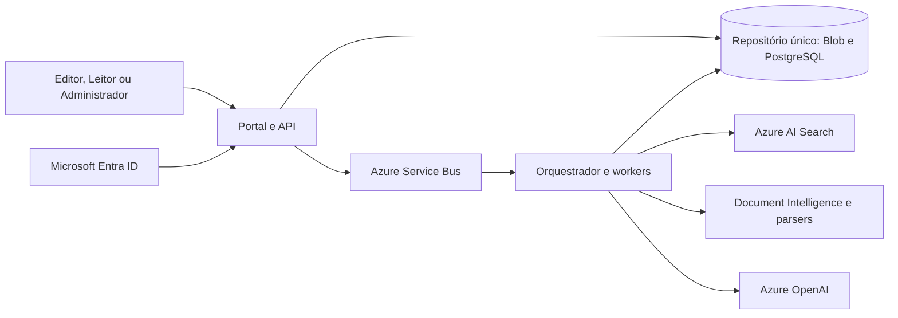

# Especificação da plataforma Jornada Guiada

**Versão do documento** 1.3 · **Data** 18/11/2026 · **Versão anterior** 1.2 (a 1.0 está arquivada em `_arquivo/2026-11-18-antes-da-revisao/`)

## Índice

| Documento | Conteúdo |
|---|---|
| [00-contrato-comum-das-capacidades.md](00-contrato-comum-das-capacidades.md) | IDs, natureza, disposições, estados, envelope, schemas, modelo de arquivo, guardrails, manifesto Turbo |
| [00-repositorio-unico-de-artefatos.md](00-repositorio-unico-de-artefatos.md) | Estrutura lógica por projeto, manifesto do índice, Azure, acesso, versionamento, retenção |
| [00-plano-de-adequacao-e-evolucao.md](00-plano-de-adequacao-e-evolucao.md) | Diagnóstico, decisões, ondas executadas, mapa arquivo antigo → novo, qualificação |
| [01-contexto-000-visao-e-contrato-da-fase.md](01-contexto-000-visao-e-contrato-da-fase.md) | Fase Contexto |
| [02-darklab-000-visao-e-contrato-da-fase.md](02-darklab-000-visao-e-contrato-da-fase.md) | Fase DarkLab |
| [03-backlog-do-futuro-000-visao-e-contrato-da-fase.md](03-backlog-do-futuro-000-visao-e-contrato-da-fase.md) | Fase Backlog do Futuro |
| `referencias/legado-0N-*.md` | Skills legadas de Épicos, Features, Histórias e O que fazer (fonte de conteúdo das capacidades da fase 03; não carregadas pelo catálogo) |

## 1. Objetivo e escopo

A Jornada Guiada converte documentos de um projeto em conhecimento rastreável, aplica a metodologia DarkLab e desdobra a solução em um backlog refinado, da evidência original até o detalhamento técnico de cada História. Cada fase oferece execução por capacidade, **Regenerar** e **Modo Turbo**.

A jornada segue o fluxo **Contexto → DarkLab → Projeto → Backlog**. O **projeto** é criado no Contexto, antes do primeiro upload, e é o identificador principal que acompanha todas as etapas: cada lote, fonte, execução, artefato e item do backlog pertence a um projeto ([contrato §5.3](00-contrato-comum-das-capacidades.md#53-etapa-do-projeto)).

| Fase | Ação principal | Resultados |
|---|---|---|
| Contexto | Criar o projeto, enviar e analisar um lote de fontes | Análise por artefato, base de conhecimento consolidada e oito artefatos complementares (jornadas, ciclos de vida, Ishikawa, hipóteses, blueprint, arquitetura Azure, sequências, wireframes) |
| DarkLab | Aplicar os sete motores sobre o Contexto | M1–M2 Upstream · AS IS ("Qual é o problema?") e M3–M7 Downstream · TO BE ("Qual é a solução?"); em cada motor, produtos próprios, atividades e entregáveis do projeto com status, ecossistema e ressalva de leitura |
| Projeto | Consolidar o que o DarkLab concluiu na ficha do projeto ([02-darklab-008](02-darklab-008-consolidar-ficha-do-projeto.md)) | Problema, objetivos e KPI, escopo dentro × fora, MVP, ondas, sementes do backlog e prontidão; página **Projetos** com portfólio, fontes e governança |
| Backlog do Futuro | Detalhar o escopo do projeto definido (ficha do projeto, Contexto e motores do DarkLab) | Épicos → Features por Épico → Histórias por Feature → O que fazer por História |

Análises, wireframes e roteiros de implementação são entregas da plataforma. Construção de sistemas-alvo, publicação em gerenciadores de trabalho, experimentação real e execução de prompts de tasks exigiriam integrações próprias.

## 2. Papéis e permissões

| Ação | Leitor | Editor | Aprovador | Administrador |
|---|:-:|:-:|:-:|:-:|
| Consultar e baixar fontes, artefatos, revisões, evidências, árvore e exportações | ✓ | ✓ | ✓ | ✓ |
| Enviar fontes, criar lotes | — | ✓ | ✓ | ✓ |
| Executar capacidade e regenerar | — | ✓ | ✓ | ✓ |
| Executar Modo Turbo, cancelar, reexecutar nó e retomar **as próprias execuções** | — | ✓ | ✓ | ✓ |
| Cancelar, reexecutar ou retomar execução de **outra pessoa** | — | — | — | ✓ |
| Marcar revisão como revisado | — | ✓ | ✓ | ✓ |
| Marcar revisão como aceito | — | — | ✓ | ✓ |
| Gerenciar membros, papéis, limites, retenção e exclusões | — | — | — | ✓ |

Quem cria um projeto no Contexto (permissão de criar projetos na organização) passa a ser Administrador dele. Permissões valem por projeto; o acesso às fontes rege leitura, pesquisa e geração derivada (detalhes em [00-repositorio-unico-de-artefatos.md](00-repositorio-unico-de-artefatos.md#4-acesso-por-papel)).

## 3. Requisitos funcionais

| ID | Requisito verificável |
|---|---|
| RF-001 | Criar o projeto no Contexto, com `projectId` interno imutável e código `PRJ-NNN`, antes de qualquer upload; aceitar upload múltiplo, registrar o original e acompanhar extração e análise por fonte. Exibir motivo de falhas e oferecer nova tentativa ou substituição. |
| RF-002 | Analisar profundamente cada artefato enviado, em paralelo ([01-contexto-001](01-contexto-001-analisar-e-enriquecer-artefato.md)), com relatório por arquivo, localizadores e cobertura de leitura. |
| RF-003 | Quando todos os artefatos do lote estiverem processados, consolidar o contexto ([01-contexto-002](01-contexto-002-consolidar-contexto.md)) e só então habilitar as gerações 003–010 do Contexto. |
| RF-004 | Gerar jornadas AS IS e TO BE, ciclos de vida, Ishikawa (6M), hipóteses, blueprint TO BE, arquitetura Azure em alto nível, diagramas de sequência e wireframes de portais web e administrativos; pré-visualizar e baixar as revisões. |
| RF-005 | Gerar os sete motores DarkLab individualmente ou no Turbo ([02-darklab-009](02-darklab-009-modo-turbo.md)). Cada motor entrega seus produtos e os blocos comuns da fase: atividades e entregáveis do projeto com status segundo as fontes, ecossistema e ressalva de leitura ([02-darklab-000 §5.5](02-darklab-000-visao-e-contrato-da-fase.md#55-estrutura-comum-da-saída-dos-motores)). Ao fim, consolidar a ficha do projeto ([02-darklab-008](02-darklab-008-consolidar-ficha-do-projeto.md)). |
| RF-006 | Gerar Épicos pelo recorte escolhido; em cada Épico, **Gerar Features**; em cada Feature, **Gerar Histórias**; em cada História, **Gerar o que fazer**. A ação exige o item pai e permissão de Editor. |
| RF-007 | Expor **Regenerar** em cada artefato, com feedback opcional e política `same_snapshot` ou `current_inputs`; oferecer histórico, **comparação de revisões** (diff estrutural por ID e `changeType`) e navegação por evidências. |
| RF-008 | Disponibilizar o Upstream das três fases por meio do [repositório único](00-repositorio-unico-de-artefatos.md), com revisões explícitas e referências navegáveis. |
| RF-009 | Exibir progresso, falhas por nó, artefatos concluídos e ações de **cancelar, reexecutar nó e retomar** de cada Turbo, preservando resultados já gravados. |
| RF-010 | **Execução e revisão humana são independentes.** Toda revisão fica disponível para consulta e consumo assim que gravada. O estado de execução (`pending`, `running`, `succeeded`, `failed`, `cancelled`, `skipped`) é técnico; o estado de revisão humana (`não revisado`, `revisado`, `aceito`) é editorial, opcional, auditado e **nunca** bloqueia execução, consumo por outra capacidade ou Modo Turbo. Não há fila de aprovação nem estados `PROPOSTO`/`APROVADO`. Só o papel Aprovador (ou Administrador) marca `aceito`, a única marca de entregável aceito na plataforma. |
| RF-011 | **O projeto é o identificador principal da jornada.** Todas as capacidades recebem e ecoam o mesmo `projectId`; a página **Projetos** lista os projetos com código, nome, etapa (`contexto`, `contexto_consolidado`, `darklab`, `projeto_definido`, `backlog`), ficha do projeto e prontidão. O Backlog do Futuro só começa com o projeto na etapa `projeto_definido`. |

### 3.1 Experiência da plataforma

A navegação segue a jornada: **Contexto**, **DarkLab**, **Projetos** e **Backlog do Futuro**, mais **Fontes e artefatos** e **Execuções**. Toda tela opera sobre o projeto selecionado; sem projeto, a única ação disponível é criar um no Contexto.
- **Projetos**: portfólio (código `PRJ-NNN`, nome, etapa, prontidão, última atividade), criação de projeto, ficha do projeto com selo de prontidão e lacunas bloqueantes, fontes e lotes do projeto, membros e papéis, e histórico de execuções. **Gerar Épicos** só aparece habilitado na etapa `projeto_definido`.
- **Fontes e artefatos**: busca, filtros por tipo, fase, natureza e revisão; navegação fonte → trecho → derivados.
- **Contexto**: lista de arquivos com extração, análise, falha e percentual examinado; cartão "Base consolidada"; após a consolidação, os oito cartões com **Gerar**/**Regenerar**. O Turbo pode partir do upload.
- **DarkLab**: os sete motores em duas faixas (Upstream AS IS, Downstream TO BE) com ações individuais e **Modo Turbo**; em cada motor, o painel "Andamento no projeto" com atividades, entregáveis por status, ecossistema e ressalva de leitura.
- **Backlog do Futuro**: árvore Épicos → Features → Histórias → O que fazer, detalhe lado a lado com a evidência e ações no nó correto.
- **Execuções**: grafo do Turbo, estado por nó, tentativas, erros acionáveis, cancelar/reexecutar/retomar.
- Página de artefato: Markdown renderizado, diagramas, revisões, comparação, insumos usados, estado de revisão humana. Distinguir visualmente erro operacional, lacuna de evidência e artefato que usou insumos de revisões anteriores.

### 3.2 Lotes e insumos

Formatos aceitos (proposta): PDF, DOCX, XLSX, PPTX, CSV, TXT, MD e HTML estático. Validar tamanho, tipo real e integridade, verificar malware e extrair fora do processo web; HTML analisado estaticamente (scripts, macros e links remotos inertes); OCR quando necessário; deduplicação por hash mantendo a proveniência de cada envio.

Uma fonte está **concluída** quando original, extração navegável e análise estruturada estão gravados. O **lote é elegível** para a consolidação quando todas as suas fontes estão concluídas; fonte ilegível ou com falha mantém o lote inelegível até correção, substituição ou escolha de outro lote. Arquivos enviados depois entram em novo lote ou nova revisão do corpus, sem alterar execuções iniciadas.

## 4. Execução, regeneração e integridade

- **Fluxo de geração**: a API valida acesso e escopo, congela as entradas em um snapshot, cria execução idempotente e responde `202` com `runId`. O worker recupera os insumos, compõe o prompt da capacidade, chama a IA, valida o JSON contra o envelope e o schema de `data` ([contrato comum §6](00-contrato-comum-das-capacidades.md#6-envelope-único-de-saída)) e as referências. Erros estruturais têm até 2 novas tentativas (proposta); se persistirem, a execução vai a `failed`. Lacunas e baixa confiança geram `gaps[]`, não falha.
- **Regeneração**: recebe alvo, revisão-base, feedback opcional e política de insumos (`same_snapshot` padrão, ou `current_inputs`). Produz revisão completa no mesmo escopo, preservando IDs por correspondência ([contrato comum §2.3](00-contrato-comum-das-capacidades.md#23-identidade-estável-entre-revisões)). Filhos anteriores continuam presos ao pai@revisão consumido; a árvore atual mostra a divergência e oferece regenerar.
- **Concorrência**: sequência monotônica por série; ponteiro "atual" = maior sequência entre as revisões gravadas; idempotência por chave + escopo e por `nodeKey` no Turbo; mesma chave com payload diferente → `409`.

### 4.1 Modos Turbo

| Fase | Grafo | Arquivo |
|---|---|---|
| Contexto | 001 (paralelo por fonte) → 002 → {003, 005}; 004←003; 006←{003,004,005}; 007←{003,004,006}; 008←007; 009←{007,008}; 010←{003,007,009} | [01-contexto-011-modo-turbo.md](01-contexto-011-modo-turbo.md) |
| DarkLab | M1 → M2 → M3 → M4 → M5 → M6 → M7 → ficha do projeto (008); todos leem o Contexto | [02-darklab-009-modo-turbo.md](02-darklab-009-modo-turbo.md) |
| Backlog do Futuro | Épicos → Features por Épico → Histórias por Feature → O que fazer por História, expansão dinâmica | [03-backlog-do-futuro-005-modo-turbo.md](03-backlog-do-futuro-005-modo-turbo.md) |

Regras comuns: falha de um nó só marca `skipped` os dependentes; ramos independentes continuam; agregado `partial` quando houver mistura. Cancelar, reexecutar nó e retomar seguem o [contrato comum §11](00-contrato-comum-das-capacidades.md#11-manifesto-do-modo-turbo-turborunmanifest).

## 5. Repositório único e API

O repositório lógico por projeto, compartilhado pelas três fases, está em [00-repositorio-unico-de-artefatos.md](00-repositorio-unico-de-artefatos.md): **Azure Blob Storage** (arquivos e saídas), **Azure Database for PostgreSQL** (metadados, revisões, execuções, árvore do backlog) e **Azure AI Search** (índice textual e vetorial reconstruível).

### 5.1 API de referência

Autenticação via Microsoft Entra ID. Papel mínimo entre parênteses.

**Projetos**
- `POST /projects` (permissão de criar projetos na organização) cria o projeto no Contexto: `{name, description?}` → `201 {projectId, code, stage: "contexto"}`; quem cria vira Administrador.
- `GET /projects` (membro) lista os projetos do usuário com `code`, `name`, `stage`, prontidão da ficha e última atividade.
- `GET /projects/{projectId}` (Leitor) devolve `projeto.json`, a ficha do projeto atual e o resumo por fase.
- `PATCH /projects/{projectId}` (Editor) altera `name` e `description`; `projectId` e `code` nunca mudam.

As demais rotas ficam sob `/projects/{projectId}`.

**Fontes e lotes**
- `POST /sources` (Editor) inicia upload e devolve URL assinada; `POST /sources/{sourceId}/complete` confere hash, tipo e malware e enfileira 01-contexto-001.
- `GET /sources`, `GET /sources/{sourceId}/revisions/{rev}` (Leitor) consultam fonte, extração e análise.
- `POST /sources/{sourceId}/retry` (Editor) reprocessa a extração/análise; `PUT /sources/{sourceId}` envia versão substituta.
- `POST /batches` (Editor) registra lote; `GET /batches` lista lotes; `GET /batches/{batchId}` mostra fontes, estados e elegibilidade.

**Execuções**
- `POST /runs` (Editor) executa uma capacidade: `{capabilityId, scope, batchId?, root?: {itemId, artifactUri, revision}, options?, idempotencyKey}` → `202 {runId, statusUrl}`.
- `POST /turbo-runs` (Editor) executa um Turbo: `{phase, batchId?, scope?, idempotencyKey}` → `202 {runId}`.
- `GET /runs/{runId}` (Leitor) devolve execução e, se Turbo, o `turboRunManifest`.
- `POST /runs/{runId}/cancel` (Editor dono ou Administrador) cancela.
- `POST /runs/{runId}/nodes/{nodeKey}/rerun` (Editor dono ou Administrador) reexecuta um nó e seus dependentes `skipped`.
- `POST /runs/{runId}/resume` (Editor dono ou Administrador) retoma reaproveitando nós `succeeded` e o snapshot original.

**Artefatos e revisões**
- `GET /artifacts?phase=&capabilityId=&nature=&current=` (Leitor) consulta o catálogo (projeção do manifesto do índice).
- `GET /artifacts/{artifactId}/revisions` e `GET /artifacts/{artifactId}/revisions/{rev}` (Leitor) leem histórico e revisão (JSON, Markdown renderizado e links de mídia temporários).
- `POST /artifacts/{artifactId}/revisions` (Editor) regenera: `{baseRevision, feedback?, inputPolicy: "same_snapshot"|"current_inputs", idempotencyKey}`.
- `GET /artifacts/{artifactId}/compare?from={rev}&to={rev}` (Leitor) **compara revisões** (RF-007): itens por ID com `changeType`, campos alterados, evidências adicionadas/removidas, diferença de cobertura.
- `PUT /artifacts/{artifactId}/revisions/{rev}/review` (Editor) define o estado de revisão humana (`não revisado`/`revisado`/`aceito`) com comentário; não afeta disponibilidade.
- `GET /evidence/{evidenceId}` (Leitor) devolve trecho e localizador na fonte.

**Backlog**
- `GET /backlog/tree?revision=current|{snapshot}&rootId=` (Leitor) devolve a árvore Épicos → Features → Histórias → O que fazer com pai@revisão de cada nó e marcas de divergência.

**Exportação e retenção**
- `POST /exports` (Leitor) gera pacote (`format`: `zip-markdown`, `json`, `pdf`; `scope`: fase, artefato ou árvore) → `202 {exportId}`; `GET /exports/{exportId}` baixa por URL temporária.
- `GET /retention-policy`, `PUT /retention-policy` (Administrador) consultam e alteram prazos.
- `DELETE /sources/{sourceId}` e `DELETE /` (Administrador) excluem fonte ou projeto (soft delete de 30 dias, depois expurgo propagado a blobs, catálogo, índice e derivados).

**Erros**: `403`/`404` conforme política de divulgação; `409` idempotência incompatível; `422` raiz inválida, pai ausente, lote inelegível ou projeto fora da etapa exigida (`projeto_nao_definido`) em execução direta; `429` limite excedido. Corpo: `{code, message, correlationId}`.

## 6. Contrato comum de capacidade

As capacidades são arquivos Markdown versionados carregados pela plataforma. Identidade, modelo de seções, entrada canônica, envelope de saída, JSON Schemas, naturezas, disposições, estados, renderização e guardrails estão em [00-contrato-comum-das-capacidades.md](00-contrato-comum-das-capacidades.md). O build valida unicidade de `capabilityId`, versão, schema, dependências e links internos.

## 7. Arquitetura de referência da plataforma

| Componente | Responsabilidade |
|---|---|
| Microsoft Entra ID | Identidade; projeto e papel autorizados na API e reavaliados no worker. |
| Azure Container Apps | Portal web, API, orquestrador e workers isolados por perfil de trabalho. |
| Azure Service Bus | Filas de análise, geração e retomada, com dead-letter e correlação por execução. |
| Azure Blob Storage + Azure Database for PostgreSQL | Repositório único e catálogo transacional. |
| Azure AI Search | Recuperação lexical/vetorial filtrada por projeto, permissões e revisões. |
| Azure AI Document Intelligence | Layout e OCR, complementados por parsers nativos. |
| Azure OpenAI no Microsoft Foundry | Geração estruturada (JSON Schema) e embeddings; modelo e parâmetros por capacidade. |
| Azure Key Vault, Azure Monitor e Application Insights | Segredos, rastreamento, alertas de falhas e custo. |

Outbox com publicação idempotente, retry com espera progressiva, timeout, limites por projeto, identidades gerenciadas, armazenamento privado e rede privada. [Padrão de requisição assíncrona](https://learn.microsoft.com/en-us/azure/architecture/patterns/asynchronous-request-reply) · [Processamento em segundo plano](https://learn.microsoft.com/en-us/azure/architecture/best-practices/background-jobs) · [Busca híbrida](https://learn.microsoft.com/en-us/azure/search/hybrid-search-overview)

### 7.1 Limites e SLOs (proposta — calibrar com corpus de teste antes da implantação)

| Item | Valor proposto |
|---|---|
| Tamanho máximo por arquivo | 50 MB |
| Arquivos por lote | 100 |
| Tamanho total por lote | 500 MB |
| Páginas por documento (OCR) | 1.000 |
| Tokens de entrada por chamada de capacidade | 200 mil (acima disso, análise distribuída por fonte/jornada e consolidação) |
| Tokens de saída por chamada | 32 mil |
| Execuções simultâneas por projeto | 4 Turbos; 16 nós em paralelo por Turbo |
| Tentativas por nó | 3 (1 + 2 retries com espera progressiva) |
| Timeout por nó | 15 min (análise de fonte) · 10 min (demais) |
| Orçamento por Turbo | configurável pelo Administrador; alerta a 80% |
| P95 da API síncrona (leituras) | ≤ 500 ms |
| P95 de `POST /runs` até `202` | ≤ 1 s |
| P95 análise de fonte de até 50 páginas | ≤ 5 min |
| P95 capacidade derivada (Contexto/DarkLab) | ≤ 3 min |
| P95 Turbo do Contexto (lote de 20 fontes) | ≤ 45 min |
| Disponibilidade mensal do portal e da API | 99,5% |
| RPO / RTO do catálogo | 15 min / 4 h |

### 7.2 Segurança e operação

- Isolamento verificável entre projetos em execução, download, busca e evidência; cada referência é conferida antes de ir ao modelo.
- Instruções embutidas em anexos são dados; ferramentas, rede e escrita ficam restritas ao orquestrador.
- Markdown e Mermaid renderizados sem HTML ativo nem links executáveis.
- Telemetria correlaciona lote, execução, capacidade, versão de prompt, modelo, tokens, custo, latência e tentativas, sem payload de documentos.
- Auditoria de upload, geração, regeneração, revisão humana, acesso e permissões.
- Retenção e exclusão conforme [00-repositorio-unico-de-artefatos.md §6](00-repositorio-unico-de-artefatos.md#6-retenção-proposta).

## 8. Critérios de aceitação de ponta a ponta

| Cenário | Resultado esperado |
|---|---|
| Upload misto de PDF, planilha e HTML | Cada fonte e sua análise ficam disponíveis com localizador; scripts e links externos inertes; páginas ilegíveis explícitas. |
| Lote com fonte em processamento ou ilegível | A consolidação (002) e as gerações 003–010 aguardam; corrigir a fonte ou escolher outro lote reavalia a elegibilidade. |
| Documento dá ordens à IA | A expressão pode aparecer como achado citado; a capacidade segue suas instruções. |
| Contexto Turbo em lote pronto | 001 por fonte → 002 → oito saídas com linhagem para o mesmo snapshot; falha em 005 deixa rodar só 003 e 004, porque 006 depende de 005 e 007–010 dependem de 006 |
| DarkLab sem telemetria do MVP | Os sete motores entregam seus produtos; M6 registra plano de experimentação e marca resultados como hipótese. |
| DarkLab com material produzido sem aceite | O entregável fica `em aceite`, com evidência e nota; nenhum entregável é marcado como aprovado pela IA. |
| Projeto como identificador | Todas as saídas de Contexto, DarkLab e Backlog de um projeto têm o mesmo `projectId`; nenhuma rota ou execução aceita item de outro projeto. |
| Backlog sem projeto definido | `Gerar Épicos` responde `422 projeto_nao_definido` com as lacunas da ficha; gerar a ficha com prontidão diferente de `insuficiente` libera o Backlog e muda a etapa para `projeto_definido`. |
| Backlog em modo individual | Revisão recém-gerada serve de pai para o nível seguinte; cada filho aponta para pai@revisão. |
| Backlog Turbo com falha em uma Feature | Outros ramos continuam; retomada expande só o ramo faltante, sem duplicatas. |
| Regeneração que divide um pai | Filhos históricos consultáveis; novos IDs com `changeType: dividido` e `relatedIds`. |
| Comparação de revisões | `compare` lista itens mantidos, alterados, novos e removidos por ID. |
| Revisão humana | Marcar `aceito` ou deixar `não revisado` não altera nenhuma execução ou consumo. |
| Cancelamento de Turbo | Nós pendentes ficam `cancelled`; resultados gravados permanecem; retomar executa só o restante. |
| Acesso a outro projeto ou fonte restrita | Pesquisa, citação, download e geração respeitam permissões; reconstruir o índice não muda isso. |

## 9. Catálogo de capacidades

| Fase | Nº | Capacidade | Turbo |
|---|---|---|:-:|
| Contexto | 000 | [Visão e contrato da fase](01-contexto-000-visao-e-contrato-da-fase.md) | — |
| Contexto | 001 | [Analisar e enriquecer artefato](01-contexto-001-analisar-e-enriquecer-artefato.md) | ✓ |
| Contexto | 002 | [Consolidar contexto](01-contexto-002-consolidar-contexto.md) | ✓ |
| Contexto | 003 | [Mapear jornadas AS IS e TO BE](01-contexto-003-mapear-jornadas-as-is-e-to-be.md) | ✓ |
| Contexto | 004 | [Mapear ciclo de vida das jornadas e assuntos](01-contexto-004-mapear-ciclo-de-vida-das-jornadas-e-assuntos.md) | ✓ |
| Contexto | 005 | [Gerar diagrama de Ishikawa](01-contexto-005-gerar-diagrama-de-ishikawa.md) | ✓ |
| Contexto | 006 | [Analisar hipóteses](01-contexto-006-analisar-hipoteses.md) | ✓ |
| Contexto | 007 | [Gerar blueprint da solução TO BE](01-contexto-007-gerar-blueprint-da-solucao-to-be.md) | ✓ |
| Contexto | 008 | [Desenhar arquitetura de solução Azure](01-contexto-008-desenhar-arquitetura-de-solucao-azure.md) | ✓ |
| Contexto | 009 | [Gerar diagramas de sequência](01-contexto-009-gerar-diagramas-de-sequencia.md) | ✓ |
| Contexto | 010 | [Propor wireframes](01-contexto-010-propor-wireframes.md) | ✓ |
| Contexto | 011 | [Modo Turbo do Contexto](01-contexto-011-modo-turbo.md) | — |
| DarkLab | 000 | [Visão e contrato da fase](02-darklab-000-visao-e-contrato-da-fase.md) | — |
| DarkLab | 001 | [Motor 1 · Enquadrar — descoberta estratégica](02-darklab-001-motor-1-enquadrar-descoberta-estrategica.md) | ✓ |
| DarkLab | 002 | [Motor 2 · Compreender — escuta e sinais](02-darklab-002-motor-2-compreender-escuta-e-sinais.md) | ✓ |
| DarkLab | 003 | [Motor 3 · Direcionar — estratégia e visão de produto](02-darklab-003-motor-3-direcionar-estrategia-e-visao-de-produto.md) | ✓ |
| DarkLab | 004 | [Motor 4 · Materializar — design e ativos digitais](02-darklab-004-motor-4-materializar-design-e-ativos-digitais.md) | ✓ |
| DarkLab | 005 | [Motor 5 · Construir — MVP e validação](02-darklab-005-motor-5-construir-mvp-e-validacao.md) | ✓ |
| DarkLab | 006 | [Motor 6 · Comprovar — experimentação e impacto](02-darklab-006-motor-6-comprovar-experimentacao-e-impacto.md) | ✓ |
| DarkLab | 007 | [Motor 7 · Antecipar — foresight e evolução](02-darklab-007-motor-7-antecipar-foresight-e-evolucao.md) | ✓ |
| DarkLab | 008 | [Consolidar a ficha do projeto](02-darklab-008-consolidar-ficha-do-projeto.md) | ✓ |
| DarkLab | 009 | [Modo Turbo do DarkLab](02-darklab-009-modo-turbo.md) | — |
| Backlog do Futuro | 000 | [Visão e contrato da fase](03-backlog-do-futuro-000-visao-e-contrato-da-fase.md) | — |
| Backlog do Futuro | 001 | [Gerar Épicos](03-backlog-do-futuro-001-gerar-epicos.md) | ✓ |
| Backlog do Futuro | 002 | [Gerar Features do Épico](03-backlog-do-futuro-002-gerar-features-do-epico.md) | ✓ |
| Backlog do Futuro | 003 | [Gerar Histórias da Feature](03-backlog-do-futuro-003-gerar-historias-da-feature.md) | ✓ |
| Backlog do Futuro | 004 | [Detalhar o que deve ser feito](03-backlog-do-futuro-004-detalhar-o-que-deve-ser-feito.md) | ✓ |
| Backlog do Futuro | 005 | [Modo Turbo do Backlog do Futuro](03-backlog-do-futuro-005-modo-turbo.md) | — |

Total: 22 capacidades executadas pela IA (10 no Contexto, 8 no DarkLab — sete motores e a ficha do projeto —, 4 no Backlog do Futuro), 3 Modos Turbo e 3 documentos de visão de fase (28 arquivos).

## 10. Referências

- **Casos de teste**: material de casos reais usados para testar as capacidades fica em `testes/`, fora das especificações; o catálogo é genérico e não cita nenhum caso.
- **referencias/legado-01-criar-epicos.md**, **legado-02-criar-features.md**, **legado-03-criar-historias.md**, **legado-04-criar-o-que-fazer.md**: skills de origem; taxonomias, fórmula de prioridade e estruturas de 21/27 seções foram convertidas para o contrato comum nas capacidades 03-backlog-do-futuro-001 a 004.
- **Carregamento**: o catálogo é composto pelos arquivos `01-contexto-0NN-*.md`, `02-darklab-0NN-*.md` e `03-backlog-do-futuro-0NN-*.md` com `NNN ≥ 001`. Arquivos `000`, `00-*`, `referencias/`, `_arquivo/` e os marcados com `status: obsoleto` não são capacidades. `node scripts/validar-catalogo.mjs` confere o catálogo ([contrato §13](00-contrato-comum-das-capacidades.md#13-validação-automática-do-catálogo)).
