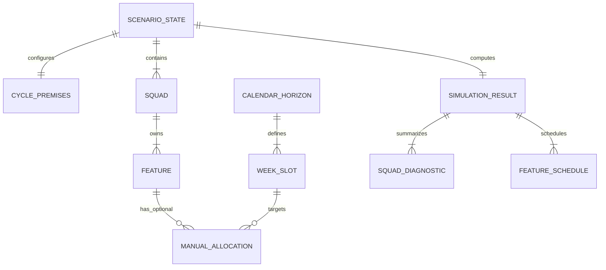
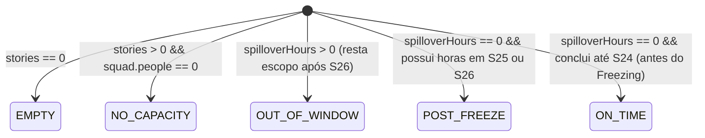

# Phase 1 Data Model: Modernização do Simulador de Roadmap e Capacity

**Feature**: `001-modernizar-simulador-roadmap`  
**Date**: 2026-11-16  
**Spec**: [spec.md](./spec.md) | **Research**: [research.md](./research.md)

---

## 1. Visão Geral das Entidades

---

## 2. Entidades Persistidas / Editáveis (`ScenarioState`)

### 2.1 `CyclePremises` (Premissas Globais do Ciclo)
Configurações gerais aplicadas a todo o portfólio simulado.

| Campo | Tipo | Padrão | Regras de Validação e Domínio |
|---|---|---|---|
| `avgHoursPerStory` | `number` (inteiro) | `56` | Mínimo `1`, máximo `240` (slider padrão `16`–`120`, input aceita `1`–`240`). |
| `hoursPerPersonPerWeek` | `number` (inteiro) | `40` | Mínimo `1`, máximo `60`. Atalhos rápidos para `30` (visão `C0-ROADMAP`) e `40` (visão `C1-ROADMAP`). |
| `startWeekId` | `string` | `'w03'` (`S07`) | Deve referenciar um `WeekSlot.id` não congelado (`frozen === false`). Padrão `S07` (logo após `ESTAMOS AQUI` em `S06`). |
| `schedulingMode` | `'continuous' \| 'whole_weeks' \| 'manual'` | `'continuous'` | Define o motor ativo: Fluxo Contínuo (`C1`), Semanas Inteiras (`C0`) ou Alocação Manual. |

### 2.2 `Squad` (Módulo / Equipe)
Representa cada uma das 4 frentes funcionais do roadmap (`A`, `B`, `C`, `D`).

| Campo | Tipo | Exemplo | Regras de Validação e Domínio |
|---|---|---|---|
| `key` | `'A' \| 'B' \| 'C' \| 'D'` | `'A'` | Identificador único imutável da Squad. |
| `title` | `string` | `'Módulo A - SQUAD A'` | Nome de exibição da Squad. |
| `colorToken` | `string` | `'--chart-1'` | Slot fixo da paleta categórica validada (`A=--chart-1`, `B=--chart-2`, `C=--chart-3`, `D=--chart-4`). |
| `people` | `number` (inteiro) | `4` | Mínimo `0`, máximo `25` (slider `0`–`12`, input `0`–`25`). `0` é permitido e aciona estado `NO_CAPACITY`. |
| `features` | `Feature[]` | `[...]` | Lista ordenada por prioridade top-down das entregas da Squad. |

### 2.3 `Feature` (Entrega de Backlog)
Item funcional pertencente a uma `Squad` e associado a um `Épico`.

| Campo | Tipo | Exemplo | Regras de Validação e Domínio |
|---|---|---|---|
| `id` | `string` | `'A-1'` | Identificador único no formato `{squadKey}-{index}`. |
| `epic` | `string` | `'EPC-001'` | Código do Épico (`EPC-001` a `EPC-011`). |
| `name` | `string` | `'A1 - Cadastro e ativação de conta'` | Nome descritivo da feature. |
| `stories` | `number` (inteiro) | `11` | Quantidade de histórias (`US`). Mínimo `0`, máximo `200`. |

### 2.4 `ManualAllocationMap` (Alocações Manuais)
Estrutura esparsa indexada por `featureId` e `weekId` armazenando a quantidade de histórias (`US`, inteiro ou decimal ≥ `0`) alocada manualmente naquela semana.
- **Formato**: `Record<featureId, Record<weekId, number>>`
- **Invariantes**:
  - Chaves de `weekId` marcadas com `frozen: true` (`'freeze'`) nunca aceitam valor `> 0`.
  - Valores `<= 0` ou `NaN` são removidos do mapa esparso.
  - Preservado no estado mesmo quando o usuário alterna temporariamente `schedulingMode` para `continuous` ou `whole_weeks` para comparação.

---

## 3. Catálogo Estático de Referência (`CalendarHorizon`)

### 3.1 `WeekSlot` (Coluna Temporal do Calendário)
Extraído das 3 abas de `SEMANAS.xlsx` (`23` colunas da grade: `22` semanas `w01`–`w22` + `1` coluna `freeze`).

| Campo | Tipo | Descrição |
|---|---|---|
| `id` | `string` | `'w01'`..`'w22'` e `'freeze'`. |
| `index` | `number` | Posição `0`..`22` na linha do tempo. |
| `month` | `string` | `'AGOSTO' \| 'SETEMBRO' \| 'OUTUBRO' \| 'NOVEMBRO' \| 'DEZEMBRO'`. |
| `sprint` | `string` | `''`, `'SPRINT-04'`..`'SPRINT-12'`, ou `'FREEZING'`. |
| `sprintWeek` | `string` | `'S05'`..`'S26'` ou `'17/12/2026'` (na coluna `freeze`). |
| `monthWeek` | `string` | `'S01'`..`'S05'` ou `''`. |
| `dateLabel` | `string` | Data de referência derivada de `C1-ROADMAP` / `SEMANAS` (ex.: `'14/08'`, `'17/12/2026'`). |
| `frozen` | `boolean` | `true` exclusivamente para `id === 'freeze'`. |
| `isHistoricalDefault` | `boolean` | `true` para `w01` (`S05`) e `w02` (`S06`, divisor de início atual). |
| `milestone` | `string \| null` | Marco oficial da aba `SEMANAS`: `'ESTAMOS AQUI'` (`S06`), `'HOMOLOGAÇÃO'` (`S21`), `'FREEZING'` (`freeze`), `'PRODUÇÃO'` (`S23`/`S25`). |

---

## 4. Entidades Derivadas / Calculadas (`SimulationResult`)

Nenhuma dessas estruturas é salva em disco; todas são derivadas de forma determinística a cada renderização/mudança de estado.

### 4.1 `FeatureSchedule` (Resultado por Feature)
| Campo | Tipo | Regra de Derivação |
|---|---|---|
| `featureId` | `string` | Referência à `Feature`. |
| `effortHours` | `number` | `stories * avgHoursPerStory`. |
| `estimatedWeeks` | `number` | `weeklyCapacity > 0 ? effortHours / weeklyCapacity : 0`. |
| `allocatedByWeek` | `Record<weekId, number>` | Horas alocadas em cada semana visível (`w01`..`w22`). |
| `allocatedHoursInHorizon` | `number` | Soma das horas alocadas até `w22` (`S26`). |
| `allocatedHoursBeforeFreeze` | `number` | Soma das horas alocadas até `w20` (`S24`, antes de `17/12/2026`). |
| `spilloverHours` | `number` | `Math.max(0, effortHours - allocatedHoursInHorizon)`. |
| `spilloverWeeks` | `number` | Em `whole_weeks`: `Math.ceil(spilloverHours / weeklyCapacity)`; nos demais modos: `spilloverHours / weeklyCapacity` (`0` se `weeklyCapacity === 0`). |
| `startWeekCode` / `endWeekCode` | `string \| null` | Primeira e última semana (`S07`..`S26` ou `+N sem`) com alocação. |
| `status` | `FeatureStatus` | Máquina de estados descrita na seção 4.4. |

### 4.2 `SquadDiagnostic` (Diagnóstico por Squad)
| Campo | Tipo | Regra de Derivação |
|---|---|---|
| `squadKey` | `'A' \| 'B' \| 'C' \| 'D'` | Identificador da Squad. |
| `weeklyCapacityHours` | `number` | `people * hoursPerPersonPerWeek`. |
| `availableHoursBeforeFreeze` | `number` | `usableWeeksBeforeFreeze * weeklyCapacityHours` (padrão `18 * weeklyCapacityHours` iniciando em `S07`). |
| `availableHoursTotalHorizon` | `number` | `usableWeeksTotal * weeklyCapacityHours` (padrão `20 * weeklyCapacityHours` iniciando em `S07`). |
| `demandHours` | `number` | Soma de `effortHours` de todas as features da Squad. |
| `requiredWeeks` | `number` | Total de semanas exigidas pela Squad no modo ativo (incluindo excedente pós-`S26`). |
| `spilloverWeeks` | `number` | Semanas necessárias além de `S26` (ou além de `S24` para corte de *Freezing*). |
| `recommendedPeopleForFreeze` | `number` | Menor inteiro `p >= 0` tal que 100% das features da Squad concluam até `S24` (antes do *Freezing*) no modo ativo (`continuous` ou `whole_weeks`; em `manual`, usa cálculo contínuo como referência). |
| `peopleDeltaForFreeze` | `number` | `Math.max(0, recommendedPeopleForFreeze - people)`. |
| `weeklyUsage` | `Record<weekId, { hours: number, ratio: number, isOvercapacity: boolean }>` | Ocupação semana a semana da Squad. |
| `status` | `'ON_TIME' \| 'POST_FREEZE' \| 'OUT_OF_WINDOW' \| 'NO_CAPACITY' \| 'OVERCAPACITY'` | Situação consolidada da Squad para exibição em `.badge` (`150×22px`). |

### 4.3 `PortfolioKpis` (Indicadores Executivos Globais)
- `totalStories` / `totalFeatures` / `totalDemandHours` / `totalPeople` / `totalWeeklyCapacity`
- `featuresCompletedBeforeFreeze` / `storiesCompletedBeforeFreeze` / `completionPctBeforeFreeze`
- `bottleneckSquadKey` + `maxRequiredWeeks` + `globalSpilloverWeeks`
- `totalRecommendedPeople` + `totalAdditionalPeopleNeeded`
- `cumulativeCurve`: vetor de pontos por semana (`weekId`, `sprintWeek`, `milestone`, `plannedCumulativeHours`, `capacityCumulativeHours`, `completedStoriesEquivalent`) que alimenta tanto o gráfico SVG quanto os 5 cartões de marcos e a tabela acessível equivalente.

### 4.4 Máquina de Estados de `FeatureStatus`

| Código (`FeatureStatus`) | Rótulo no `.badge` (`150×22px`) | Variante Semântica | Significado de Negócio |
|---|---|---|---|
| `ON_TIME` | `No prazo` | `.ok` (sucesso) | 100% concluída até `S24` (antes de `17/12/2026`). |
| `POST_FREEZE` | `Pós-Freezing` | `.warn` (aviso) | Conclui dentro de 2026 (`S25`–`S26`), mas após o congelamento de `17/12`. |
| `OUT_OF_WINDOW` | `Fora da janela` | `.bad` (perigo) | Excede `S26` (ou possui histórias não alocadas no modo manual). |
| `NO_CAPACITY` | `Sem capacidade` | `.bad` (perigo) | Squad com `0` profissionais e escopo `> 0`. |
| `EMPTY` | `Sem escopo` | neutro (`.info`/neutro) | Feature com `0` histórias estimadas. |

---

## 5. Dataset Base Inicial (Reconciliado com `SEMANAS.xlsx`)

| Squad | Pessoas (Inicial) | Features | Total US (Inicial) | Esforço (`56h/US`) | Capacity `40h` (`C1`) | Semanas Contínuas (`C1`) | Semanas Inteiras (`C0` em `40h`) |
|---|---:|---:|---:|---:|---:|---:|---:|
| **Squad A** (`Módulo A`) | `4` | `8` (`A1`–`A8`) | `42` | `2.352 h` | `160 h/sem` | `14,70 sem` | `19 sem` |
| **Squad B** (`Módulo B`) | `1` | `8` (`B1`–`B8`) | `33` | `1.848 h` | `40 h/sem` | `46,20 sem` | `50 sem` |
| **Squad C** (`Módulo C`) | `1` | `6` (`C1`–`C6`) | `32` | `1.792 h` | `40 h/sem` | `44,80 sem` | `48 sem` |
| **Squad D** (`Módulo D`) | `2` | `7` (`D1`–`D7`) | `56` *(soma real)* | `3.136 h` | `80 h/sem` | `39,20 sem` | `41 sem` |
| **Total Portfólio** | **`8`** | **`29`** | **`163`** *(ver nota)* | **`9.128 h`** | **`320 h/sem`** | — | — |

> **Nota de auditoria aritmética:** A soma exata das histórias iniciais das 29 features cadastradas em `SEMANAS.xlsx` e `src/main.jsx` é **`163 US`** (`42 + 33 + 32 + 56 = 163`). O motor sempre calcula `totalStories` dinamicamente pela soma real das features (`reduce`), garantindo zero divergência caso o usuário edite qualquer `Qtd. US`.
