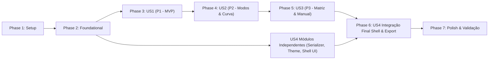

---
description: "Task list for Modernização do Simulador de Roadmap e Capacity"
---

# Tasks: Modernização do Simulador de Roadmap e Capacity

**Input**: Design documents from `/specs/001-modernizar-simulador-roadmap/`  
**Prerequisites**: [plan.md](./plan.md), [spec.md](./spec.md), [research.md](./research.md), [data-model.md](./data-model.md), [contracts/](./contracts/), [quickstart.md](./quickstart.md)

**Tests**: Inclui suítes unitárias e de contrato rápidas no runner nativo `node --test` (`tests/simulationEngine.test.js` e `tests/scenarioSerializer.test.js`) conforme definido nos gates `G1`/`G2` de `plan.md`.

**Organization**: Tarefas agrupadas por História de Usuário (`US1` a `US4`) para permitir implementação, validação e demonstração incremental independente (MVP já na conclusão da Fase 3).

## Format: `[ID] [P?] [Story] Description`

- **[P]**: Pode ser executada em paralelo (arquivos distintos, sem dependência de tarefas não concluídas na mesma etapa)
- **[Story]**: História de usuário atendida (`[US1]`, `[US2]`, `[US3]`, `[US4]`)
- Caminhos exatos de arquivos incluídos em todas as tarefas

---

## Phase 1: Setup (Shared Infrastructure)

**Purpose**: Inicialização da estrutura modular de pastas, configuração explícita do Vite/React 19, carregamento tipográfico e scripts de conveniência na raiz.

- [X] T001 Create modular source and test directories (`src/data`, `src/domain`, `src/hooks`, `src/components/shell`, `src/components/simulator`, `src/components/matrix`, `src/components/ui`, `src/styles`, `tests`) in `roadmap-react/roadmap-react/`
- [X] T002 Pin explicit semver ranges (`react@^19.3.0`, `react-dom@^19.3.0`, `vite@^8.3.0`, `@vitejs/plugin-react@^6.1.1`) and add `"test": "node --test tests/*.test.js"` script in `roadmap-react/roadmap-react/package.json`
- [X] T003 [P] Create root forwarding `package.json` with `dev`, `build`, `preview`, and `test` scripts (`--prefix roadmap-react/roadmap-react`) in `package.json`
- [X] T004 [P] Create explicit Vite configuration enabling `@vitejs/plugin-react` in `roadmap-react/roadmap-react/vite.config.js`
- [X] T005 [P] Update `roadmap-react/roadmap-react/index.html` with `lang="pt-BR"`, `Montserrat` font weights (`400;500;600;700`), `<meta name="theme-color">`, and synchronous `<head>` anti-FOUC script resolving `<html data-theme="light|dark">` from `localStorage.getItem('theme')` and `prefers-color-scheme`

---

## Phase 2: Foundational (Blocking Prerequisites)

**Purpose**: Tokens visuais NextPrev, catálogo temporal reconciliado com `SEMANAS.xlsx`, primitivos acessíveis de UI e estado base validado.

**⚠️ CRITICAL**: Deve estar concluída antes de iniciar as fases de Histórias de Usuário.

- [X] T006 Create consolidated NextPrev CSS tokens (Light mode per DS §15/§18.13, Dark mode `:root[data-theme="dark"]` per DS §19.4, `12px` floor `--text-xs`, `tabular-nums` utility, `3px solid #56bbb2` focus-visible ring, and `prefers-reduced-motion` reset) in `roadmap-react/roadmap-react/src/styles/tokens.css`
- [X] T007 [P] Create enriched static catalog (`WEEKS` with `23` slots `'w01'..'w22'` + `'freeze'`, real date labels, `frozen: true` on `'freeze'`, milestones `'ESTAMOS AQUI'` on `S06`, `'HOMOLOGAÇÃO'` on `S21`, `'FREEZING'` on `'freeze'`, `'PRODUÇÃO'` on `S23`/`S25`; and `INITIAL_SQUADS` with keys `'A' | 'B' | 'C' | 'D'`, fixed `colorToken` `'A=--chart-1', 'B=--chart-2', 'C=--chart-3', 'D=--chart-4'`, `29` features across `'EPC-001' a 'EPC-011'`, and `163` baseline stories) in `roadmap-react/roadmap-react/src/data/initialRoadmapData.js`
- [X] T008 [P] Implement inline SVG icon primitive (`viewBox="0 0 24 24"`, `stroke="currentColor"`, `strokeWidth="1.65"`, `aria-hidden="true"`, including Copilot mark, sun/moon/monitor, search, star, sliders, export, check, warning, undo, and area icons) in `roadmap-react/roadmap-react/src/components/ui/Icon.jsx`
- [X] T009 [P] Implement standardized `Badge` component (`width: 150px; height: 22px; box-sizing: border-box; flex-shrink: 0`, `6px` status dot, ellipsis truncation with automatic full-text `title`, and variants `.ok`, `.warn`, `.bad`, `.info`) in `roadmap-react/roadmap-react/src/components/ui/Badge.jsx`
- [X] T010 [P] Implement accessible `SliderField` component (`.slider-row` `grid-template-columns: 1fr 120px; gap: 12px`, synchronized `<input type="range">` + canonical `<input type="number">`, 3 reference tick labels `Mínimo / Padrão / Teto`, and domain validation message `.err` via `aria-describedby`) in `roadmap-react/roadmap-react/src/components/ui/SliderField.jsx`
- [X] T011 [P] Implement accessible `Toast` notification banner (`role="status"`, `aria-live="polite"`, `2300ms` auto-hide) in `roadmap-react/roadmap-react/src/components/ui/Toast.jsx`
- [X] T012 Create base `useSimulationState` hook managing `ScenarioState` with validated setters enforcing constraints verbatim (`avgHoursPerStory`: `"Mínimo 1, máximo 240 (slider padrão 16–120, input aceita 1–240)"`, `hoursPerPersonPerWeek`: `"Mínimo 1, máximo 60. Atalhos rápidos para 30 (visão C0-ROADMAP) e 40 (visão C1-ROADMAP)"`, `startWeekId`: `"Deve referenciar um WeekSlot.id não congelado (frozen === false). Padrão S07 (logo após ESTAMOS AQUI em S06)"`, `schedulingMode`: `'continuous' | 'whole_weeks' | 'manual'`, `Squad.people`: `"Mínimo 0, máximo 25 (slider 0–12, input 0–25). 0 é permitido e aciona estado NO_CAPACITY"`, and `Feature.stories`: `"Quantidade de histórias (US). Mínimo 0, máximo 200"`) in `roadmap-react/roadmap-react/src/hooks/useSimulationState.js`

**Checkpoint**: Fundação pronta — tokens, catálogo, primitivos de UI e estado validado operacionais.

---

## Phase 3: User Story 1 - Simulação Executiva de Capacidade e Prazos em Tempo Real (Priority: P1) 🎯 MVP

**Goal**: Permitir ao gestor simular premissas do ciclo (`30h`/`40h`, média `h/US`, início `S07`) e tamanho de cada Squad via controles deslizantes sincronizados, visualizando em tempo real os cartões executivos de conclusão, entregas até o *Freezing* (`17/12/2026`), gargalos e recomendação automática de profissionais por Squad.

**Independent Test**: Abrir `http://localhost:5173`, ajustar os controles deslizantes de `Média de horas por história` ou `Profissionais` da Squad B e verificar atualização imediata (`< 100ms`) dos cartões KPI à direita, do status `Badge` (`150×22px`) e da recomendação de *headcount*, além da troca proporcional entre jornadas de `40h (C1)` e `30h (C0)`.

### Implementation for User Story 1

- [X] T013 [US1] Implement core `runSimulation(state, weeks)` in `roadmap-react/roadmap-react/src/domain/simulationEngine.js` with `continuous` (`C1`) scheduling, `FREEZING` (`17/12/2026`) exclusion, post-`S26` `spilloverHours`/`spilloverWeeks`, `FeatureStatus` transitions (`'EMPTY'`, `'NO_CAPACITY'`, `'ON_TIME'`, `'POST_FREEZE'`, `'OUT_OF_WINDOW'`), `SquadDiagnostic` (`recommendedPeopleForFreeze` and `peopleDeltaForFreeze`), and `PortfolioKpis`
- [X] T014 [P] [US1] Create 2-column asymmetric simulator layout (`gap: 16px`, aligned card tops per DS §7.6), `.surface` containers (`border-radius: 13px`, `padding: 22px`), `.slider-row`, `.dsh-card.kpi` (`--text-2xl: 32px` isolated from generic `.kpi` per DS §20.10.3), and `.badge` styles in `roadmap-react/roadmap-react/src/styles/simulator.css`
- [X] T015 [P] [US1] Implement `ScopePremisesCard` component (feature/epic quick filter input, `startWeekId` selector restricted to `frozen === false`, `hoursPerPersonPerWeek` quick buttons `30h (C0)` / `40h (C1)` + numeric input `1..60`, and Freezing window summary) in `roadmap-react/roadmap-react/src/components/simulator/ScopePremisesCard.jsx`
- [X] T016 [P] [US1] Implement `ParametersCard` component with synchronized `SliderField` rows for `avgHoursPerStory` (slider `16..120`, input `1..240`, default `56h`) and Squads `A..D` `people` (slider `0..12`, input `0..25`, live weekly capacity `h/sem` readout) in `roadmap-react/roadmap-react/src/components/simulator/ParametersCard.jsx`
- [X] T017 [P] [US1] Implement `KpiSummaryColumn` component rendering `.dsh-card.kpi` executive cards (Portfolio Horizon & Bottleneck Squad, Features/US Completed Before `17/12` Freezing with `%`, and Squad demand-vs-capacity breakdown bars) in `roadmap-react/roadmap-react/src/components/simulator/KpiSummaryColumn.jsx`
- [X] T018 [P] [US1] Implement `SquadDiagnosticsCard` component displaying per-Squad capacity, demand, required vs. available weeks, `150×22px` status `Badge`, and actionable headcount recommendation summary to clear Freezing deficit in `roadmap-react/roadmap-react/src/components/simulator/SquadDiagnosticsCard.jsx`
- [X] T019 [US1] Compose initial 2-column executive simulator view in `roadmap-react/roadmap-react/src/App.jsx` and update entry point `roadmap-react/roadmap-react/src/main.jsx` to mount `App` with `tokens.css` and `simulator.css`

**Checkpoint**: MVP executivo funcional — simulação interativa em duas colunas com KPIs e diagnóstico de *headcount* em tempo real.

---

## Phase 4: User Story 2 - Comparação de Modalidades de Alocação e Curva Visual de Marcos (Priority: P2)

**Goal**: Adicionar alternância entre as três modalidades de agendamento (*Fluxo Contínuo*, *Semanas Inteiras* e *Alocação Manual*) e exibir a curva gráfica de evolução de entregas frente à capacidade com os 5 cartões de marcos do projeto e visão tabular equivalente acessível.

**Independent Test**: Alternar o seletor segmentado entre *Fluxo Contínuo* e *Semanas Inteiras* observando a diferença real de semanas na Squad A (`14,70` vs `19` semanas), inspecionar a curva gráfica e os 5 cartões de marcos (`S06`, `S12`, `S18`, `S21 Homologação`, `S23 Produção`), navegar nos pontos por teclado e alternar para a tabela de marcos equivalente.

### Implementation for User Story 2

- [X] T020 [US2] Extend `roadmap-react/roadmap-react/src/domain/simulationEngine.js` with `whole_weeks` (`C0` `Math.ceil` exclusive week allocation + exact iterative `recommendedPeopleForFreeze` solver `p = 1..50`), `cumulativeCurve` series across `S05`–`S26`, and `deriveManualAllocationsFromResult(simulationResult, avgHoursPerStory)`
- [X] T021 [P] [US2] Create unit and contract tests for `continuous` (`C1`), `whole_weeks` (`C0`), `30h` (`C0-ROADMAP`) vs `40h` (`C1-ROADMAP`) reconciliation, `0` people (`NO_CAPACITY`), `0` stories (`EMPTY`), `FREEZING` skip, and iterative headcount solver in `roadmap-react/roadmap-react/tests/simulationEngine.test.js`
- [X] T022 [P] [US2] Add 3-option segmented `schedulingMode` selector (`Fluxo Contínuo` `'continuous'`, `Semanas Inteiras` `'whole_weeks'`, `Alocação Manual` `'manual'`) with `aria-pressed` / `radiogroup` semantics to `roadmap-react/roadmap-react/src/components/simulator/ParametersCard.jsx`
- [X] T023 [P] [US2] Implement `ProjectionChartCard` component (`<svg role="img" aria-labelledby aria-describedby>` cumulative delivery vs. capacity curve using `--chart-*` tokens, keyboard-focusable week markers with `ArrowLeft`/`ArrowRight`/`Home`/`End`/`Esc` tooltip control, `Gráfico | Tabela de marcos` segmented toggle, and 5 milestone summary cards `S06 Atual`, `S12 Set`, `S18 Nov`, `S21 Homologação`, `S23 Produção`) in `roadmap-react/roadmap-react/src/components/simulator/ProjectionChartCard.jsx`
- [X] T024 [US2] Wire `schedulingMode` transitions (auto-seeding `manualAllocations` from current schedule when entering `'manual'` if empty while preserving existing manual edits) in `roadmap-react/roadmap-react/src/hooks/useSimulationState.js` and mount `ProjectionChartCard` in `roadmap-react/roadmap-react/src/App.jsx`

**Checkpoint**: Histórias `US1` e `US2` completas e validadas por testes unitários em `simulationEngine.test.js`.

---

## Phase 5: User Story 3 - Gestão Detalhada na Matriz de Roadmap, Estouro Explícito e Alocação Manual (Priority: P3)

**Goal**: Entregar a matriz completa modernizada (`S05`–`S26` + `FREEZING` + coluna explícita de excedente `+Sem`), com filtros combináveis com chips, edição inline de `Qtd. US` e modo de *Alocação Manual* com bloqueio de *Freezing*, auto-distribuição por feature e alerta visual/textual de sobrecarga semanal (*overcapacity*).

**Independent Test**: Filtrar Squad B na matriz e confirmar que todas as 8 features aparecem com status `Fora da janela` e semanas excedentes explícitas em `+Sem` (zero truncamento silencioso); ativar *Alocação Manual*, lançar histórias acima da capacidade semanal para verificar o alerta de sobrecarga e confirmar o bloqueio da coluna `FREEZING`.

### Implementation for User Story 3

- [X] T025 [US3] Implement `manual` scheduling evaluation (`ManualAllocationMap` enforcing `"Chaves de weekId marcadas com frozen: true ('freeze') nunca aceitam valor > 0"` and `"Valores <= 0 ou NaN são removidos do mapa esparso"`, per-week Squad `weeklyUsage` with `isOvercapacity` and `overHours`, and `autoDistributeSingleFeature(state, featureId, weeks)`) in `roadmap-react/roadmap-react/src/domain/simulationEngine.js`
- [X] T026 [P] [US3] Create NextPrev matrix/Gantt styles (sticky left columns and 4-row sticky header, `40px` min row height per DS §20.10.7, Squad `--chart-1..4` allocation bars, semantic hatched `FREEZING` column, `.capacity-meter` bar, `.week-over` alert styling, and `+Sem` spillover column) in `roadmap-react/roadmap-react/src/styles/roadmap-matrix.css`
- [X] T027 [P] [US3] Implement `MatrixToolbar` component (filters by Squad `'A'..'D'`, Epic `'EPC-001'..'EPC-011'`, `FeatureStatus`, and text search; removable active filter chips + `Limpar filtros`; `Gantt | Grade` view toggle and full-width matrix focus toggle) in `roadmap-react/roadmap-react/src/components/matrix/MatrixToolbar.jsx`
- [X] T028 [US3] Implement `RoadmapMatrix` component (inline `stories` input `0..200`, `150×22px` `FeatureStatus` `Badge`, explicit post-`S26` `+Sem` spillover column, manual weekly US inputs locked on `frozen: true`, Squad overcapacity alert badges/tooltips, and per-feature `Auto-distribuir` / `Limpar` action buttons + double-click/context-menu shortcuts) in `roadmap-react/roadmap-react/src/components/matrix/RoadmapMatrix.jsx`
- [X] T029 [P] [US3] Expand `roadmap-react/roadmap-react/tests/simulationEngine.test.js` with tests for `manual` mode calculations, `overcapacity` detection, `'freeze'` rejection, `autoDistributeSingleFeature`, and post-`S26` spillover non-omission across all 29 features
- [X] T030 [US3] Integrate `MatrixToolbar` and `RoadmapMatrix` below the 2-column simulator workspace (including expandable focus mode) in `roadmap-react/roadmap-react/src/App.jsx`

**Checkpoint**: Histórias `US1`, `US2` e `US3` completas — visibilidade executiva + controle fino de cronograma sem perda/omissão de dados.

---

## Phase 6: User Story 4 - Shell do Portal do Gestor, Copiloto Contextual, Temas e Exportação de Cenários (Priority: P4)

**Goal**: Envolver o simulador no Shell completo do Portal do Gestor (Sidebar, Topbar com `Ctrl+K` e seletor de Tema Claro/Escuro/Sistema, Breadcrumbs, Favorito), adicionar painel lateral do Copiloto com propostas confirmáveis, *Undo* de 30 níveis, restauração segura em 2 cliques e exportação/importação (`.json`, `.csv` e **Exportar estudo em PDF** em tema claro).

**Independent Test**: Alternar entre temas Claro e Escuro sem *flash* ao recarregar; abrir o Copiloto, confirmar proposta de balanceamento e acionar *Desfazer*; clicar duas vezes em *Restaurar valores iniciais*; exportar e reimportar `.json` (testando também arquivo inválido); acionar *Exportar estudo em PDF* com tema Escuro ativo e confirmar impressão limpa em fundo claro.

### Implementation for User Story 4

- [X] T031 [P] [US4] Implement `scenarioSerializer.js` (`roadmap.sim.v2` persistence, automatic migration from legacy `roadmap.avg` and `roadmap.squads`, `ScenarioEnvelopeV2` JSON export + `validateAndParseScenarioJson` returning error codes `INVALID_JSON`, `UNSUPPORTED_SCHEMA`, `INVALID_PREMISES`, `INVALID_SQUADS` with `'freeze'` sanitization, and `UTF-8 BOM` `;`-separated `pt-BR` CSV generator) in `roadmap-react/roadmap-react/src/domain/scenarioSerializer.js`
- [X] T032 [P] [US4] Create unit and contract tests for legacy `localStorage` migration, JSON schema validation error codes, `'freeze'` sanitization on import, and CSV output formatting in `roadmap-react/roadmap-react/tests/scenarioSerializer.test.js`
- [X] T033 [P] [US4] Implement `buildCopilotInsights(state, result)` generating contextual Q&A cards and confirmable `CopilotProposal` objects (`'balance-for-freeze'`, `'switch-to-continuous'`, `'optimize-story-slicing'`) with `contextFingerprint` staleness check in `roadmap-react/roadmap-react/src/domain/simulationEngine.js`
- [X] T034 [P] [US4] Implement `useTheme` hook managing `'light' | 'dark' | 'system'` preference in `localStorage` (`theme`), updating `<html data-theme>` + `<meta name="theme-color">`, listening to OS `prefers-color-scheme`, and syncing across tabs via `storage` event in `roadmap-react/roadmap-react/src/hooks/useTheme.js`
- [X] T035 [US4] Upgrade `roadmap-react/roadmap-react/src/hooks/useSimulationState.js` to integrate `scenarioSerializer` auto-persistence/migration, 30-entry `Undo` stack, Copilot batch proposal apply/undo, JSON scenario import with validation feedback, and 2-click armed reset (`4000ms` timeout, zero `window.confirm()`)
- [X] T036 [P] [US4] Create Portal Shell layout, `254px` fixed Sidebar / mobile drawer + backdrop, `77px` Topbar, `PageHeader`, and `410px` `CopilotDrawer` push/overlay styles across the 5 consolidated breakpoints (`480 / 720 / 1024 / 1280 / 1650px`) in `roadmap-react/roadmap-react/src/styles/shell.css`
- [X] T037 [P] [US4] Create `@media print` stylesheet (`@page { size: landscape; margin: 10mm; }`, forced light-theme palette, executive `ESTUDO SIMULADO` header banner, hidden chrome/drawers/controls) in `roadmap-react/roadmap-react/src/styles/print.css`
- [X] T038 [P] [US4] Implement `Sidebar` component (`NextPrev · PORTAL DO GESTOR` brand header, fixed items `Início / Minhas tarefas / Favoritos`, accordion `Áreas de trabalho` with active `Portfólio › Simulador de roadmap`, `3px` `#345c78` active accent, and mobile drawer close) in `roadmap-react/roadmap-react/src/components/shell/Sidebar.jsx`
- [X] T039 [P] [US4] Implement `Topbar` (search input bound to `Ctrl+K`/`Cmd+K`, `Demonstração — dados simulados` indicator, profile selector, `40×40px` accessible `menuitemradio` Theme button, and `#062b4f` + `#c2ac71` Copilot toggle) and `PageHeader` (back pill, breadcrumbs, eyebrow, `H1`, favorite `.star`, `Desfazer`, 2-click `Restaurar`, `Importar JSON`, `Exportar JSON/CSV`, and `Exportar estudo em PDF`) in `roadmap-react/roadmap-react/src/components/shell/Topbar.jsx` and `roadmap-react/roadmap-react/src/components/shell/PageHeader.jsx`
- [X] T040 [P] [US4] Implement `CopilotDrawer` component (`410px` aside, contextual prompt chips, diagnostic responses, `.proposal-card` with Confirm/Discard, `.cp-stale` warning when `contextFingerprint` changes, batch Undo trigger, and `Esc` + `returnFocus` management) in `roadmap-react/roadmap-react/src/components/shell/CopilotDrawer.jsx`
- [X] T041 [US4] Assemble full Portal Shell (`Skip link`, `Sidebar`, `Topbar`, `PageHeader`, `<main id="main-content" tabIndex={-1}>`, `CopilotDrawer`, `Toast`, `print.css`, and global `Ctrl+K` / `Esc` listeners) in `roadmap-react/roadmap-react/src/App.jsx`

**Checkpoint**: Todas as 4 Histórias de Usuário (`P1`–`P4`) integradas e funcionais no padrão completo do Portal do Gestor.

---

## Phase 7: Polish & Cross-Cutting Concerns

**Purpose**: Limpeza de código legado, documentação atualizada e validação automatizada e funcional ponta a ponta.

- [X] T042 [P] Remove obsolete Excel-style `roadmap-react/roadmap-react/src/styles.css` (ensuring zero dead selectors remain and all imports point to `src/styles/*.css`)
- [X] T043 [P] Update `roadmap-react/roadmap-react/README.md` with modernized feature overview, NextPrev design tokens/themes, 3 scheduling modes, keyboard shortcuts, and execution/test instructions
- [X] T044 Execute automated unit/contract tests (`npm test --prefix roadmap-react/roadmap-react`) and production build (`npm run build --prefix roadmap-react/roadmap-react`) verifying 100% pass rate and `< 100 KB` gzip bundle
- [X] T045 Run end-to-end validation checklist across Scenarios 1–4 (P1–P4, edge cases, responsive breakpoints `360px`–`1650px+`, light/dark contrast, and light-mode PDF print preview) per `specs/001-modernizar-simulador-roadmap/quickstart.md`

---

## Dependencies & Execution Order

### Phase Dependencies

1. **Setup (Phase 1: `T001`–`T005`)**: Sem dependências — inicia imediatamente.
2. **Foundational (Phase 2: `T006`–`T012`)**: Depende da Fase 1 — **bloqueia** o início das histórias de usuário.
3. **User Story 1 (Phase 3: `T013`–`T019`)**: Depende da Fase 2 — entrega o **MVP executivo**.
4. **User Story 2 (Phase 4: `T020`–`T024`)**: Depende da conclusão do motor base de `US1` (`T013`) para estender `simulationEngine.js` com `whole_weeks` e `cumulativeCurve`, enquanto os componentes visuais (`T022`, `T023`) são paralelizáveis.
5. **User Story 3 (Phase 5: `T025`–`T030`)**: Depende da Fase 2 (e integra-se ao `simulationEngine.js` estendido em `T020`); estilização e barra de ferramentas (`T026`, `T027`) rodam em paralelo.
6. **User Story 4 (Phase 6: `T031`–`T041`)**: Serialização (`T031`, `T032`), `useTheme` (`T034`), estilos do Shell/Print (`T036`, `T037`) e componentes de Shell (`T038`–`T040`) podem ser construídos em paralelo assim que a Fase 2 terminar, integrando-se em `App.jsx` (`T041`).
7. **Polish (Phase 7: `T042`–`T045`)**: Depende da conclusão de todas as fases anteriores.

### User Story Dependency Graph



---

## Parallel Execution Examples

### Parallel Batch — Phase 2 (Foundational Primitives)
```text
Task T007: Create enriched static catalog in roadmap-react/roadmap-react/src/data/initialRoadmapData.js
Task T008: Implement inline SVG Icon component in roadmap-react/roadmap-react/src/components/ui/Icon.jsx
Task T009: Implement standardized 150x22px Badge in roadmap-react/roadmap-react/src/components/ui/Badge.jsx
Task T010: Implement synchronized SliderField in roadmap-react/roadmap-react/src/components/ui/SliderField.jsx
Task T011: Implement accessible Toast in roadmap-react/roadmap-react/src/components/ui/Toast.jsx
```

### Parallel Batch — User Story 1 (MVP UI Cards after `T013`)
```text
Task T014: Create simulator 2-column & KPI styles in roadmap-react/roadmap-react/src/styles/simulator.css
Task T015: Implement ScopePremisesCard in roadmap-react/roadmap-react/src/components/simulator/ScopePremisesCard.jsx
Task T016: Implement ParametersCard in roadmap-react/roadmap-react/src/components/simulator/ParametersCard.jsx
Task T017: Implement KpiSummaryColumn in roadmap-react/roadmap-react/src/components/simulator/KpiSummaryColumn.jsx
Task T018: Implement SquadDiagnosticsCard in roadmap-react/roadmap-react/src/components/simulator/SquadDiagnosticsCard.jsx
```

### Parallel Batch — User Story 4 (Shell, Serializer, Theme & Print)
```text
Task T031: Implement scenarioSerializer.js in roadmap-react/roadmap-react/src/domain/scenarioSerializer.js
Task T034: Implement useTheme.js in roadmap-react/roadmap-react/src/hooks/useTheme.js
Task T036: Create Portal Shell styles in roadmap-react/roadmap-react/src/styles/shell.css
Task T037: Create PDF light-mode print styles in roadmap-react/roadmap-react/src/styles/print.css
Task T038: Implement Sidebar in roadmap-react/roadmap-react/src/components/shell/Sidebar.jsx
Task T040: Implement CopilotDrawer in roadmap-react/roadmap-react/src/components/shell/CopilotDrawer.jsx
```

---

## Implementation Strategy

### 1. MVP First (`User Story 1` Only)
1. Executar **Phase 1 (Setup)** + **Phase 2 (Foundational)**.
2. Executar **Phase 3 (User Story 1: `T013`–`T019`)**.
3. **Parada de validação**: O simulador executivo em duas colunas com sliders sincronizados, KPIs e recomendação de *headcount* já estará navegável e funcional em `http://localhost:5173`.

### 2. Incremental Delivery (`US2` → `US3` → `US4` → `Polish`)
1. Adicionar **US2 (`T020`–`T024`)**: habilita comparação `C1` vs `C0` + curva SVG e cartões de marcos + primeiros testes unitários automatizados.
2. Adicionar **US3 (`T025`–`T030`)**: habilita a Matriz/Gantt modernizada sem truncamento pós-`S26`, filtros combináveis e alocação manual com detecção de sobrecarga.
3. Adicionar **US4 (`T031`–`T041`)**: envolve tudo no Shell completo do Portal do Gestor, adiciona temas Claro/Escuro, Copiloto contextual, *Undo*/Reset seguro e exportação JSON/CSV/PDF.
4. Concluir com **Phase 7 (`T042`–`T045`)**: limpeza final, testes `node --test` 100% verdes e build Vite verificada.
