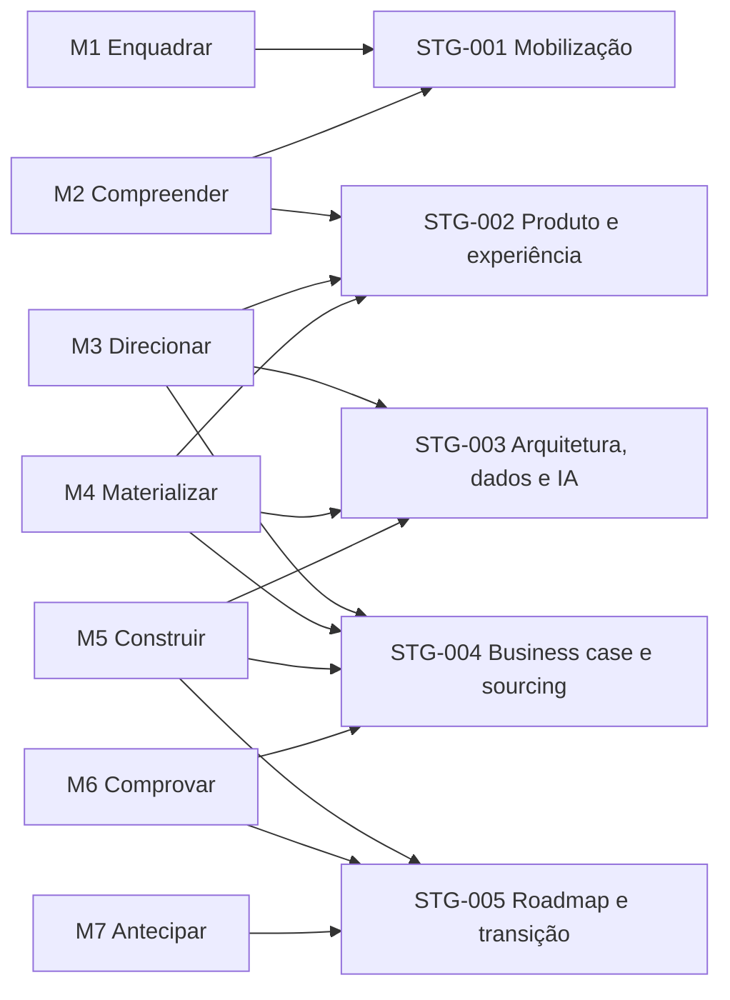

# Perfil de protocolo · Credit on Wealth (exemplo)

Este arquivo **não é capacidade** e não é carregado pelo catálogo. É um **exemplo** de perfil de protocolo para a capacidade genérica [Aplicar perfil de protocolo](../02-darklab-008-aplicar-perfil-de-protocolo.md), extraído do caso Credit on Wealth (crédito com garantia de patrimônio investido). Ele também concentra o **conhecimento de domínio do caso** — regras de garantias, valuation, haircut, LTV, business case e sourcing — que **não** fica em nenhuma capacidade da plataforma.

Origem: o protótipo HTML do caso (`Darklabs-Credit-on-Wealth-tags-auditadas (1).html`, estruturas `projectProtocol`, `engineTimeline` e tipos/status do caderno de conhecimento), tratado como dado. Foram **excluídos** nomes de pessoas, nomes de instituições clientes, links, datas, cronogramas, contagens de status reports, telas de aprovação e valores demonstrativos.

Convenções: [contrato comum](../00-contrato-comum-das-capacidades.md) e [DarkLab · visão e contrato](../02-darklab-000-visao-e-contrato-da-fase.md).

## 1. Protocolo: 5 etapas sobrepostas aos 7 motores

> 5 etapas do projeto ≠ 7 motores DarkLab. Os motores permanecem transversais; as etapas organizam objetivos, atividades e entregáveis do caso.

| Etapa | Nome | Motores | Objetivo | Entregáveis |
|---|---|---|---|---|
| `STG-001` | Mobilização e assimilação | M1, M2 | Consolidar o conhecimento existente, alinhar stakeholders e definir as decisões críticas da descoberta. | `DLV-001` Project Charter e governança · `DLV-002` Knowledge base, mapa de decisões e dependency map |
| `STG-002` | Produto e experiência | M2, M3, M4 | Definir visão de produto, produto-orquestrador, usuários, canais, jornadas, experiência-alvo e escopo funcional. | `DLV-003` Product Vision e proposta de valor · `DLV-004` Jornadas, service blueprint e protótipo navegável · `DLV-005` Escopo funcional e requisitos priorizados |
| `STG-003` | Arquitetura, dados e IA | M3, M4, M5 | Desenhar a plataforma orquestradora, integrações, requisitos de dados e capacidades de IA. | `DLV-006` Arquitetura de referência e capability map · `DLV-007` Catálogo de APIs/eventos e modelo conceitual de dados · `DLV-008` Casos de IA, guardrails e arquitetura de transição |
| `STG-004` | Business case e sourcing | M3, M4, M5, M6 | Atualizar business case, TCO e sourcing por cobertura de capacidades; quantificar valor, investimento e riscos. | `DLV-009` Business case, TCO e cenários · `DLV-010` Build × buy × partner e vendor scorecard |
| `STG-005` | Roadmap e transição | M5, M6, M7 | Preparar o roadmap de MVP, implantação e experimentações futuras; converter a recomendação em plano executável. | `DLV-011` Roadmap de MVP, backlog, ondas, transição, implantação, caminho crítico e KPIs |



### 1.1 Atividades típicas por etapa (sem datas nem responsáveis)

- **STG-001**: kickoff com negócio, inovação e times de produto; ingestão de estudos, arquiteturas, decisões e planejamento existentes; classificação de fatos, premissas, divergências e lacunas; inventário de iniciativas e fornecedores já identificados; mapa de stakeholders e dependências; papéis, critérios de aceite e governança; plano de entrevistas e sessões.
- **STG-002**: usuários e necessidades por segmento de clientes de alta renda; avaliação de atendimento por gerente, autosserviço ou modelo híbrido; papel dos aplicativos e plataformas atuais; pesquisa com gerente, cliente e áreas operacionais; jornada atual, dores, handoffs e exceções; proposta de valor por usuário; jornadas futuras de gerente e cliente; service blueprint; priorização do escopo funcional; wireframes e protótipo navegável; teste de conceito, testes de usabilidade e consolidação de requisitos.
- **STG-003**: arquitetura atual e sistemas de origem; capacidades próprias do orquestrador; ativos elegíveis e fontes de garantia; integrações com crédito, investimentos, seguros/previdência, corretora e canais; bloqueio, liberação, valuation, haircut, LTV e eventos; catálogo de APIs e eventos; segurança, auditoria, observabilidade e resiliência; fontes, qualidade e ownership dos dados; casos de IA e hiperpersonalização; explicabilidade, guardrails e humano no circuito; arquitetura de transição e preparação para Open Finance e custódia externa.
- **STG-004**: validação da base elegível e do potencial de contratação; incremento de crédito e retenção de ativos; impacto em principalidade e share of wallet; receitas e benefícios; custos de plataforma, integração, licenças, infraestrutura, operação e sustentação; TCO e cenários; sensibilidade e riscos de execução; comparação build, buy, partner e híbrido; avaliação de fornecedores por capability coverage; long list, short list, RFI/RFP funcional e técnica; recomendação executiva de sourcing.
- **STG-005**: MVP funcional e técnico; priorização por valor, esforço, dependência e risco; backlog priorizado; roadmap por ondas; arquitetura de transição; dependências e caminho crítico; alinhamento com times de produto; owner do produto e da plataforma; governança de execução; KPIs de implantação, adoção e valor; plano de contratação ou desenvolvimento; riscos, premissas e decisões; decision pack executivo; recomendação de experimentação condicionada à contratação e à validação das condicionantes.

## 2. Composição dos entregáveis a partir dos motores

| Entregável | Campos de motor usados (`capabilityId#campo`) | Obrigatórios |
|---|---|---|
| `DLV-001` Project Charter e governança | M1 `framedChallenge`, `stakeholders`, `constraints`, `expectedResults`, `successCriteria` | todos de M1 |
| `DLV-002` Knowledge base, mapa de decisões e dependency map | M1 `opportunityMap`, `investigationHypotheses`; M2 `signals`, `insights`; M3 `dependencies` (apoio) | M1, M2 |
| `DLV-003` Product Vision e proposta de valor | M3 `productVision`, `valuePropositions`, `productStatementPack`, `businessModel` | M3 |
| `DLV-004` Jornadas, service blueprint e protótipo navegável | M4 `futureJourneys`, `flows`, `serviceBlueprint`, `prototypes`; M2 `journeyPatterns` (apoio) | M4 |
| `DLV-005` Escopo funcional e requisitos priorizados | M4 `buildReadyBacklog`; M3 `priorities`; M5 `mvpDefinition` (apoio) | M4, M3 |
| `DLV-006` Arquitetura de referência e capability map | M3 `capabilityMap`, `partners`; M4 `technicalView` | M3, M4 |
| `DLV-007` Catálogo de APIs/eventos e modelo conceitual de dados | M4 `technicalView`, `assetLibrary`; M5 `instrumentationPlan` | M4 |
| `DLV-008` Casos de IA, guardrails e arquitetura de transição | M2 `solutionPills`; M4 `technicalView`; M5 `pocPlan`, `qualityPlan`; M3 `dependencies` | M4, M5 |
| `DLV-009` Business case, TCO e cenários | M3 `businessModel`, `metrics`, `priorities`; M5 `validationPlan`; M6 `indicators`, `experiments` | M3 |
| `DLV-010` Build × buy × partner e vendor scorecard | M3 `partners`, `capabilityMap`, `dependencies`; M4 `assetLibrary` | M3 |
| `DLV-011` Roadmap de MVP, backlog, ondas, transição, implantação, caminho crítico e KPIs | M5 `mvpDefinition`, `increments`; M6 `recommendation`, `indicators`; M7 `revisedRoadmap`, `futureBacklog`, `reviewTriggers` | M5, M7 |

"Apoio" = `required: false`: um motor fora da etapa pode complementar o entregável, mas sua ausência não gera lacuna obrigatória.

## 3. Tipos de item de conhecimento do caso

| Chave | Rótulo | Natureza padrão | Prefixos de origem | Observação |
|---|---|---|---|---|
| `ponto_relevante` | Ponto relevante | `documentado` | `INS`, `PAIN`, `SIG` | Achado sustentado por fontes. |
| `hipotese` | Hipótese | `hipótese` | `HIP`, `ASM` | Precisa de forma de validar. |
| `foresight` | Foresight | `hipótese` | `FRC`, `SCN`, `IMP` | Sinal, horizonte, incerteza e implicação; nunca previsão. |
| `decisao` | Decisão | `documentado` | `DEC` | Só com evidência da decisão; sem evidência vira `hipótese` + `GAP`. |
| `evidencia` | Evidência | `documentado` | `EVD` | Trecho localizado de fonte. |
| `entregavel` | Entregável | — (da seção) | `DLV` | Natureza herdada das seções. |
| `diario` | Diário | `documentado` | `SRC`, `EVD` | Registro de sessão (o que aconteceu, aprendizado, hipótese, decisão, pendência), sem participantes nominais. |

## 4. Mapeamento de status do caso para o contrato comum

O status do caso descreve **o trabalho no projeto real** (conteúdo analítico, campo `situacaoNoProjeto`), não a execução da plataforma nem aprovação. Os estados técnicos (`pending`, `running`…) só descrevem a geração do item pela plataforma.

| Status do caso | Natureza | Estado de execução (plataforma) | Estado de revisão humana | `situacaoNoProjeto` | Exige `GAP` |
|---|---|---|---|---|---|
| documentado | `documentado` | — | — | — | não |
| hipótese | `hipótese` | — | — | — | não |
| em andamento | `documentado` (a fonte afirma o andamento) | — (`running` só para a geração em curso pelo nó 008) | — | `em_andamento` | não |
| bloqueado | `documentado` (a fonte registra o impedimento) | — (nunca bloqueia execução; entregável fica `parcial`/`sem_insumo` se faltar insumo) | — | `impedido` | **sim** (descreve o impedimento e o insumo faltante) |
| aguardando aprovação (inclui "em fechamento", "material produzido, aceite pendente") | `documentado` | — | `não revisado` (ou `revisado` quando o time registrar observações); `aceito` só por ação humana no catálogo | `aguardando_decisao_externa` | não |
| não iniciado | `proposta` (a plataforma pode propor o conteúdo) | `pending` enquanto o entregável não tiver sido gerado | — | `nao_iniciado` | não |
| cenário | `hipótese` | — | — | — | não |

Regras: "aguardando aprovação" **nunca** vira bloqueio nem estado de aprovação; produção de material não equivale a aceite; aceite formal do cliente só existe se documentado nas fontes (`DEC` com evidência).

## 5. Conhecimento de domínio do caso

Regras e pontos de atenção do caso, usados como `domainChecks` (verificações sobre evidências) e como glossário. **Nenhum** destes itens está embutido na plataforma.

### 5.1 Mobilização e assimilação (STG-001)

- Inventariar fontes, estudos, iniciativas, fornecedores e dependências com procedência.
- Consolidar Project Charter, papéis, mapa de decisões e dependency map; classificar fatos, premissas, divergências e lacunas.
- Toda decisão liga-se a evidência ou vira questão aberta; o índice de conhecimento aponta para fontes do repositório.
- Propor agenda de entrevistas e sessões com objetivos e perguntas de pesquisa.

### 5.2 Produto e experiência (STG-002)

- Analisar segmentos, necessidades e canais; comparar atendimento assistido (gerente), autosserviço e modelo híbrido.
- O produto é tratado como **orquestrador** de crédito e patrimônio; definir seu papel frente aos aplicativos e plataformas atuais.
- Proposta de valor por perfil de cliente; jornadas atuais e futuras de gerente e cliente; service blueprint; direção de wireframes e protótipo; escopo funcional priorizado; plano de teste de conceito e usabilidade.
- **Navegar não é compreender**: avançar na jornada não prova entendimento de garantia, ativos comprometidos, parcelas, certificados e consequências do atraso.
- Pesquisa qualitativa relatada sem reteste comprovado não sustenta mudança como validada.

### 5.3 Arquitetura, dados e IA (STG-003)

- Mapear arquitetura atual e proposta, capacidades do orquestrador e interfaces existentes.
- Representar, **somente quando documentados no recorte**: elegibilidade de ativos, bloqueio e liberação de garantias, valuation, haircut, LTV, margin call e eventos de garantia.
- Monitoramento contínuo de garantias e LTV é **capacidade** (dados, regras de execução, alertas, responsabilidade operacional, exceções), não apenas tela.
- APIs, eventos, modelo conceitual de dados, ownership, qualidade, rastreabilidade, segurança, auditoria, resiliência e observabilidade.
- Casos de IA priorizados com dados, explicabilidade, guardrails e humano no circuito; arquitetura de transição e extensões de ecossistema (Open Finance, custódia externa) como proposta condicionada.
- **Desenho, implantação e validação são estados diferentes**: novas garantias, certificados ou mudanças de experiência em desenho não estão em produção nem validadas sem evidência.
- Novos tipos de garantia dependem de jurídico, compliance, arquitetura e operação.
- Fragmentação entre crédito, investimentos, custódia, canais e regras é dor estrutural a ser evidenciada.

### 5.4 Business case e sourcing (STG-004)

- Modelar benefícios, custos iniciais e recorrentes, TCO, cenários e sensibilidade, documentando fórmulas, unidades, horizontes e dados faltantes; sem dados, cálculos paramétricos ou valores `null` com `GAP`.
- **Estoque de investimentos não é oportunidade**: subtrair estoques de investimento e de crédito não produz oportunidade.
- **Razão entre estoques não é LTV nem conversão**: crédito ativo ÷ investimentos é razão agregada; não mede LTV de operações, conversão nem subutilização causal.
- **Quatro efeitos econômicos separados**: demanda nova, migração de crédito sem garantia (clean), eficiência e perdas evitadas não se somam sem baseline.
- **Iniciativas existentes compõem o baseline**: resultados de iniciativas já operantes saem do benefício incremental.
- **Pré-aprovado, elegibilidade e disponibilidade são estados diferentes**: ausência de oferta pré-aprovada não significa impossibilidade de contratação; cobertura e consulta em tempo real variam por canal.
- **Rentabilidade ajustada ao risco não comprova maior VPL**: não substitui fluxo de caixa incremental, custos, prazo e canibalização.
- Dimensionar oportunidade exige conciliar cliente, elegibilidade, necessidade, ativos livres e canal.
- Business case depende de owners e bases anonimizadas e conciliadas de crédito, investimentos e relacionamento.
- Comparar build, buy, partner e híbrido por capability coverage, dependências, riscos e operação; vendor scorecard; perguntas de RFI/RFP; nenhum fornecedor é selecionado sem evidência.

### 5.5 Roadmap e transição (STG-005)

- Recorte funcional e técnico do MVP; iniciativas em ondas por valor, risco, esforço e dependências.
- Arquitetura de transição, implantação, operação, responsáveis candidatos (por papel), caminho crítico e KPIs de implantação, adoção e valor.
- Decision pack executivo com alternativas, premissas, riscos, recomendações, temas para o backlog e próximos experimentos.
- Experimentação real só é recomendada após contratação e validação das condicionantes; até lá, M6 entrega plano e resultados `hipótese`.
- Datas e owners incertos ficam explícitos como lacuna.

### 5.6 Glossário do caso

| Termo | Definição |
|---|---|
| Garantia | Ativo do cliente vinculado a uma operação de crédito para mitigar risco. |
| Ativo elegível | Ativo que, pelas regras documentadas, pode ser usado como garantia. |
| Bloqueio / liberação | Restrição e retirada da restrição de movimentação do ativo dado em garantia. |
| Valuation | Valor atribuído ao ativo para fins de garantia. |
| Haircut | Desconto aplicado ao valor do ativo para refletir risco de mercado e liquidez. |
| LTV (loan-to-value) | Relação entre o saldo da operação e o valor da garantia após haircut. |
| Margin call | Chamada de recomposição de garantia quando o LTV ultrapassa limite. |
| Crédito clean | Crédito sem garantia. |
| Principalidade | Condição de o banco ser a instituição principal do cliente. |
| Share of wallet | Participação do banco no total de produtos financeiros do cliente. |
| Capability coverage | Grau em que uma opção de sourcing cobre as capacidades necessárias. |
| TCO | Custo total de propriedade ao longo do horizonte analisado. |
| VPL | Valor presente líquido do fluxo de caixa incremental. |

## 6. Instância JSON do perfil

Válida contra `https://jornada-guiada/schemas/02-darklab-008-aplicar-perfil-de-protocolo/1.0.0/protocol-profile.json`.

```json
{
  "schemaVersion": "1.0.0",
  "protocolProfileId": "prf-credit-on-wealth",
  "name": "Credit on Wealth",
  "description": "Protocolo de descoberta em 5 etapas para crédito com garantia de patrimônio investido, sobreposto aos 7 motores DarkLab.",
  "profileVersion": "1.0.0",
  "stages": [
    {
      "id": "STG-001", "order": 1, "name": "Mobilização e assimilação",
      "objective": "Consolidar o conhecimento existente, alinhar stakeholders e definir as decisões críticas da descoberta.",
      "motors": [1, 2],
      "activities": ["Ingestão e classificação de estudos, arquiteturas e decisões existentes", "Inventário de iniciativas e fornecedores", "Mapa de stakeholders e dependências", "Papéis, critérios de aceite e governança", "Plano de entrevistas e sessões"],
      "deliverables": [
        {
          "id": "DLV-001", "name": "Project Charter e governança", "description": "Desafio, escopo, stakeholders, restrições, resultados esperados, critérios de sucesso e governança.",
          "composition": [ { "capabilityId": "02-darklab-001-motor-1-enquadrar-descoberta-estrategica", "fields": ["framedChallenge", "stakeholders", "constraints", "expectedResults", "successCriteria"], "required": true } ],
          "sections": [
            { "key": "desafio", "title": "Desafio e escopo", "guidance": "Enunciado, ambição, escopo e exclusões.", "sourceFields": ["02-darklab-001-motor-1-enquadrar-descoberta-estrategica#framedChallenge"] },
            { "key": "governanca", "title": "Stakeholders e governança", "guidance": "Papéis, interesse, influência e restrições; sem nomes de pessoas.", "sourceFields": ["02-darklab-001-motor-1-enquadrar-descoberta-estrategica#stakeholders", "02-darklab-001-motor-1-enquadrar-descoberta-estrategica#constraints"] },
            { "key": "sucesso", "title": "Resultados esperados e critérios de sucesso", "guidance": "Separar esperado de observado; linha de base ausente vira lacuna.", "sourceFields": ["02-darklab-001-motor-1-enquadrar-descoberta-estrategica#expectedResults", "02-darklab-001-motor-1-enquadrar-descoberta-estrategica#successCriteria"] }
          ],
          "knowledgeItemTypes": ["decisao", "ponto_relevante", "entregavel"]
        },
        {
          "id": "DLV-002", "name": "Knowledge base, mapa de decisões e dependency map", "description": "Índice do conhecimento, decisões com evidência e dependências.",
          "composition": [
            { "capabilityId": "02-darklab-001-motor-1-enquadrar-descoberta-estrategica", "fields": ["opportunityMap", "investigationHypotheses"], "required": true },
            { "capabilityId": "02-darklab-002-motor-2-compreender-escuta-e-sinais", "fields": ["signals", "insights"], "required": true },
            { "capabilityId": "02-darklab-003-motor-3-direcionar-estrategia-e-visao-de-produto", "fields": ["dependencies"], "required": false }
          ],
          "sections": [
            { "key": "conhecimento", "title": "Base de conhecimento", "guidance": "Fatos, premissas, divergências e lacunas com procedência.", "sourceFields": ["02-darklab-002-motor-2-compreender-escuta-e-sinais#signals", "02-darklab-002-motor-2-compreender-escuta-e-sinais#insights"] },
            { "key": "decisoes", "title": "Mapa de decisões", "guidance": "Decisões com evidência; sem evidência, questão aberta.", "sourceFields": ["02-darklab-001-motor-1-enquadrar-descoberta-estrategica#investigationHypotheses"] },
            { "key": "dependencias", "title": "Dependency map", "guidance": "Dependências entre frentes, sistemas, dados e decisões.", "sourceFields": ["02-darklab-003-motor-3-direcionar-estrategia-e-visao-de-produto#dependencies"] }
          ],
          "knowledgeItemTypes": ["evidencia", "decisao", "hipotese", "diario"]
        }
      ]
    },
    {
      "id": "STG-002", "order": 2, "name": "Produto e experiência",
      "objective": "Definir visão de produto, produto-orquestrador, usuários, canais, jornadas, experiência-alvo e escopo funcional.",
      "motors": [2, 3, 4],
      "activities": ["Usuários e necessidades por segmento", "Assistido, autosserviço ou híbrido", "Jornada atual, dores, handoffs e exceções", "Jornadas futuras de gerente e cliente", "Service blueprint", "Wireframes e protótipo navegável", "Teste de conceito e usabilidade"],
      "deliverables": [
        {
          "id": "DLV-003", "name": "Product Vision e proposta de valor", "description": "Visão, Product Statement, proposta de valor por perfil e modelo de negócio.",
          "composition": [ { "capabilityId": "02-darklab-003-motor-3-direcionar-estrategia-e-visao-de-produto", "fields": ["productVision", "valuePropositions", "productStatementPack", "businessModel"], "required": true } ],
          "sections": [
            { "key": "visao", "title": "Visão de produto", "guidance": "Visão, princípios e o que o produto não é.", "sourceFields": ["02-darklab-003-motor-3-direcionar-estrategia-e-visao-de-produto#productVision"] },
            { "key": "proposta_de_valor", "title": "Proposta de valor por perfil", "guidance": "Ganhos e dores aliviadas por segmento.", "sourceFields": ["02-darklab-003-motor-3-direcionar-estrategia-e-visao-de-produto#valuePropositions", "02-darklab-003-motor-3-direcionar-estrategia-e-visao-de-produto#productStatementPack"] }
          ],
          "knowledgeItemTypes": ["ponto_relevante", "hipotese", "entregavel"]
        },
        {
          "id": "DLV-004", "name": "Jornadas, service blueprint e protótipo navegável", "description": "Jornadas futuras, fluxos, blueprint e especificação do protótipo.",
          "composition": [
            { "capabilityId": "02-darklab-004-motor-4-materializar-design-e-ativos-digitais", "fields": ["futureJourneys", "flows", "serviceBlueprint", "prototypes"], "required": true },
            { "capabilityId": "02-darklab-002-motor-2-compreender-escuta-e-sinais", "fields": ["journeyPatterns"], "required": false }
          ],
          "sections": [
            { "key": "jornadas", "title": "Jornadas futuras", "guidance": "Por ator, com dores resolvidas.", "sourceFields": ["02-darklab-004-motor-4-materializar-design-e-ativos-digitais#futureJourneys", "02-darklab-002-motor-2-compreender-escuta-e-sinais#journeyPatterns"] },
            { "key": "blueprint", "title": "Service blueprint", "guidance": "Frente de palco, bastidores, sistemas e pontos de falha.", "sourceFields": ["02-darklab-004-motor-4-materializar-design-e-ativos-digitais#serviceBlueprint"] },
            { "key": "prototipo", "title": "Protótipo navegável", "guidance": "Especificação e roteiro de teste; não afirmar teste sem evidência.", "sourceFields": ["02-darklab-004-motor-4-materializar-design-e-ativos-digitais#prototypes", "02-darklab-004-motor-4-materializar-design-e-ativos-digitais#flows"] }
          ],
          "knowledgeItemTypes": ["ponto_relevante", "hipotese", "entregavel"]
        },
        {
          "id": "DLV-005", "name": "Escopo funcional e requisitos priorizados", "description": "Temas preparados para construção, priorização e recorte de MVP.",
          "composition": [
            { "capabilityId": "02-darklab-004-motor-4-materializar-design-e-ativos-digitais", "fields": ["buildReadyBacklog"], "required": true },
            { "capabilityId": "02-darklab-003-motor-3-direcionar-estrategia-e-visao-de-produto", "fields": ["priorities"], "required": true },
            { "capabilityId": "02-darklab-005-motor-5-construir-mvp-e-validacao", "fields": ["mvpDefinition"], "required": false }
          ],
          "sections": [
            { "key": "escopo", "title": "Escopo funcional", "guidance": "Temas, regras, integrações e critérios de pronto.", "sourceFields": ["02-darklab-004-motor-4-materializar-design-e-ativos-digitais#buildReadyBacklog"] },
            { "key": "prioridades", "title": "Requisitos priorizados", "guidance": "Valor, esforço, risco e trade-offs.", "sourceFields": ["02-darklab-003-motor-3-direcionar-estrategia-e-visao-de-produto#priorities", "02-darklab-005-motor-5-construir-mvp-e-validacao#mvpDefinition"] }
          ],
          "knowledgeItemTypes": ["decisao", "entregavel"]
        }
      ]
    },
    {
      "id": "STG-003", "order": 3, "name": "Arquitetura, dados e IA",
      "objective": "Desenhar a plataforma orquestradora, suas integrações, requisitos de dados e capacidades de IA.",
      "motors": [3, 4, 5],
      "activities": ["Arquitetura atual e sistemas de origem", "Capacidades do orquestrador", "Ativos elegíveis e fontes de garantia", "Bloqueio, liberação, valuation, haircut, LTV e eventos", "Catálogo de APIs e eventos", "Segurança, auditoria, observabilidade e resiliência", "Casos de IA, explicabilidade e humano no circuito", "Arquitetura de transição"],
      "deliverables": [
        {
          "id": "DLV-006", "name": "Arquitetura de referência e capability map", "description": "Capacidades, parceiros e visão técnica.",
          "composition": [
            { "capabilityId": "02-darklab-003-motor-3-direcionar-estrategia-e-visao-de-produto", "fields": ["capabilityMap", "partners"], "required": true },
            { "capabilityId": "02-darklab-004-motor-4-materializar-design-e-ativos-digitais", "fields": ["technicalView"], "required": true }
          ],
          "sections": [
            { "key": "capacidades", "title": "Capability map", "guidance": "Situação existente, a evoluir ou nova.", "sourceFields": ["02-darklab-003-motor-3-direcionar-estrategia-e-visao-de-produto#capabilityMap"] },
            { "key": "arquitetura", "title": "Arquitetura de referência", "guidance": "Componentes e integrações; existentes só com evidência.", "sourceFields": ["02-darklab-004-motor-4-materializar-design-e-ativos-digitais#technicalView"] }
          ],
          "knowledgeItemTypes": ["ponto_relevante", "decisao", "entregavel"]
        },
        {
          "id": "DLV-007", "name": "Catálogo de APIs, eventos e modelo conceitual de dados", "description": "Integrações, ativos de dados e instrumentação.",
          "composition": [
            { "capabilityId": "02-darklab-004-motor-4-materializar-design-e-ativos-digitais", "fields": ["technicalView", "assetLibrary"], "required": true },
            { "capabilityId": "02-darklab-005-motor-5-construir-mvp-e-validacao", "fields": ["instrumentationPlan"], "required": false }
          ],
          "sections": [
            { "key": "apis_eventos", "title": "APIs e eventos", "guidance": "Origem, destino, tipo e modo; eventos de garantia só se documentados.", "sourceFields": ["02-darklab-004-motor-4-materializar-design-e-ativos-digitais#technicalView"] },
            { "key": "dados", "title": "Modelo conceitual de dados", "guidance": "Entidades, ownership e qualidade a partir dos ativos de dados.", "sourceFields": ["02-darklab-004-motor-4-materializar-design-e-ativos-digitais#assetLibrary", "02-darklab-005-motor-5-construir-mvp-e-validacao#instrumentationPlan"] }
          ],
          "knowledgeItemTypes": ["evidencia", "entregavel"]
        },
        {
          "id": "DLV-008", "name": "Casos de IA, guardrails e arquitetura de transição", "description": "Casos de IA priorizados, controles e transição.",
          "composition": [
            { "capabilityId": "02-darklab-002-motor-2-compreender-escuta-e-sinais", "fields": ["solutionPills"], "required": false },
            { "capabilityId": "02-darklab-004-motor-4-materializar-design-e-ativos-digitais", "fields": ["technicalView"], "required": true },
            { "capabilityId": "02-darklab-005-motor-5-construir-mvp-e-validacao", "fields": ["pocPlan", "qualityPlan"], "required": true },
            { "capabilityId": "02-darklab-003-motor-3-direcionar-estrategia-e-visao-de-produto", "fields": ["dependencies"], "required": false }
          ],
          "sections": [
            { "key": "casos_ia", "title": "Casos de IA", "guidance": "Dados necessários, explicabilidade e humano no circuito.", "sourceFields": ["02-darklab-002-motor-2-compreender-escuta-e-sinais#solutionPills", "02-darklab-005-motor-5-construir-mvp-e-validacao#pocPlan"] },
            { "key": "transicao", "title": "Arquitetura de transição", "guidance": "Passos e dependências; extensões de ecossistema como proposta condicionada.", "sourceFields": ["02-darklab-004-motor-4-materializar-design-e-ativos-digitais#technicalView", "02-darklab-003-motor-3-direcionar-estrategia-e-visao-de-produto#dependencies"] }
          ],
          "knowledgeItemTypes": ["foresight", "hipotese", "entregavel"]
        }
      ]
    },
    {
      "id": "STG-004", "order": 4, "name": "Business case e sourcing",
      "objective": "Atualizar business case, TCO e sourcing por capability coverage; quantificar valor, investimento e riscos.",
      "motors": [3, 4, 5, 6],
      "activities": ["Base elegível e potencial de contratação", "Benefícios e receitas", "Custos e TCO", "Cenários e sensibilidade", "Build, buy, partner e híbrido", "Avaliação de fornecedores", "RFI/RFP", "Recomendação de sourcing"],
      "deliverables": [
        {
          "id": "DLV-009", "name": "Business case revisado, TCO e cenários", "description": "Benefícios, custos, cenários e sensibilidade com premissas explícitas.",
          "composition": [
            { "capabilityId": "02-darklab-003-motor-3-direcionar-estrategia-e-visao-de-produto", "fields": ["businessModel", "metrics", "priorities"], "required": true },
            { "capabilityId": "02-darklab-005-motor-5-construir-mvp-e-validacao", "fields": ["validationPlan"], "required": false },
            { "capabilityId": "02-darklab-006-motor-6-comprovar-experimentacao-e-impacto", "fields": ["indicators", "experiments"], "required": false }
          ],
          "sections": [
            { "key": "beneficios_custos", "title": "Benefícios e custos", "guidance": "Efeitos econômicos separados; baseline de iniciativas existentes; valores sem evidência ficam nulos.", "sourceFields": ["02-darklab-003-motor-3-direcionar-estrategia-e-visao-de-produto#businessModel"] },
            { "key": "cenarios", "title": "Cenários, TCO e sensibilidade", "guidance": "Fórmulas, unidades e horizontes explícitos.", "sourceFields": ["02-darklab-003-motor-3-direcionar-estrategia-e-visao-de-produto#metrics", "02-darklab-006-motor-6-comprovar-experimentacao-e-impacto#indicators"] }
          ],
          "knowledgeItemTypes": ["hipotese", "decisao", "entregavel"]
        },
        {
          "id": "DLV-010", "name": "Estratégia build x buy x partner e vendor scorecard", "description": "Comparação de opções de sourcing por cobertura de capacidades.",
          "composition": [
            { "capabilityId": "02-darklab-003-motor-3-direcionar-estrategia-e-visao-de-produto", "fields": ["partners", "capabilityMap", "dependencies"], "required": true },
            { "capabilityId": "02-darklab-004-motor-4-materializar-design-e-ativos-digitais", "fields": ["assetLibrary"], "required": false }
          ],
          "sections": [
            { "key": "opcoes", "title": "Build, buy, partner e híbrido", "guidance": "Cobertura de capacidades, dependências, riscos e operação.", "sourceFields": ["02-darklab-003-motor-3-direcionar-estrategia-e-visao-de-produto#capabilityMap", "02-darklab-003-motor-3-direcionar-estrategia-e-visao-de-produto#partners"] },
            { "key": "scorecard", "title": "Vendor scorecard e RFI/RFP", "guidance": "Critérios e perguntas; nenhum fornecedor selecionado sem evidência.", "sourceFields": ["02-darklab-003-motor-3-direcionar-estrategia-e-visao-de-produto#partners", "02-darklab-004-motor-4-materializar-design-e-ativos-digitais#assetLibrary"] }
          ],
          "knowledgeItemTypes": ["decisao", "entregavel"]
        }
      ]
    },
    {
      "id": "STG-005", "order": 5, "name": "Roadmap e transição",
      "objective": "Preparar o roadmap para MVP, implantação e futuras experimentações; converter recomendação em plano executável.",
      "motors": [5, 6, 7],
      "activities": ["MVP funcional e técnico", "Backlog priorizado", "Roadmap por ondas", "Dependências e caminho crítico", "KPIs de implantação, adoção e valor", "Decision pack executivo"],
      "deliverables": [
        {
          "id": "DLV-011", "name": "Roadmap de MVP, backlog, ondas, transição, implantação, caminho crítico e KPIs", "description": "Plano executável e decision pack.",
          "composition": [
            { "capabilityId": "02-darklab-005-motor-5-construir-mvp-e-validacao", "fields": ["mvpDefinition", "increments"], "required": true },
            { "capabilityId": "02-darklab-006-motor-6-comprovar-experimentacao-e-impacto", "fields": ["recommendation", "indicators"], "required": false },
            { "capabilityId": "02-darklab-007-motor-7-antecipar-foresight-e-evolucao", "fields": ["revisedRoadmap", "futureBacklog", "reviewTriggers"], "required": true }
          ],
          "sections": [
            { "key": "mvp", "title": "MVP funcional e técnico", "guidance": "Escopo incluído e excluído, incrementos e critérios de pronto.", "sourceFields": ["02-darklab-005-motor-5-construir-mvp-e-validacao#mvpDefinition", "02-darklab-005-motor-5-construir-mvp-e-validacao#increments"] },
            { "key": "roadmap", "title": "Ondas, caminho crítico e backlog", "guidance": "Ondas relativas; datas e owners incertos como lacuna.", "sourceFields": ["02-darklab-007-motor-7-antecipar-foresight-e-evolucao#revisedRoadmap", "02-darklab-007-motor-7-antecipar-foresight-e-evolucao#futureBacklog"] },
            { "key": "kpis_decisao", "title": "KPIs e decision pack", "guidance": "KPIs de implantação, adoção e valor; recomendação condicionada.", "sourceFields": ["02-darklab-006-motor-6-comprovar-experimentacao-e-impacto#recommendation", "02-darklab-006-motor-6-comprovar-experimentacao-e-impacto#indicators", "02-darklab-007-motor-7-antecipar-foresight-e-evolucao#reviewTriggers"] }
          ],
          "knowledgeItemTypes": ["decisao", "foresight", "entregavel"]
        }
      ]
    }
  ],
  "knowledgeItemTypes": [
    { "key": "ponto_relevante", "label": "Ponto relevante", "description": "Achado sustentado por fontes.", "defaultNatureza": "documentado", "entityPrefixes": ["INS", "PAIN", "SIG"] },
    { "key": "hipotese", "label": "Hipótese", "description": "Suposição a validar.", "defaultNatureza": "hipótese", "entityPrefixes": ["HIP", "ASM"] },
    { "key": "foresight", "label": "Foresight", "description": "Sinal, horizonte, incerteza e implicação.", "defaultNatureza": "hipótese", "entityPrefixes": ["FRC", "SCN", "IMP"] },
    { "key": "decisao", "label": "Decisão", "description": "Decisão registrada com evidência.", "defaultNatureza": "documentado", "entityPrefixes": ["DEC"] },
    { "key": "evidencia", "label": "Evidência", "description": "Trecho localizado de fonte.", "defaultNatureza": "documentado", "entityPrefixes": ["EVD"] },
    { "key": "entregavel", "label": "Entregável", "description": "Entregável do protocolo; natureza herdada das seções.", "defaultNatureza": null, "entityPrefixes": ["DLV"] },
    { "key": "diario", "label": "Diário", "description": "Registro de sessão: ocorrido, aprendizado, hipótese, decisão e pendência, sem participantes nominais.", "defaultNatureza": "documentado", "entityPrefixes": ["SRC", "EVD"] }
  ],
  "statusMap": [
    { "status": "documentado", "label": "Documentado", "natureza": "documentado", "estadoExecucao": null, "estadoRevisao": null, "situacaoNoProjeto": null, "exigeGap": false, "observacao": null },
    { "status": "hipotese", "label": "Hipótese", "natureza": "hipótese", "estadoExecucao": null, "estadoRevisao": null, "situacaoNoProjeto": null, "exigeGap": false, "observacao": null },
    { "status": "em_andamento", "label": "Em andamento", "natureza": "documentado", "estadoExecucao": null, "estadoRevisao": null, "situacaoNoProjeto": "em_andamento", "exigeGap": false, "observacao": "Andamento do trabalho real; 'running' só descreve a geração em curso pela plataforma." },
    { "status": "bloqueado", "label": "Bloqueado", "natureza": "documentado", "estadoExecucao": null, "estadoRevisao": null, "situacaoNoProjeto": "impedido", "exigeGap": true, "observacao": "Nunca bloqueia execução; o GAP descreve o impedimento e o insumo faltante." },
    { "status": "aguardando_aprovacao", "label": "Aguardando aprovação", "natureza": "documentado", "estadoExecucao": null, "estadoRevisao": "não revisado", "situacaoNoProjeto": "aguardando_decisao_externa", "exigeGap": false, "observacao": "Vira 'revisado' quando o time registra observações; 'aceito' só por ação humana no catálogo. Nunca bloqueia." },
    { "status": "nao_iniciado", "label": "Não iniciado", "natureza": "proposta", "estadoExecucao": "pending", "estadoRevisao": null, "situacaoNoProjeto": "nao_iniciado", "exigeGap": false, "observacao": "'pending' enquanto o entregável não foi gerado pela plataforma." },
    { "status": "cenario", "label": "Cenário", "natureza": "hipótese", "estadoExecucao": null, "estadoRevisao": null, "situacaoNoProjeto": null, "exigeGap": false, "observacao": "Cenário de foresight; nunca previsão." }
  ],
  "domainChecks": [
    { "id": "CHK-001", "stageIds": ["STG-004"], "statement": "Estoque de investimentos não é oportunidade de crédito.", "howToVerify": "Verificar se algum item deriva oportunidade subtraindo ou comparando estoques sem conciliar cliente, elegibilidade, necessidade, ativos livres e canal." },
    { "id": "CHK-002", "stageIds": ["STG-003", "STG-004"], "statement": "Razão entre estoques agregados não é LTV nem taxa de conversão.", "howToVerify": "Verificar se crédito ativo dividido por investimentos é apresentado como LTV, conversão ou subutilização." },
    { "id": "CHK-003", "stageIds": ["STG-004"], "statement": "Demanda nova, migração de crédito clean, eficiência e perdas evitadas são efeitos distintos.", "howToVerify": "Verificar se benefícios somam efeitos sem baseline separado para cada um." },
    { "id": "CHK-004", "stageIds": ["STG-004"], "statement": "Resultados de iniciativas já operantes compõem o baseline.", "howToVerify": "Verificar se o benefício incremental exclui iniciativas existentes." },
    { "id": "CHK-005", "stageIds": ["STG-002", "STG-004"], "statement": "Pré-aprovado, elegibilidade e disponibilidade são estados diferentes e variam por canal.", "howToVerify": "Verificar se ausência de oferta pré-aprovada é tratada como impossibilidade de contratação." },
    { "id": "CHK-006", "stageIds": ["STG-004"], "statement": "Rentabilidade ajustada ao risco não comprova maior VPL.", "howToVerify": "Verificar se o VPL considera fluxo incremental, custos, prazo e canibalização." },
    { "id": "CHK-007", "stageIds": ["STG-002"], "statement": "Concluir a navegação não prova compreensão da decisão financeira.", "howToVerify": "Verificar se testes medem compreensão de garantia, ativos comprometidos, parcelas e consequências do atraso." },
    { "id": "CHK-008", "stageIds": ["STG-002", "STG-003"], "statement": "Desenho, implantação e validação são estados diferentes.", "howToVerify": "Verificar se itens em desenho aparecem como implantados ou validados sem evidência." },
    { "id": "CHK-009", "stageIds": ["STG-003"], "statement": "Elegibilidade, bloqueio e liberação de garantias, valuation, haircut, LTV e margin call só entram quando documentados.", "howToVerify": "Verificar se regras de garantia têm evidência; sem evidência, natureza proposta ou lacuna." },
    { "id": "CHK-010", "stageIds": ["STG-003"], "statement": "Monitoramento de garantias e LTV é capacidade com dados, regras, alertas, exceções e responsabilidade operacional.", "howToVerify": "Verificar se o monitoramento aparece só como tela, sem capacidade, dados e responsável." },
    { "id": "CHK-011", "stageIds": ["STG-003"], "statement": "Novos tipos de garantia dependem de jurídico, compliance, arquitetura e operação.", "howToVerify": "Verificar se a ampliação de garantias registra essas condicionantes." },
    { "id": "CHK-012", "stageIds": ["STG-004"], "statement": "Nenhum fornecedor é selecionado sem evidência de avaliação por capability coverage.", "howToVerify": "Verificar se recomendações de sourcing citam scorecard e evidências." },
    { "id": "CHK-013", "stageIds": ["STG-001", "STG-005"], "statement": "Material produzido não equivale a aceite formal.", "howToVerify": "Verificar se entregáveis produzidos são apresentados como aceitos sem decisão documentada." }
  ],
  "glossary": [
    { "term": "Haircut", "definition": "Desconto aplicado ao valor do ativo para refletir risco de mercado e liquidez." },
    { "term": "LTV", "definition": "Relação entre o saldo da operação e o valor da garantia após haircut." },
    { "term": "Valuation", "definition": "Valor atribuído ao ativo para fins de garantia." },
    { "term": "Margin call", "definition": "Chamada de recomposição de garantia quando o LTV ultrapassa limite." },
    { "term": "Crédito clean", "definition": "Crédito sem garantia." },
    { "term": "Capability coverage", "definition": "Grau em que uma opção de sourcing cobre as capacidades necessárias." }
  ]
}
```
